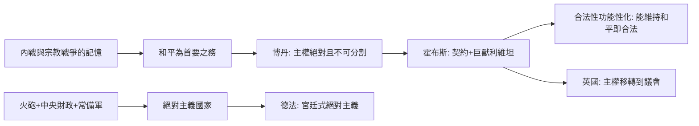

# 5.2 利維坦的主權者誕生

時間：1651年《利維坦》出版；其主權理論與歐洲絕對主義國家的形成互相映照。

## 一幅卷首畫，半部政治學

《利維坦》的卷首版畫出自亞伯拉罕·博斯之手，可能是政治學史上最著名的圖像。平原上方，山巔立著一具鎧甲巨人：胸甲由無數小人的面孔拼成，他們的目光轉向同一個頭部——主權者。巨人的右手持劍（象徵武力與執法），左手持主教牧杖（象徵祭司權），左右兩端分別俯瞰一座城堡與一座教堂；下方地面上成列的，一側是世俗權力的火砲、戰鬥與加冕，另一側是宗教權力的審判與教階。畫面並未暗示劍與杖分屬兩人；恰恰相反，兩把權力全都交在同一具巨獸手裡——霍布斯的答案不是「政教分離」，而是「政教都臣屬於主權」。

這幅畫把全書的核心命題拆視覺化：國家不是自然而然的存在，而是一台被人民合力造出的機器。這句話在那個世紀相當激進，因為此前近兩千年的西方思維把政治共同體當成自然長成的有機物（亞里斯多德）或神意秩序的層級（奧古斯丁）。霍布斯把政治學機械化：理論上，你手上的工具箱裡就能造出一個國家，只要所有人同時把裁斷權交給一個最高位。

## 主權：一個不可分割的新名詞

「主權」（sovereignty）一詞夾在讓·博丹與霍布斯之間成型。法國法學家博丹在1576年《國家政論六書》中定義：主權是「國家之上絕對且不可分割的權力」，一國之內其他機構的權威都來自它的授權。霍布斯接下這個框架，推得更遠——他的論證核心不是歷史或血統，而是一個安全證明：

- 若主權可分割或可撤回，則兩人都自認有權裁斷衝突，戰爭狀態就會重啟。
- 故主權必須單一、絕對、在位不可撤，這是和平的邏輯條件，不是君王的野心理由。

從功能上看，這具巨獸要做的三件事：裁斷人與人的糾紛（司法）、執行裁斷（執法與武力）、對外擋住別的巨獸（國防）。法律之所以對人有約束力，不是因為它合乎道德，而是因為寫它的那具巨獸握有讓人無力反抗的權力；這將成為法律實證主義的祖源。

## 歐洲同步：絕對主義國家的物質基礎

《利維坦》的思想與十七世紀的現實同時成型。法國的路易十四、普魯士的腓特烈諸王、西班牙的波旁諸王都在做同一件事：把地方貴族司法權、世襲官職與私人軍隊收進王宮，打造常備軍與職業官僚。支撐這一切的還有兩件事：火砲讓貴族城堡的防禦失效，防衛重心轉向王室的常備軍與財政；市場與貨幣經濟的擴大，也讓收稅與貿易管制需要統一的行政。

霍布斯為這些工程提供一份世俗的合法性證書：統治者不是因為神授才可使民服從，是因為他正切合人民確實的需求（終止戰爭），這個契約邏輯把神權與血統全部剔除。英國在1660年復辟查理二世時，用的是這條邏輯的反面：查理二世沒有經過神學爭論一統理論，而是承諾不重啟戰爭。和平，而不是君權，成了二十世紀之前歐洲各國統治的訴。

### 絕對主義 vs 君權神授：注意一個區分

十七世紀的歐洲沒有立意上單一的「絕對主義」。法國的國王可以被神學解釋（神授），卻仍受行會特權、地方司法、購官制與貴族「司法上訴」這些實際頸部壓力；普魯士諸王自稱「第一公僕」，卻把軍隊組織成效率機器；英國走相反方向，而英國1688年後議會的權威正在上抬。利維坦的邏輯不必然催生法國式的宮廷；它可以長出一個以議會為主權者的民選主權。

## 留下一句話的筆尖

霍布斯最後一章討論公民自由。他說：臣民的自由是「法律所未禁止之事」。這句話後來成為自由主義的定義句，卻出自一個絕對主權論者的筆下。他在書中甚至承認：臣民的義務，以主權者能否保護他為條件；若主權者無力保護，義務就出現裂縫。這條裂縫，是霍布斯本人在證明絕對主義時順手撕開的，而它的大小決定了未來整整三百年：怎樣的條件下、保護哪些權利、以什麼程序，人民可以合法地對國家說「我不服從」？

那條路要看約翰·洛克，他在著作中接手了這個破洞：他也是一位社會契約論者，卻把契約的目的定成「保護生命、自由與財產」——而這些權利先於國家存在。
