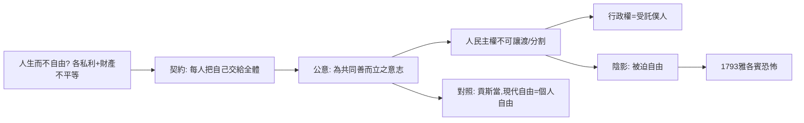

# 7.1 盧梭社會契約論與公意

時間：1762年《社會契約論》出版；1789年後成為革命的聖經。

## 一個鐘錶匠的兒子與社會的枷鎖

讓-雅克·盧梭1712年生於日內瓦一位鐘錶匠之家，母親產後去世，十歲時父親因決鬥而逃亡，他此後流浪、當學徒、被貴婦收留、靠替人抄樂譜維生。他一生以「日內瓦公民」為榮——日內瓦是一個推選式、有公民大會傳統的小共和國，不是君主的巴黎。這個身分決定了他整個政治思想的方向：他從來不是一個貴族沙龍裡的改革者，而是一個以公民自居、以平等為底色的理論家。

1750年，他因《論科學與藝術》造成一陣轟動：他的答案震驚啟蒙茶會——「我們的美德隨著藝術與科學而墮落」。此後《論人類不平等的起源》（1755）推出了更鋒利的判決：私有財產是文明社會不平等的根源，「第一個圈地說『這是我的』並且有一群人相信他的人，就是文明社會的真正奠基者」。1758年起他被巴黎的百科全書派（包括他過去的朋友伏爾泰與狄德羅）放逐，獨自在蒙特莫朗西撰寫《愛彌兒》與《社會契約論》。

順帶一提，1776年亞當·斯密的《國富論》在英國同時出版、亞當·弗格森也在討論商業社會的影響；盧梭的問題——「如果商業社會使人彼此競爭、互相評比，那麼『好政治』是什麼？」——在當時全歐洲都是一場疑難，1770年代後更因糧食、貧困與財政問題日益尖銳而在法國火藥化。

## 「人生而自由，卻無往不在枷鎖之中」

《社會契約論》第一章第一句，是政治學最被人引述的一行。它的裂口在於：如果人生而自由，那需要什麼樣的條件，才能使這個自由不停留在口號？

盧梭的回答分三步：

1. 強力不是權利。鎖鏈裹得再多，也不產生「應該服從」的義務。因此「人為的自由」不能靠武力證成正當。
2. 要在枷鎖中重獲自由，只有一種方式：每個人把自身與其全部權力交給全體（共同體），把自己視為「不可讓渡的、全體的一部分」。換句話說，每個簽約者同時是兩個身分的共同成員：作為個人，被全體治理；作為一分子，參與治理全體。他自我統治，所以仍是自由的。
3. 這個全體的意志，就是「公意」（volonté générale, general Will）。

公意是全書最容易被誤讀的概念——它不是「多數人的意見」。盧梭區分「眾意志」（各人私利的總和）與「公意」（這個共同體作為整體，為共同善而立的意志）。公民在投票前應問的問題不是「我贊成還是反對」，而是「這個方案是不是共同體的好方案」；投票是對公意的一次參考調查。為了聽到公意，社會必須沒有派系（黨派），因為派系遮蔽了公意。

「人民主權」由此確立：主權屬於人民，不可讓渡、不可分割。立法權是公意的行使，因此凌駕於執行權之上（與孟德斯鳩巧妙相對）；而執行權只是受託付的「政府」，是可以隨時更換的僕人。

## 陰影：「被迫自由」與雅各賓的鬼影

《社會契約論》第七章有一句被拉進兩百年政治爭議的話：若有人拒絕服從公意，「全體要強迫他」——也就是「人們用強力使他自由」（forced to be free）。這行話的本意其實很精確：簽約本身就是把裁斷權交給共同體，違背公意者是在違反自己簽過的約。但在1793年雅各賓恐怖統治者（羅伯斯庇爾自認是《社會契約論》的執行者）手中，這行話變成了正當化清洗的句子——「你反對革命，就是在反對你自己，因此你該被處死」。

康德式的解讀與邦雅曼·貢斯當的批評分別是兩條規範後果：康德認為這種「第二個自我」的自由觀，只能建立在理性可援引的條件上；而貢斯當1819年的演講《古代人的自由與現代人的自由》正面指出：古代人（如盧梭鍾愛的斯巴達、日內瓦小共和邦）的自由是集體性的，直接主權在小國可行，在大國只會讓一個「抽象的主權人民」變成壓迫個人的新怪物——他主張現代自由是個人自由（宗教、商業、私生活的自由），政治參與只是保障這些自由的手段。這場爭論至今仍是自由與民主緊張的核心版本。

## 迷思破除

- 盧梭不是「民主就是多數決」的存護者。他反對代議制，主張公民直接立法；也反對大國民主，認為法制要合乎國土人口畫。這些都可以當作十八世紀的空想，但它們都先於現代民主技術（如公投、數位直接民主）。
- 他不支持「共產共妻」。財產在《社會契約論》中仍被承認，只是其合法性受制於共同體（首次占有須勞動、須足夠、須非佔有過度）；這是重平等而非否認財產的立場。
- 「被迫自由」判例在《社會契約論》中與「生命權保留」（第4章：契約不能讓渡生命拒殺之權）並存。可是不到三十年的法國革命實踐，把此書的關鍵兩句分別交給了兩個陣營。

下一章的主角雖然仍屬十八世紀，但我們先把鏡頭轉向革命散場的兩個洲，一個「理論化為大規模實踐」的時代。
