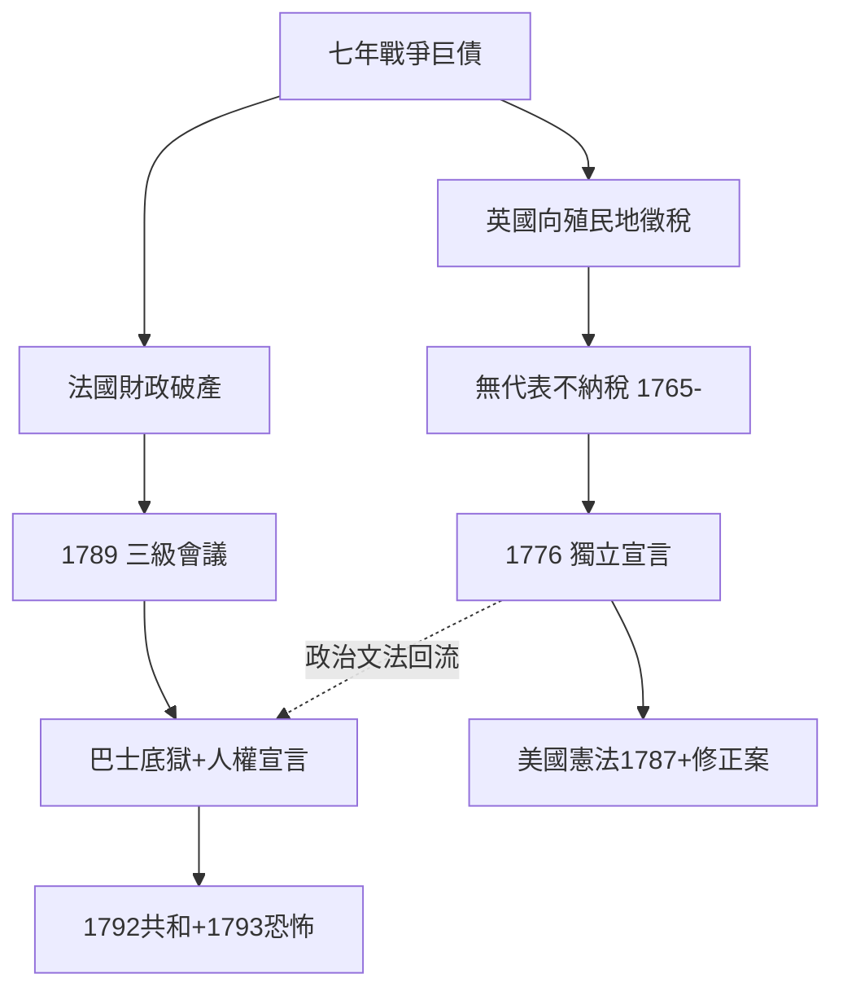

# 7.2 獨立宣言與人權宣言

時間：1776年7月4日費城；1789年8月26日巴黎。

## 一張借據的誕生：1776年的賓夕法尼亞

1770年代的美洲殖民地，經濟已成熟、文化已有大學與印刷場，政治上卻沒有代表權的出口。七年戰爭（1756–63）的巨額戰債讓倫敦決心向殖民地徵稅，而殖民地的律師們在 反對《印花稅法》（1765）時就已經找到一種特殊的武器：他們以洛克式的政治文法反擊——「無代表，不納稅」不是抗議，而是一條合法性論證。沒有被治理者的同意，徵稅是暴政；舊的憲政契約已被單方面撕毀。

到1776年，十三個殖民地各自宣布脫離英國，而在費城的第二届大陸會議上，由傑弗遜起草、富蘭克林與亞當斯修改的《獨立宣言》於7月4日通過。宣言清楚的結構是三段式：

1. 一套政治科學的公理：人被造而平等，享有不可讓渡的權利；政府的正當權力來自被治理者的同意。
2. 一份證據清單：國王歷歷列舉二十七項暴政罪狀（解散議會、設軍隊法庭、阻撓司法）。
3. 一個結論： 既然上述信託已被系統性毀棄，「這些殖民地從此是，且有權是，自由與獨立的各邦」。

要點在這裡：這是一份法學文書，不是一份詩。它的每一段都在演示洛克《政府論》下篇的論證程序（政府基於信託——信託已破——反抗合法）；傑弗遜本人也承認這不是新思想，而是「把當時美國人心中的常識寫成清楚的形式」。

這份宣言的實踐難題即刻浮現：宣言說「人人生而平等」，而新生的合眾國裡奴隸制照常運轉——傑弗遜本人擁有數百名奴隸。一百年後，這矛盾在林肯的葛底斯堡演講中被重讀（「八十七年前，我們的先輩在這大陸上創立了一個新國家，它在自由中孕育，信奉『人皆生而平等』這一信念」），最終以內戰的代價兌現。

## 從兩個革命到兩份文書：1789年的巴黎

法國財政因參與美國獨立戰爭（軍費與借貸）而破產，路易十六被迫召開三級會議（1789年5月）。第三等級拒絕被投票制衡（每階級一票），6月17日自稱國民議會，20日在網球場宣誓「不制定憲法不相散」。7月14日巴士底獄被攻破。

8月26日，制憲議會通過《人權與公民權宣言》（Déclaration des droits de l'homme et du citoyen），起草人包括拉法葉、米拉波與西哀士的影子。這份十七條的文件做了一件美國宣言沒做明說的事：它把人權從「美國人對英王的抗辯」升級為「全人類對一切政權的準則」——「人生而自由，且在權利上平等」（第1條）、「主權存在於國民」（第3條）、「法律是公意的表現」（第6條，盧梭的印記）、「未經合法程序不得拘捕」（第7條，孟德斯鳩的印記）、「自由即不損害他人之事，所有限制由法律指定」（第4條）、「財產為神聖不可侵犯」（第17條，洛克的印記）。

順帶一提，兩份宣言的交換也在同時進行：拉法葉在美國革命中親身參戰，回國後起草人權宣言時，一開始的草稿就是「美式的」——他請富蘭克林審閱；傑弗遜時任駐法公使，與拉法葉多有耳語。《人權宣言》因此是一份「洛克—盧梭—孟德斯鳩」的工本混用，而美國宣言是洛克的獨奏。

## 一張對照表：兩個宣言，兩種民主

| | 美國《獨立宣言》(1776) | 法國《人權宣言》(1789) |
|---|---|---|
| 核心句 | 生命、自由、追求幸福 | 自由、平等、公民權 |
| 主權 | 各邦與合眾國（聯邦制，代表制） | 「國民」整體（統一不可分割） |
| 理論主角 | 洛克（有限政府+反抗權） | 盧梭（公意）+孟德斯鳩（法定程序） |
| 後果路線 | 憲政制衡+司法審查 | 人民主權+既有代議危機（1793、1871革命回響） |

## 迷思破除

- 「巴士底獄被攻破是因為有七個政治犯」：是後世共識的錯誤版本：1789年獄中僅七人（多為瘋人或作偽誓者），民眾衝向巴士底的原因主要是求武器與火藥，「打倒暴政」的意義是後來的追認。
- 《獨立宣言》簽名日期的問題：大部分代表於1776年8月2日才簽名，「7月4日簽名」是印本流傳後被扭曲的記憶（而當時通過的是宣言文本，不是簽名儀式）。
- 《人權宣言》的「人」（hommes）沒有即時被擴及女性：1791年古茲畫的《女權宣言》寫道「婦女有上絞台之權，因此也有上講台之權」，1793年3月女革命者被處決。語言起碼一百年才追上。

革命把理論變成了立法，但也把理論變成一種不容分歧的宗教型「聖典」。1793年的恐怖、1794年熱月政變、1799年拿破崙政變——十二年內，一場以自由為名的革命收束於一人的帝位。這種「革命如何收尾」的問題，由兩種十分不同的回音接手：英國的休謨與柏克，及下一章的整體十九世紀意識形態大戰。
