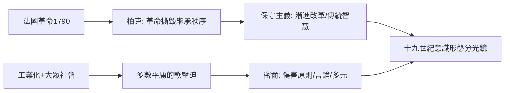

# 8.1 柏克保守主義與密爾論自由

時間：1790年柏克《法國革命反思錄》；1859年密爾《論自由》。

## 柏克對革命的先知式隔絕

埃德蒙·柏克是愛爾蘭裔的英國輝格黨議員，一生支持美國革命反對母國的壓迫，並在眾議院主導彈劾印度總督黑斯廷斯（1788–1795）的世紀大審。1789年法國革命爆發時，絕大多數英國知識人都歡呼——福克斯、華茲華絲、理查德·普賴斯牧師都在贊揚。1790年11月，柏克發出全歐洲最刺耳的一封信：《法國革命反思錄》對普賴斯的答覆。

他的推理不是「舊制度是好的」，而是「革命改天換地的工程必然流血」：

1. 政治不是一道幾何題。「抽象權利」（人權、自由、平等）看似完美，但一組由書桌推演的權利一旦被實踐，必須用暴力從歷史中撕出來。秩序是幾代累積出來的「偏見」——傳統、習俗、地方性制度——它們不是理性可以「設計」的。
2. 拆樑會毀掉樑下的支持。法國一夜废除地主階層與教會財權，目的是清除壓迫，結果是清洗、通貨膨脹、無法可依。柏克1790年的預言在兩年內幾乎逐條兌現：法王被處死（1793）、教會財產處置失序、恐怖內戰。
3. 保守主義的原理：社會是「死者的共同體」。我們的憲政不是我們起草的，是繼承的；它含有我們不理解的智慧。拿一場革命的口號撕掉它，你得到的不是天上好的制度，而是權力的空窗期，由最敢殺的人補位。

柏克不是「反正動派」：他支持美國革命，因為那是殖民地依既有權利的反抗，而不是以抽象藍圖重建整個社會。他的標準是「是否破壞繼承的秩序基座」——這構成了保守主義的根本典範，影響十九世紀英、法、德等歐洲的所謂「漸進改革派」。

## 密爾的命題：只有自照的燈是不夠的

六十九年後，另一位英國哲學家以完全不同的理由走到了同一邊。約翰·斯圖亞特·密爾（J.S. Mill，1806–1873）父親是功利主義哲學家詹姆斯·密爾，他用極端的填鴨教育把兒子培養成才（密爾三歲讀希臘文）。他的成人陰影是二十歲時的精神危機，其後靠華茲華斯的詩與好友哈麗特·泰勒的思想陪伴而走出。

他的命題只有一句：文明的危險不是暴政，而是多數的「軟壓迫」——社會輿論、大眾平庸、家庭生活使個體沉默。1859年《論自由》推出的「傷害原則」（Harm Principle）踩出了明確界線：

- 只有為了防止對他人的傷害，社會才能合法干預個人的行為。
- 對自己的傷害（墮落、吸毒、古怪生活方式）不可用法律或強力管理；你可以勸說、討厭，但不可以由集體去禁止。

《論自由》第二、三章把其論證推得很尖銳：若一個觀點被人一錯再錯地封禁，若它是對的，世界就被剝奪了真理；若它是錯的，那「錯誤」藏起的真相也提供一種服務（激起了一陣辯證）。壓迫異見最破壞的不是個人，而是「理性總體」。

密爾也完成了最早一份對「多數暴政」的制度性防禦：《論代議政府》（1861）論證代議制的危險在於多數趨於一致化，他支持黑爾的比例代表制以保護少數的聲音。1867年他任議員時首度動議女性選舉權（動議雖被否決，卻是世界議會史上第一份系統的女權立法提案）。

## 兩人什麼關係？自由主義的兩條腿

柏克與密爾自相矛盾，但合起來正是十九世紀自由主義的兩條腿：

- 柏克的問題是「如何改」：反對用抽象設計撕裂社會，主張漸進、保留、歷史性修補。
- 密爾的問題是「如何守」：反對多數用輿論與法律抹平個體，主張言論、思想、生活方式的邊界。

## 迷思破除

- 柏克不是同情法國舊制度的「昏奴」：《反思錄》對舊制度自身的浪費與腐敗多有指責，他反對的是重建的結構，不是一切基礎。
- 密爾的傷害原則不是無償的「為所欲為」：他清楚討論間接傷害——例如誘導未成年人、酒醉駕馬車危及路人，社會便有權介入；傷害原則第一天就包含「間接傷害」，操作起來比口號聽起來精細。
- 密爾也不全是拉一切自由：他支持殖民地教化（帶有帝國色彩），大力讚揚美、印、愛爾蘭的行政；他的自由主義與十九世紀歐洲中心的「父權式進步」有共犯結構。

下一節，歐陸正在以另一種方式回答「如何改」：不是柏克的漸進，而是馬克思的回答——不修這個制度，直接把它廢掉。
