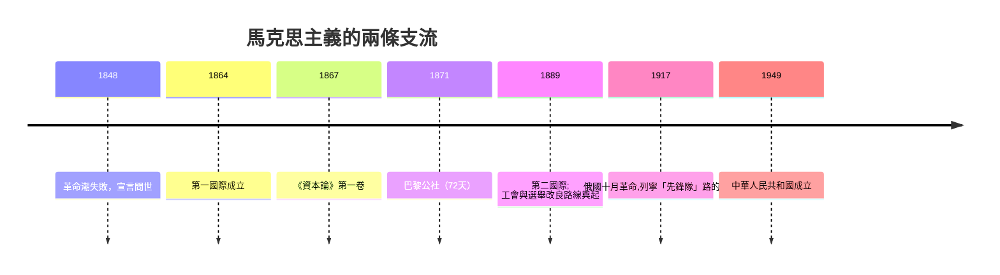

# 8.2 馬克思共產黨宣言與階級鬥爭

時間：1848年2月《共產黨宣言》倫敦出版。

## 工業革命改寫了「政治」的行囊

十九世紀上半葉的歐洲，政治學的舞台被一種新的力量重排。1780到1840年間，瓦特改良的蒸汽機、紡織機械化與煤鐵技術，把成千上萬的農民趕進曼徹斯特、里昂、魯爾區的工廠；1830年前後，歐洲城市第一次出現了一個新的社會階層——無產階級：沒有土地、沒有工具，只有勞動力可以出售。

政治問題的老框架（君權、憲政、代議）已不足以描述這個現實：選舉權再普及，也不改變「工人在生產現場每天十四小時」的處境；工廠主可以合法在政治上自由，也可以合法在工廠裡付近乎飢餓的工資。1840年代的愛爾蘭大飢荒、英國工廠法反覆拉鋸、德國西里西亞織工起義（1844）——階級衝突成了新的政治語法。

卡爾·馬克思（1818–1883）出身特里爾的律師家庭，萊茵河畔受黑格爾哲學訓練，後在巴黎與恩格斯結識、在布魯塞爾被逐、最後流亡倫敦。他從黑格爾那裡借來「歷史由對立與否定而發展」的辯證法，把其中的「精神/理念」置換為「物質生產」——經濟基礎決定上層建築（法律、政治、宗教、文化的形貌隨生產方式而變）。1848年初，倫敦共產主義者同盟委託他起草一份綱領。

## 《共產黨宣言》：一份行動指南的政治學

《共產黨宣言》篇幅不到八十頁，卻是影響力最大的政治文書之一。它的核心命題可以拆成四步：

1. 「到現在為止，一切社會的歷史都是階級鬥爭的歷史。」主人與奴隸、領主與農奴，如今是資產階級與無產階級。
2. 「現代國家只是資產階級的執行委員會。」法律、憲政、選舉制度，都為財產關係服務；政治權力跟著經濟權力走。
3. 資本主義有自我瓦解的內在矛盾：它需要不斷革命化生產，卻把社會切成越來越少的有產者與越來越多的無產者；產能集中到社會性程度，而產權仍是私人的。
4. 無產階級是第一個「沒有自己的」階級，也是第一個可以透過聯合而消滅自己統治位置的階級；其任務是自我組織、奪取權力，而終點是「國家的政治形式」消失。

宣言的語法特點在於它同時是歷史哲學與行動指南，並保留了兩處驚人的坦率：它讚美資產階級的歷史成就（「不到一百年，它創造的生產力超過過去一切世代」），也預告全球化（「資產階級的世界市場之取得，使得一切國家的生產與消費成為世界性的」）。這不是怨憤之書，而是把階級衝突當作歷史引擎的理論化。

## 1848：一場被同時觸發的革命潮

宣言出版的那一年，歐洲發生了整整一輪「民族之春」：巴黎二月革命推翻七月王朝；柏林、維也納、米蘭、威尼斯、布拉格、布達佩斯相繼爆發；各國君主或退逃或讓步，多國頒布憲法。但到1849年，反動反撲全面獲勝：馬克思被驅逐至倫敦，法國第二共和收束於拿破崙三世的帝制（1852）。

這場失敗很關鍵：它說明工人、手工業者、中產自由派三股力量在同一場街壘上，結局不一定一致。馬克思後來把「無產階級的獨立組織」提為核心教義；而歐洲各地工人運動的另一條路也開啟了——英國的工會立法合法化、1880年代德國的社會民主黨路線、1890年代法國的改良主義社會民主黨，紛紛在《資本論》的馬克思潮中選擇走選舉與工會路線而非街壘路線。

## 驗證一張後果圖：從馬克思到俄國

十九世紀末的社會民主派（伯恩斯坦、考茨基）逐漸走向改良資本主義（工會、國民年金、選票）；而列寧拒絕這條路，主張以地下先鋒黨奪權、以黨員的專政掌握「無產階級」名義。1917年後，「馬克思」分裂為兩個不通往彼此的系統：西方的社會民主與改良主義，和蘇聯式的列寧主義國家——其實踐規模之大，直接催生了下一章的主題：極權主義。

## 迷思破除

- 馬克思沒有「發明」階級鬥爭說：法國的梯葉里、英國的斯密就談過階級衝突；馬克思的獨特性在於把經濟結構、歷史規律與革命情緒做成一個系統。
- 「共產黨宣言」當年是倫敦一家小印刷廠印的德文傳單，發行前後並未引起大波；它成為世界史文件，靠的是此後長年的移民、翻譯與俄國革命。

而這兩個流派在十九世紀末都受到同一個幽靈的反敵：二十世紀的第一次大戰之後，歐洲資本主義內部又爆發了法西斯主義與納粹主義。下一章的直接主角，就是在那個黑洞前倖存、逃離希特勒的兩位猶太裔流亡者，一個用歷史寫「起源」，一個用哲學寫「開放社會」。
