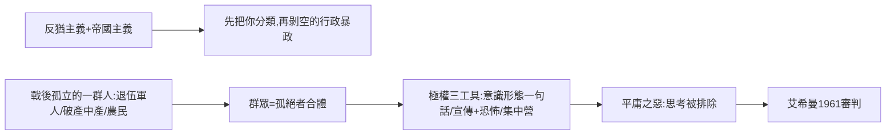

# 9.1 鄂蘭極權主義的起源

時間：1951年《極權主義的起源》出版。

## 一個無國籍者寫作的「起源」

漢娜·鄂蘭1906年生於德國漢諾瓦的猶太家庭，在馬爾堡師從海德格（並與之有一段師生戀），以奧古斯丁「愛」的概念寫博士論文。1933年蓋世太保一度逮捕她研究反猶主題，她隨即流亡巴黎；1940年維琪法國把猶太人移交給德國的收容安排，她輾轉經葡萄牙抵達美國。1937年起她成了無國籍者（德國1929年起剝奪猶太人國籍），做了十八年「Nansen 護照」的人——一個沒有任何國家願意為她作主的身分。她此後的整本書，都在回答她自己走過的問題：一個人如何從公民變成「無權的人」？

她寫《極權主義的起源》時，納粹已滅、史大林主義猶在：這不是一本「德國人為什麼壞」的歷史書。它分析了兩個先決條件：反猶主義與帝國主義。反猶主義為仇恨提供了允許的替罪羊；帝國主義（特別是英國與西班牙十九世紀的殖民管理）把人分成「治理的」與「被治理的」，製造了「種族可以由行政單位決定」的先例——那意味著一種純粹以「行政」而非「法律」統治牲人的政治型態。

## 「無目標的一頁一頁」

鄂蘭的分析焦點是「孤絕」（loneliness）這個概念，而不是「絕望」。她仔細辨別三個概念：

- 隔離（isolation）：政治上被排除，還有家人朋友。
- 孤獨（loneliness）：連「內心的人」都被剝空，個人與自身之間失去共同世界。
- 孤絕：在內在沉思中，沒有他者可與之共同生活。

極權主義的溫床，正是群眾社會裡的孤絕：第一次大戰的退伍軍人、通貨膨脹下失守財產的中產、失根的農民。極權主義從「每個人都是同樣的」，用官方青年組織、方陣、隊伍和宣傳的形式，把孤絕轉化為「群眾的狂熱」，因為群眾只有集體的意義。群眾社會與十九世紀意識形態政治最大的區別，在於它以「現代組織＋大眾媒體」把孤絕制度化。

關鍵三件工具：

1. 意識形態的一句話（如「一切歷史是種族鬥爭」「一切歷史是階級鬥爭」），把過去和未來一次拉到底；接下來一切事件都不再被個別辨識，而成為這一行的光譜。
2. 建構「受害者與統治者」的極權方法：極權式統治者能夠不斷執行「宣教＋恐怖」的雙輪工具。20世紀的媒體、收音機與群眾大會，使「謊言必須重複、且可能成為真」成為制度性程序。
3. 集中營（不是監獄）的目的：不只關人，而是消除人格，把每一個「人」變成「可以互相交換的個人」。

## 平庸之惡：艾希曼的審判

1961年，以色列在耶路撒冷起訴納粹官員艾希曼。鄂蘭親自聽審，寫下《艾希曼在耶路撒冷：一份關於平庸之惡的報告》（1963）。那本書的殺傷力在於她正面撞上了一個令人不安的結論：艾希曼不是怪物，他「平庸」，像任何職場中層管理人，無法在職位之外思考，只會「引用上司的語言」。邪惡往往不是心理變態者的行為，而是一種「不去思考」的行為——邪惡可以是膚淺的、平庸的，而非幾乎需要惡魔般的深度。

這一觀點與極權起源的立論互補：極權不是心理變態（如史大林追打不同民族），而是把「思考」系統性地排除掉，也就是說極權時代「去除人性」的機制不是靠殘暴的目的，而是靠殘暴的體與一個「消弱個體」的條件。

## 迷思破除

- 她並非「贊成極權」或冷戰式的統一敘事譯者：她把納粹與史大林主義並置於同一政治結構下分析（「集中營制度」等），此書1950年代在美英學界曾因一視納粹與蘇聯而遭批評，往後的蘇聯檔案開放反而支持了她的判斷。
- 她書中的史大林部分不是冷戰宣傳：她提出的關鍵是，蘇聯的極權不是民族主義的，而是以「階級鬥爭」為主；亦即它以全球理論轉動恐怖，同樣是「集體化的人形」；她的結論在1990年代蘇聯指的批評與討論上早了一世紀。

下一節的人物是一位與鄂蘭共享同一批歷史敵人的流亡者：卡爾·波普爾於1945年在英國出版《開放社會及其敵人》，追根溯源到柏拉圖，指出極權思想的譜系早在兩千四百年前已有了一份藍圖。
