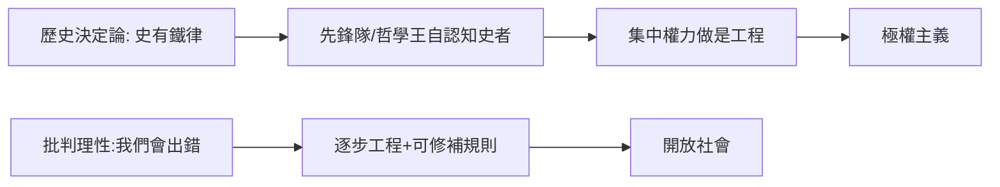

# 9.2 波普爾開放社會及其敵人

時間：1945年《開放社會及其敵人》出版；寫作期為二戰中的紐西蘭。

## 一位從維也納逃出來的哲學家

卡爾·波普爾1902年生於維也納（原籍猶太裔改信路德派），在維也納大學受的是物理學與心理學訓練，1930年代寫下《科學發現的邏輯》：科學的特點不是證明，而是可否證。1937年納粹壓力迫使這位宣布已改信路德派的猶太裔學者接受紐西蘭克賴斯特徹奇大學的教職；沒有其他歐洲國家收他。他在紐西蘭一邊教物理學，一邊面對「自己的原鄉正在被一種病人式的政治吞噬」，寫成了兩卷本的《開放社會及其敵人》（1943年完成，1945年由倫敦政經學院的哈耶克協助推出版）。

本書一點都不學究：它是一篇檢討整個西方文明史，尋找「我們為什麼用這種方式抵擋暴政」的證詞。波普爾從希臘文明長期戰爭的疲憊做起，指出柏拉圖、黑格爾、馬克思都有一種「歷史決定論」：認為歷史有一條必然的軌道（柏拉圖的城邦衰老、黑格爾的世界精神進化、馬克思的階級鬥爭必然到達共產主義）；而這種歷史命運的思想一旦與「應給它充理」的工程學結合，就會產生一種認為「我瞭解歷史，因此我有權剝奪個人自由」的政治。

## 歷史決定論的三大課題

波普爾的核心批評可以用三句話寫成：

1. 「我們無法預測未來的歷史進程」——因為預測本身會改變人們的行為；「規律的歷史」不存在，有的只是各種以自身立場為前提的預言。
2. 歷史沒有「意義」，但未來有「我們可以為它做點什麼的空間」。政治應從「歷史必然」轉到「錯誤修補」：我們應容忍出錯，也應有制度可以不流血地更換統治者。
3. 「誰來統治？」是錯的提問。正確的提問是：如何設計制度，使得即使壞人掌權也做不了太大的壞事？

## 開放社會 vs 封閉社會

波普爾把社會分為兩型：

- 封閉社會：部落式、魔法式的，個人被集體規範與祖先傳統包埋，用「服從」提供安全感。部落瓦解時（希臘殖民貿易擴張、工業化），多數人產生「文明的張力」與無所依靠的焦慮；極權主義正是對這種焦慮的「回歸部落」供應。
- 開放社會：面對批評、容許錯誤修正、透過規則競爭來改善。它以「批判的传统」取代「服從的傳統」，給予個人在制度中發聲與更換統治者之權。

他對柏拉圖的批評最為尖刻。柏拉圖的「哲學王」與三階層種姓系統，在傳統讀法中是最偉大的正義論；波普爾則指出：第一個把「領袖」直接對應到「三個階層的種姓制度」的理論家，正是柏拉圖；「正義即各司其職」的階級秩序，稍一轉型就能成為種族主義與極權主義的底層架構。

## 烏托邦工程 vs 點滴工程

波普爾把兩種政策取向做成一個對照：

| | 烏托邦工程 | 逐步（點滴）社會工程 |
|---|---|---|
| 目標 | 按理想藍圖重造整體社會 | 尋找並修補最迫切的社會之苦 |
| 風險 | 集中所有權力，錯誤一榮全毀 | 錯誤可局部修正 |
| 預設 | 我們已知最終藍圖 | 我們會出錯 |
| 對待批評 | 批評者為敵人 | 批評被制度化 |

值得注意：波普爾與同時期出版《通往奴役之路》（1944）的哈耶克雖在反極權上結盟（哈耶克協助推動了《開放社會》的出版），立場卻有分歧——哈耶克反對累進稅與大部分再分配，波普爾則認為國家應積極透過制度修補失業與貧窮。他們的共同底線是：任何干預都必須可被批評、可被修正。

## 迷思破除

- 波普爾不是「自由放任主義經濟學家」：他有明確的國家介入情緒（失業、劬勞、教育與研究）；他的底線是「一切介入需可被批評、可取消」。
- 波普爾與哈耶克是盟友而非同一套理論：哈耶克以自發秩序與市場為基礎，波普爾以否證論（可否證的批判理性）為基礎；「開放社會」的術語各有版本，共同的敵人才是歷史決定論。

兩位流亡者（鄂蘭與波普爾）在冷戰初期就把「極權」當成一個可分析的類別。隨後三十年，西方陣營的勝利使「開放社會」成為具體的制度選項——下一章的問題是：當西方認為自己贏了，什麼是正義之真正內容？
