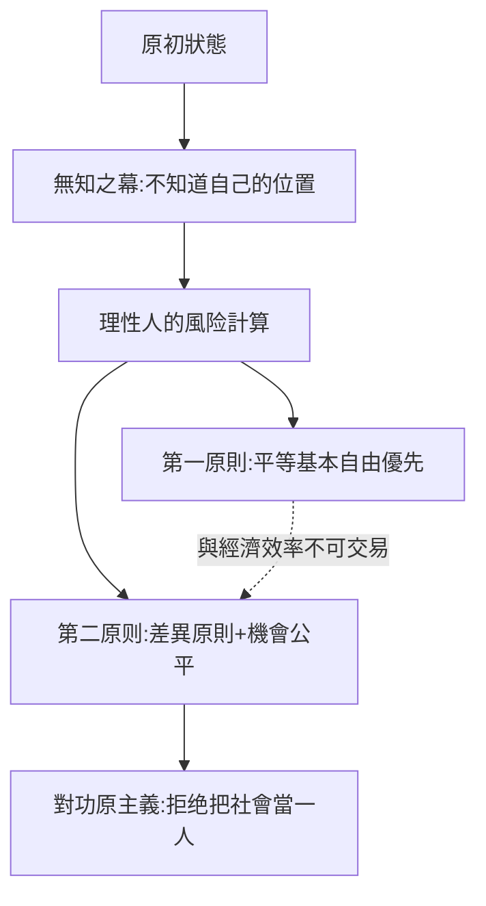

# 10.1 羅爾斯正義論與無知之幕

時間：1971年《正義論》出版。

## 一個從戰爭歸來的士兵寫的書

約翰·羅爾斯1921年生於巴爾的摩。二戰時他做過陸軍步兵，在太平洋戰場（新幾內亞、菲律賓）親歷戰鬥；廣島原爆的消息傳來時，他所在的部隊正準備登陸日本本土。這段經歷留下兩件東西：一則是他退伍後不久放棄了原本想當神學家或數學家的路，轉向倫理學；另一則是一個生死問題——「我為什麼沒有死在那裡？我是憑武力，不是憑功績活下來的」。運氣、偶然的分配，成為他終生思考的對象。

戰後美國的另一個時代背景：福利國家混合體制（羅斯福新政、英國的貝弗里奇報告）已在西方國家落地；但在哲學上，「社會可以爭辯哪種分配是正義的」這個議題當時接近真空——英語哲學主流是邏輯實證主義，視倫理判斷為「不可驗證」。羅爾斯就是在這個空窗期，用二十年在康乃爾、麻省理工與哈佛完成《正義論》。

## 原初狀態與無知之幕：一趟思想實驗

羅爾斯的方法繼承十八世紀的社會契約傳統（洛克、盧梭、康德），但在程序上重新設計。他問：如果合約在完全公平的條件下簽訂，會得到什麼樣的原則？

「原初狀態」的定義有一個關鍵裝置——「無知之幕」（veil of ignorance）：在選擇社會基本原則時，所有人不得知道自己在未來社會中的定位。你不知道自己是男是女、是富是貧、天賦高低、屬於哪個種族與世代；你只知道社會協作的一般事實與心理學的一般規律。

在這個資訊真空下，理性自私的簽約者會選什麼？羅爾斯的答案分為兩個原則，並有優先次序：

1. 第一原則（自由優先）：每個人對最廣泛平等的基本自由，享有同等不可剝奪之權利（政治自由、言論與集會、良知、人身、法治下的財產權）。
2. 第二原則（分配）：a. 差異原則——社會與經濟的不平等，必須對社會中最不利的成員最有利，才是正義；b. 機會公平——社會職位必須在公平的機會平等條件下向所有人開放。

這兩條原則的排列是決定性的：自由不可與經濟利益交易。你不可以為了GDP多兩個百分點，砍掉一部分人的言論自由。

無知之幕的直觀力量在哪？舉例說：若你是「不知道自己會是哪種人」的立場，你不會同意奴隸制——因為你可能成為奴隸；你不會同意極端功利主義（多數人的大福利可犧牲少數人）——因為你可能成為被犧牲的少數。這個設計的巧妙處在於：它不需假設人皆善良，也不需神性啟示；它用「活動條件」把公正的選擇逼出來。

可以用博弈論讀：最大化最小值（maximin）——選那個「最壞情形」最好的社會規則。這就是為什麼羅爾斯的正義原則不是「平均財富」，而是「最少受惠者的最大利益」。

## 對功利主義的宣戰

十八至二十世紀的主流倫理是功利主義（邊沁、密爾）：最大多數的最大幸福。羅爾斯的《正義論》有整整一章是「對功利主義的拒絕」，理由有兩層：

- 功利主義把全社會當成一大人，可被內部交易的犧牲，抹殺「人與人的分離」——每個人的權利不能為他人收益而收沒。
- 功利主義「一點分配都不問」：它問的是總和，不是「這些幸福是誰的」。

《正義論》出版後的影響速度驚人：它是二十世紀政治哲學的「新起點」——社會分配正義重回哲學中心（哈耶克、哈特、米爾斯、桑德爾、努斯鮑姆、森都必須回答他）；經濟學家阿馬蒂亞·森的「能力進路」與肯尼斯·阿羅的社會選擇理論，都在他的問題域中。此後的「福利國家辯護」「全球化與公平」「基本收入」討論，都走進羅爾斯式框架。

## 羅爾斯的疑難：深層反駁的三處

反對者也非沉默：

- 右翼（諾齊克《無政府、國家與烏托邦》1974）：若一個社會的財富分配是自由的歷史成就，再分配即是一種「勞役」——強迫部分人為別人做事。差異原則沒有顧慮到天賦的來源。
- 左翼（森、努斯鮑姆）：羅爾斯以「基本善」開列清單（自由、權利、職位與收入、自尊的基本基底）；但人們的變異（殘疾、疾病）也會造成能力轉換差異，僅靠商品相等不夠。
- 社群主義（桑德爾、麥克蒂勒、泰勒）：無知之幕假定「自我先於目的」，脫離了具身、社群、歷史；下一節將展開之。

## 迷思破除

- 羅爾斯不是「平等主義者」那麼簡單。差異原則允許不平等存在，只要「最劣者受益」即算合格。
- 「無知之幕」不是主張「所有人都平等地無知」：它是個思想裝置，不是教育方案；在真實社會中人們完全知道自己是誰——重點是我們用這個裝置來「清理」被偏誤扭曲的判斷程序。

《正義論》帶動一場持續四十年的大辯論。下一節的主題是它觸發的直接迴響：若自我是社群的產物，無知之幕還能剩下什麼？
