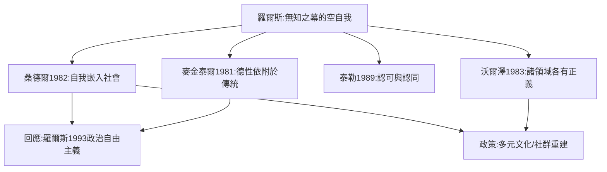

# 10.2 自由主義與社群主義的大辯論

時間：1980–1990年代，羅爾斯《正義論》引發的反擊與回應。

## 自我先於目的，還是目的先於自我？

羅爾斯《正義論》的哲學立足點有一個對手：他假定的「自我」是自由的、可以抽離脫絡一切社會脈絡的理性主體。這個假定成為1980年代一批美國哲學家攻擊焦點——他們並非一致，卻有一個共同判斷：人先屬於某某家庭、宗教、族群、語言、城市；「無所屬」的自我，在經驗上不存在，在規範上也不可取。

四位主角值得一一分別記下：

- 麥金泰爾《德性之後》（1981）：西方道德哲學已碎裂成互相不可通的殘片（情感主義、義務論、功利主義）；正向的出路是回到亞里斯多德——德性以實踐傳統與社群敘事為根；「誰的敘事，誰的傳統」先於「什麼是最高原則」——否則只是把「我的偏好」藏進抽象論證。知識分子今日的重塑期望之一，是恢復「公善」的實踐共同體。
- 查爾斯·泰勒《自我的根源》（1989）：自我以「認可」（recognition）為條件；多元文化的政治核心問題，是不同認同群體如何彼此認可而不上抬為「自由主義中立性」的幻象。
- 邁克爾·沃爾澤《正義的諸領域》（1983）：「正義」不是單一原則，而是多個領域（健康、教育、財富、政治權力）各有自身的分配標準；跨領域的挪用（有錢人可以購買到教育、權力、名聲的一切）才是真正的暴政。
- 邁克爾·桑德爾《自由主義與正義的局限》（1982）：對羅爾斯「無知之幕」的第一擊；「自我先於目的」不可能成立，因為一個脫離期望與認同的空自我無法知道什麼才是善。人們必須首先「發現自身是什麼」，再辨別共同善。後來他走向更為人知的立場：《錢買不到的東西》（2012）。

## 從哲學振還到世局

這場辯論不是學界的自娛節目，而有明確的時代背景。1960年代美國民權、學生運動與越戰抗議之後，文化之共同底座（宗教、家庭、國家、工會）確實鬆動了；1980年代新自由主義（里根、撒柴爾）又把市場邏輯推至日常生活。兩波變化都導向「公共政治的空心化」。社群主義的疾呼引發了1990年代美國的「重建社區」運動與「公共善」政策討論；埃茲奧尼（Amitai Etzioni）《社群主義的螺旋》（1996）與他所創的「社群運動網」是其中最討論的變體。

同時，這場辯論也塑造了全球政策文獻：多元文化主義的憲政設計（加拿大1982年憲章第27條、歐洲的語言與少數民族權利）、1990年《美國殘障人士法》（ADA）的特殊權利保障，都能在此脈絡中找到理論支點。

## 三條界線：不是「自由 vs 社群」的二元大戰

真正讀懂這場戰役，要注意至少三件事：

1. 羅爾斯不是只會「抽象自由派」。他在《政治自由主義》（1993）回應了桑德爾等人：問題不是「如何確定善」，而是「如何在價值多元、信念對立的社會中，找到人人可接受的政治原則」；這套原則不依賴任何一種完整人生觀，「自由主義的公共中立」不等於價值真空。
2. 桑德爾與泰勒即使在社群主義內部有裂縫：桑德爾強調「共同善」的共和傳統，泰勒強調 文化與認可的多線性；麥金泰爾明確傾向「傳統不僅是您出生的社群，還是您必須自我使之成立若的敘事」。
3. 「自由 vs 社群」在政策上不完全換位：自由派與社群派都可支持貧困救助、也可反對國家介入私生活，恐怖點遇到「個人選擇」的邊界（婚姻、性別、宗教）時起點相異。

## 迷思破除

- 社群主義不是共產主義或神權保守派：桑德爾與泰勒在美國往往被劃為「民主社會主義者/自由派」，而他們共同反對的是「市場可以定義一切價值」。
- 「無知之幕」失敗的觀點亦有強力反擊：賓莫爾、高希爾等博弈論契約派認為，公平未必需要「拋棄自我」；霍布斯式的利己計算也可導出類似結論。

自由與社群之辯，是「個人與國家關係」第四條主線在二十世紀的精彩一夜。而正當哲學家們推擠「什麼是正義」，世界歷史即在柏林圍牆倒下那一夜，把問題推向更實務的層次：民主陣營是否原則性地勝利了？ —— 歷史終結論與其鄉愁，是我們下一章的主角。
