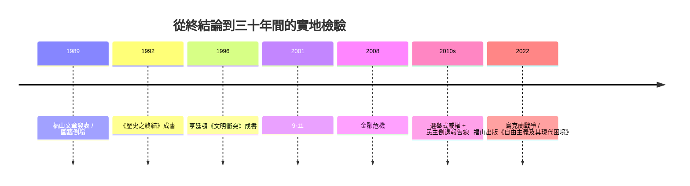

# 11.1 福山歷史終結及其後

時間：1989年〈歷史的終結？〉一文；1992年《歷史之終結與最後一人》成書。

## 柏林圍牆倒塌格式的那一年

1989年6月2日，波蘭圓桌選舉中團結工聯大勝；6月4日，天安門被鎮壓；11月9日柏林圍牆被推倒；12月羅馬尼亞的希奧塞古被處決——這一年歐洲共產政權連環崩塌。就在6月的前幾天，美國國務院政策計畫室副主任福山在《國家利益》（The National Interest）期刊登出一篇文章：〈歷史的終結？〉。

他寫道：左右兩方的大敘事之爭（自由主義 vs 馬克思主義）已結束，自由民主與市場資本主義成為人類意識形態演化的「終點」，此後的衝突（種族、宗教、資源）不再系統性地威脅這個「以選舉、消費、人權」定義的生活方式。文章在當年被視為美國勝利主義的冒失語，但柏林圍牆倒塌隨之而來，把這個表述塑造成了冷戰勝利的第一個理論標籤。

福山的思想根基不全是「美國中心主義」：他以黑格爾「歷史的辯證」作為理論基礎——歷史由人以「為了被認可」（recognition）的爭鬥而成；現代自由民主透過普選給每個人「法律上的承認」，是這一鬥爭的制度出口。他借用了科耶夫對黑格爾的解讀；《歷史之終結與最後一人》在1992年成書，正面回應了所有正反爭論。

## 反擊一：民主的退潮與制度化後門

接下來三十年發生的事，不斷驗證與打臉這條論斷：

- 1990年代「第三波民主化」確實成為大勢：蘇聯、東歐、拉丁美洲、南非、韓國、台灣接近轉型。
- 但二十一世紀的樣本不同：俄羅斯（普丁由2000年至今）、匈牙利（歐爾班2010至今）、土耳其（艾爾多安2003至今）、委內瑞拉、菲律賓——「選舉式威權」的模式制度化：保留選舉的外表，掏空司法與媒體。
- 2014年以後，美國與歐洲（巴西、匈牙利、印度、波蘭）的民粹化浪潮，及2021年1月6日美國國會山莊事件，都說明「先進民主國家也會失能」。

福山後來的政治秩序研究（《政治秩序的起源》兩卷，2011、2014）與《自由主義及其現代困境》（2022）做了大幅自我修正：他承認早先低估了「社會與技術的動態交互」，也低估了「民主自身的內部腐敗」；其中的關鍵之一是社群媒體對政治的影響，與民主自身的「制度自我維護」失靈。

## 反擊二：亨廷頓「文明的衝突」直接對打

福山的老師塞穆爾·亨廷頓同年（1993）在《外交事務》寫〈文明的衝突？〉直接反駁：歷史沒有結束，而是切換到另一層衝突——以文化與宗教為單位的「文明圈」（西方、儒家、伊斯蘭、印度、東正教、日本、拉丁美洲）將取代意識形態衝突，成為冷戰後世界最主要的斷層線；他的《文明衝突與世界秩序的重建》1996年成書，以一九九〇年代的波士尼亞、車臣、盧安達為敘例。9·11之後，這份理論重新成為西方戰略討論的中心，但也在學界被批评：把宗教文化視作外交的根本動力，忽略了國際政治的物質結構；所謂「文明共通」的内聚力在印度、伊斯蘭世界内部都存疑。

還有一派反擊來自經濟：阿馬蒂亞·森、拉古拉姆·拉詹等指出，全球化把資本重分配到已開發地，同時把風險落在窮國身上——1997亞洲金融風暴、2008金融危機、2010年代中國的國家資本主義（如一帶一路）都在告訴我們「市場化不等於自由化」。

## 一個比較：福山 vs 亨廷頓

| | 福山（1989/1992） | 亨廷頓（1993/1996） |
|---|---|---|
| 基本單位 | 意識形態（自由民主 vs 其他） | 文明（宗教與文化圈） |
| 未來圖景 | 自由民主趨同 | 文明間衝突與重劃 |
| 政治訊息 | 民主是歷史的終點，但不能保證皆贏 | 西方應自我防衛，勿試圖「教化」他者 |
| 影響 | 決定1990年代「和平紅利」話語 | 決定9·11後「文明」對話 |

## 迷思破除

- 福山說的「歷史終結」不是「不再有事發生」，而是指意識形態演化的「終結」；他本人已多次強調此點。但「最後之人（Last Man）」是尼采式術語，預警了「民主國家只維持現狀而不冒險」的現代無聊——這也促成了他對自身結論「單薄」的反省。
- 這不是「美國勝利主義」的唯一表述：同期的「第三波」研究者亨廷頓本人在1991年也出版《第三波》，對民主化與其逆轉同時進行了獨立評估。

此外，冷戰勝利並未自動帶來制度品質的正向溢出。下一位主角，就正在那個經濟起飛的大背景下，思考資訊技術與「國家權力」的最終形態——北京、莫斯科、劍橋分析與監視資本主義，正候在門後。
