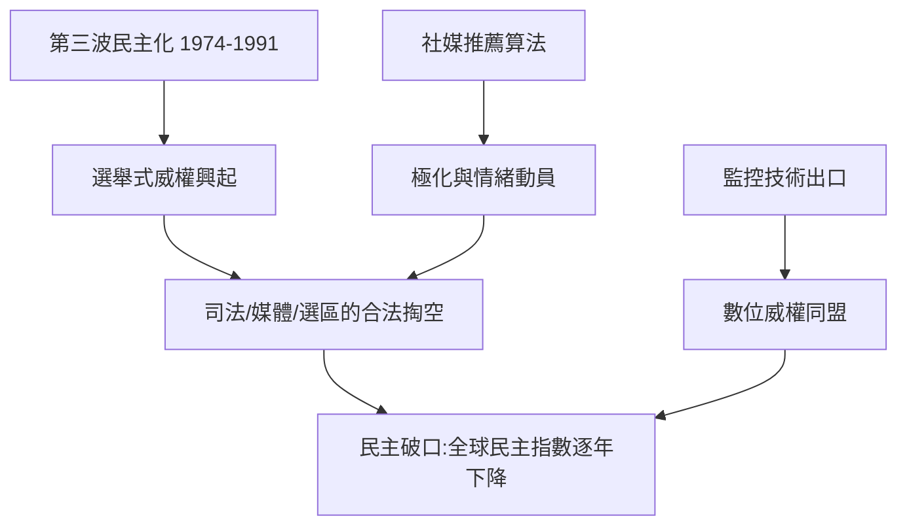

# 11.2 文明衝突與威權復甦

時間：1990年代至2020年代，民主的全球版本監控。

## 從「第三波」到「民主破口」的索引

亨廷頓於1991年出版《第三波》：他記錄了1974年葡萄牙康乃馨革命之後的三十年，全球突破式民主化已在南歐、拉美、東亞與東歐連續發生。思潮與制度並行：西方的民主體制、開放的市場、公民社會、國際資本流動——「開放」成為冷戰後「正常國家」的標準配置。

但二十一世紀的逆風接連而來：

1. 「選舉式威權」制度化：俄羅斯、匈牙利、土耳其、委內瑞拉、白俄羅斯、柬埔寨、泰國等國，保留了選舉制度，卻在媒體、司法、選區規劃和政商網絡上，開始用合法的行政手段（司法攻擊反對者、媒體集團收購、管制性法律）掏空競爭。
2. 「先進民主的治理失靈」：2016年的兩個投票事件（脫歐、川普），被經濟新自由主義撕裂的地區以選票表達「退出」，社群媒體精準點燃情緒；多個歐洲國家的極右派在2010年代後期選舉中崛起。
3. 2020之後：COVID 疫情、烏克蘭戰爭使信任危機再創新低。根據自由之家（Freedom House）年度報告，全球自由程度連續十九年下降（自2006年起）。
4. 公民文化與憲政精神在美國2020大選爭議、2021國會山莊入侵中被嚴重動搖；「選舉公信力」成為近年美國政治的核心難題。

## 「文明衝突」的當代版本

亨廷頓從「意識形態」走下來，以宗教文化圈為單位。這條理論的三重價值在於：

- 提醒我們：1945至1990的統一敘事（油價、武器、無形資本）不足以解釋1990年代的種族清洗（南斯拉夫、盧安達、車臣）與「冷戰結束為伴生的撕裂」。
- 但它也把宗教文化當作一種「不可變」的內核，實際上，文化溝通是一門學術難題，而近年軟實力（教育部與青年）的重構，使「世代內部」的裂縫可能比「文明之間」更劇烈。
- 也因此有現代版本的分析家（許多在美國學界）認為：21世紀的主要衝突不在文明與文明之間，而在「每個社會內部的開放 vs 封閉」，以及「威權與民主的技術力量」的斷層線上。

## 威權復甦的三件新工具

二十一世紀的威權主義不再是史大林型「恐怖＋集中營」。它升級為「精準的、可獲利並可向外輸出的」新型權力：

1. 數位監控的常規化：人臉識別、社會信用系統、網路管控、手機與資訊產品的預裝辨識（如中國在新疆的大規模監控基礎建設，2021年起被學者與聯合國專家確認），莫斯科與明斯克陷入網路干預之判例。
2. 「病毒式輿論」的商業化：社群平台的推薦演算法放大極化；境外資訊操作（俄國對2016年美國大選、2017歐洲選舉等）被情報界正式定罪。
3. 「出口型」威權資本：獨裁國家透過基礎建設貸款、出口監控技術、法律合作（引渡、警務交流）建立威權同盟（如上海合作組織）；再加上中國式國家資本主義作為一種不靠民主的發展模型，對發展中國家的吸引力。

## 迷思破除

- 亨廷頓不是「反民主」：《第三波》整書的主軸正是「民主化是可推廣的」。他1996年論戰的是「文化與宗教差異的不可通約」，而非反對民主普及。
- 「民主倒退」不是一場災型的「政變」：多數退走並非軍事接管，而是由法律程序內的行政與司法操控完成，這使其更難被國際社會識別。
- 「福山說自由民主必勝」是他對1990年代西方敘事的一個簡化；福山本人在其後作了更複雜的自我修正，且於2020年代加入了對技術平台的危機警訊。

2000年代以後，民主與威權的競賽變成了一場技術競賽。下一位主角是「人不會死於威權，卻可能死於演算法」，要了解這句話如何成為一個精確的產業：劍橋分析、臉書、社會信用系統與生物政治。
