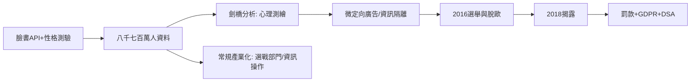

# 12.1 劍橋分析與演算法政治

時間：2014–2018年，劍橋分析事件與其餘波。

## 一份漏出的資料，一門新產業

2014年，英國心理學研究者柯根（Aleksandr Kogan）以「性格測驗App」的名義收集了約27萬臉書用戶的資料，並利用臉書當時的API規則，同時拿到每位用戶及其好友的資料，外擴至多達八千七百萬人的行為檔案。這份資料被交給英國政治諮詢公司劍橋分析（Cambridge Analytica），該公司以「基於心理測繪選民」聞名，其客戶包括川普2016年競選陣營與英國脫歐派組織。

2018年3月《紐約時報》與《觀察家報》揭露，前員工懷利（Christopher Wylie）吹哨。臉書遭美國聯邦貿易委員會罰款50億美元（2019），英國資訊委員會罰款50萬英鎊；劍橋分析宣布破產。扎克伯格被呼入國會聽證；「數據即政治軍火」成為新聞與立法的標準句。

## 心理測繪政治學的五階段

劍橋分析使用的核心方法可以折疊為五個階段，這一模型截至今天仍是「選舉資訊戰」的通用語法：

1. 資料收購：社群平台、消費紀錄、選民名冊、公開資料被拼成一個極其詳細的個人檔案。
2. 心理測繪（OCEAN）：以五因子人格模型（開放、盡責、外向、宜人、神經質）預測每個選民的可說服點。
3. 微定向（micro-targeting）：為不同的心理人群推送不同的廣告，且各組看到的訊息彼此看不見，由於沒有公共場域，錯誤資訊無法被對手當場拆穿。
4. 情緒推力：不說服「反對者」，而是讓「我方支持者失望而不去投票」，或讓搖擺者被恐懼（移民、犯罪）定錨。
5. 資訊隔離：這才是真正革命的地方——不是撒謊，是讓每個人群活在自己的「定制謊言」中，誤信對手原本就腐敗。

## 社會層面的影響

政治學界對「劍橋分析究竟改變了選舉結果」持保留態度（多數研究者判斷其效應小於傳統競選工程），但它的技術與組織原則成為此後競選與資訊操作的基礎設施：

- 2016年美國總統大選後，參議院情報委員會與特別檢察官調查俄羅斯網軍（IRA）在社群平台上的行動；臉書自行披露，該行動的內容觸及超過1.2億美國用戶。
- 臉書於2018年後擴充「選舉完整性」團隊，並於2020年設立獨立的監督委員會審查內容治理。
- 歐盟以 GDPR（2018）回應，並於2022通過《數位服務法》（DSA）要求平台定期披露線上治理與演算法透明；美國聯邦與州的「資料隱私權」立法仍碎片化。

而正當劍橋分析事件揭露時，數位行為的另一個重心正在轉移：不僅是「選舉時用資料打選戰」，而是「每天被演算法重新塑造人的注意力、情緒與政治同情」。哈佛商學院的舒莎娜·朱伯夫（Shoshana Zuboff）在《監視資本主義時代》（2019）把這一產業模式命名為「監視資本主義」：以「預測你的下一步行為」為商品，把人的日常經驗轉換為資料，賣給廣告商，也可以賣給有權取得它的政府。

## 迷思破除

- 「臉書／劍橋分析騙了選舉結果」。因果鏈判定困難：心理測繪的效果，多數學者認為程度有限，錯誤資訊與「情緒推送」的效應也非單一來源。真正的革命是「技術+法律缺席」的結構，而非任何單一黑客。
- 劍橋分析並非孤立：同類技術在印度、肯亞、巴西、菲律賓的選戰中被複製；臉書2021年被孟加拉、菲律賓等過去掌權者「清洗」報告——資訊操作是平台經濟的普遍副產品，不是個案。

「平台+資料+心理測繪」只是第一波。下一節要問的是更根本的問題：若國家能以演算法與生物特徵掌握每一個公民的精細資料，民主的「可錯性與可修復」還剩多少空間？這就是數位威權主義與生物政治的核心。
