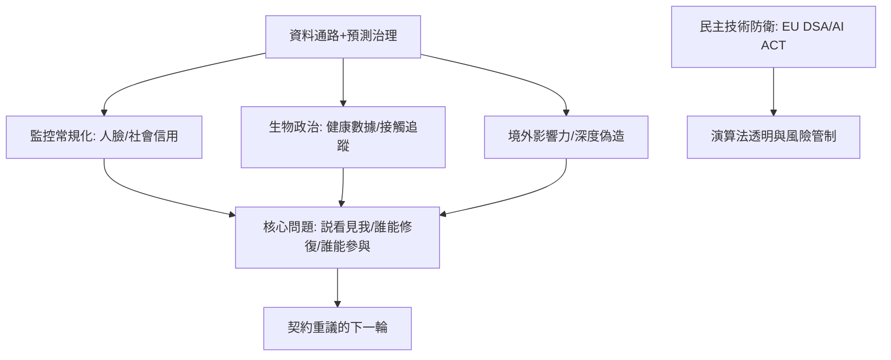

# 12.2 數位威權與權力的未來邊界

時間：二十一世紀，監控與技術治理的重構。

## 從「恐怖」到「預測」：威權的升級

二十世紀的極權主義（鄂蘭的分析）以恐怖與宣傳為雙輪；二十一世紀的數位威權主義，以「數據通路＋預測治理」為基本結構。它呈現幾種政策形態：

1. 大規模監控的常規化。人臉識別、指紋、資訊內容審查與社交平台資料的整合；中國與俄羅斯的「智慧城市監控」已輸出至多國的公私合作安全系統；境外研究者揭露了新疆預測式監控與「分類化管理」的技術中台。
2. 社會信用系統（中國地方試點之後擴至全國），把交通、金融、網路言論、犯罪紀錄同步為「社會信用分數」，可影響人們的乘車、就學與貸款；它常被簡化描寫為電影中的「單一分數」，地方版本與商業信用版本不同，但「行為進程」評分這一技術邏輯則是實存的。
3. 「去匿名化」與「法外暴力」。伊朗2019年網路封鎖與伊朗安全機構經由手機辨識出抗議者；2020白俄羅斯以人臉辨識抓人；緬甸2017年以社交媒體煽動羅興亞暴力的案件，被聯合國調查認為有平台的放大效應。
4. 「生物政治」的回歸。自傅柯（Foucault）1970年代分析「生命政治」以來，國家治理深入生物過程；智慧手錶、健康App與疫情期間的接觸告知，使「生理數據監控」成為現實；COVID 期間的疫苗通行證與封城管理是否合乎比例原則，是法律與人權界的持續辯論。

## 民主的技術防衛

與此同時，民主國家的技術防衛分為四個層面：

1. 立法層面：歐盟《數位服務法》《數位市場法》《人工智慧法》（2023–2024）提出「高風險 AI 系統」（社會評分、預測性警務、司法與教育）被直接禁止或嚴格限制。
2. 媒體層面：多數歐美國家開始立法管理「演算法推薦的可規避性」「隱私拒絕」「深度偽造信息」在選舉期的標示義務。
3. 消費者與公眾層面：隱私工具（加密訊息、VPN、去中心化平台）使用的回升；對控制權的法律（歐洲GDPR 2018，CCPA 2020）。
4. 選舉安全（國家機構）：選舉管理機構對社交平台「境外影響力行動」的訊息分享機制。

## 擲出的問題：權力的邊界在哪裡？

霍布斯問題（誰來裁斷、避免戰爭）、洛克問題（國家不可侵犯的邊界）、孟德斯鳩問題（分權與制衡）、鄂蘭問題（孤絕與不思考）——每一次技術變革都重新定一次。演算政治的三個新座標，等候下一次「契約」的重議：

1. 誰能看見我？——資料主權不屬個人而屬平台與國家的時代，契約論的「被治理者同意」原則，其「同意」在後台條款與演算法中並未被知悉。
2. 誰 能修復？——一旦演算法成為事實上的「規則」，公民無法買單「立法否決」的能力：這是把否決權從人民轉讓給平台的隱藏契約。
3. 誰 能參與？——鄂蘭的政治性以「並肩而行」為核心；當公民被動聆聽、被算法定向，「公共領域」的確留出足夠空間給非定制意見？

這三條問題正是為什麼本書一路追蹤的「合法性—正義—權力結構—個人與國家」四大提問，並沒有隨著霍布斯、洛克、羅爾斯的解答而結束：每一次技術升級都把它們推回論辯台上。利維坦還在生長——只不過今天的名字，可能是「平台」、可能是「社會信用」、也可能是「預測性治理」。

## 迷思破除

- 「社會信用系統」不是單一全面通行評分：研究顯示中國各地版本與執行差異極大，主要仍以個人與企業信用為主；失信名單（如限制高消費、禁止搭乘航班的「失信被執行人」制度）是實存的懲罰案例，但「一張全面評分」是誇張。真正令人擔心的是「行為監控技術標準」的輸出與制度化的速度。
- 「演算法一定導致極端化」尚未被科學定論：不同研究發現的效應不一；但「平台商設計使情緒高張內容容易被推廣」幾乎是共識，而「假訊息傳播速度的變化」已在2018年的 Nature 論文裡數量式顯示。

## 收束：回望序章

如果在第一章，雅典公民大會以六千人的嗓音就能開會；今天，「公共會議」被移動到推送流里，意見的權力被演算法重新配分。雅典人會說這是更寬的民主——每個人都能發聲。柏拉圖則會說：不，這是更深的洞——影子被精心調校，而鎖鏈看起來像螢幕的開關。

政治學的故事仍未結束。它每一次翻頁，都由上一代的異議者與本代的民主反抗者合力撰寫。閱讀本書的您，可能是下一頁的第一個簽名。
