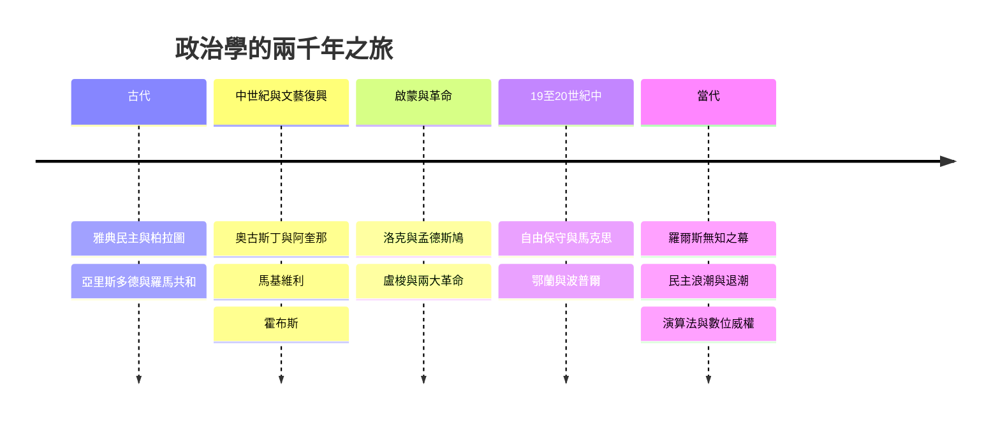

# 政治學的故事：從城邦正義、權力謀略到民主危機的權力史詩

本書跨越兩千多年，講述人類如何從雅典城邦的公共生活開始思考「什麼是好的社會與正義」，經歷中世紀神權、近代君主專制、啟蒙運動的民主革命，一路演變成現代意識形態對決與數位時代的權力重塑。

全書圍繞四條核心提問展開：

1. 合法性：憑什麼由你來統治？（神授 → 君主血統 → 社會契約與人民授權）
2. 正義：什麼樣的社會才是公平良好的？（哲學王階級秩序 → 個人天賦人權 → 資源再分配與無知之幕）
3. 權力結構：如何防止權力濫用？（君主集權 → 三權分立 → 多元民主與憲政制衡）
4. 個人與國家：國家的邊界在哪裡？（極權介入一切 → 消極自由與私領域保護 → 數位時代的監控與反思）

## 全書結構總覽

---

## 目錄

* 第1章-雅典民主與柏拉圖的理想國（西元前5–前4世紀）
    * [1.1-雅典公民大會與蘇格拉底之死](01.1-雅典公民大會與蘇格拉底之死.md)
    * [1.2-柏拉圖理想國與哲學王](01.2-柏拉圖理想國與哲學王.md)
* 第2章-亞里斯多德與羅馬共和（西元前4世紀–西元1世紀）
    * [2.1-亞里斯多德政治學與政體演變](02.1-亞里斯多德政治學與政體演變.md)
    * [2.2-羅馬共和與西塞羅的混合政體](02.2-羅馬共和與西塞羅的混合政體.md)
* 第3章-上帝之城與雙劍論（西元5–13世紀）
    * [3.1-奧古斯丁上帝之城](03.1-奧古斯丁上帝之城.md)
    * [3.2-阿奎那自然法與雙劍論](03.2-阿奎那自然法與雙劍論.md)
* 第4章-馬基維利的權力術（西元1513年）
    * [4.1-君王論與政治道德的切割](04.1-君王論與政治道德的切割.md)
    * [4.2-獅子與狐狸現實政治的誕生](04.2-獅子與狐狸現實政治的誕生.md)
* 第5章-利維坦主權與社會契約的萌芽（西元1651年）
    * [5.1-英國內戰與所有人对所有人的戰爭](05.1-英國內戰與所有人對所有人的戰爭.md)
    * [5.2-利維坦的主權者誕生](05.2-利維坦的主權者誕生.md)
* 第6章-天賦人權與權力分立（西元1689–1748年）
    * [6.1-洛克政府論與天賦人權](06.1-洛克政府論與天賦人權.md)
    * [6.2-孟德斯鳩與三權分立](06.2-孟德斯鳩與三權分立.md)
* 第7章-公意與革命的火種（西元1762–1789年）
    * [7.1-盧梭社會契約論與公意](07.1-盧梭社會契約論與公意.md)
    * [7.2-獨立宣言與人權宣言](07.2-獨立宣言與人權宣言.md)
* 第8章-意識形態大決戰（19世紀）
    * [8.1-柏克保守主義與密爾論自由](08.1-柏克保守主義與密爾論自由.md)
    * [8.2-馬克思共產黨宣言與階級鬥爭](08.2-馬克思共產黨宣言與階級鬥爭.md)
* 第9章-極權主義的陰霾與民主的拯救（1930–1950年代）
    * [9.1-鄂蘭極權主義的起源](09.1-鄂蘭極權主義的起源.md)
    * [9.2-波普爾開放社會及其敵人](09.2-波普爾開放社會及其敵人.md)
* 第10章-什麼是真正的正義（1971年）
    * [10.1-羅爾斯正義論與無知之幕](10.1-羅爾斯正義論與無知之幕.md)
    * [10.2-自由主義與社群主義的大辯論](10.2-自由主義與社群主義的大辯論.md)
* 第11章-民主的浪潮與倒退（1989年至今）
    * [11.1-福山歷史終結及其後](11.1-福山歷史終結及其後.md)
    * [11.2-文明衝突與威權復甦](11.2-文明衝突與威權復甦.md)
* 第12章-演算法監視資本主義與未來權力（21世紀至今）
    * [12.1-劍橋分析與演算法政治](12.1-劍橋分析與演算法政治.md)
    * [12.2-數位威權與權力的未來邊界](12.2-數位威權與權力的未來邊界.md)

---

## 閱讀路線建議

- 想理解「正義」如何被回答：1.2 → 3.2 → 7.2 → 10.1 → 12.1
- 想理解「權力制衡」如何演化：2.2 → 5.2 → 6.2 → 9.2 → 11.2
- 想理解「個人自由」如何被捍衛：6.1 → 7.1 → 8.1 → 9.1 → 12.2
