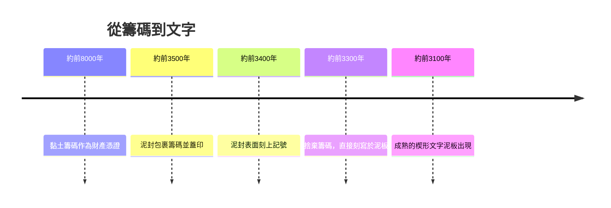

# 1.1 黏土籌碼：文字發明前的財產紀錄

## 一個倉庫管理員改寫了人類史

1960年代，法國考古學者丹妮絲·施曼特-貝瑟拉（Denise Schmandt-Besserat）在美索不達米亞的遺址中，注意到一種長期被忽視的小東西：拳頭大小、形狀各異的黏土小件，有的是圓球、有的是圓錐、有的是做成動物形。過去的考古報告常把它們當成玩具或遊戲棋子。她花了近二十年，走遍中東各地的博物館與倉庫，清點了超過八千件這類小物，最後提出一個驚人的結論：這些是距今約八千年前（約西元前8000年）的「黏土籌碼」（tokens），是人類最早的記帳工具。

一個圓錐代表一份穀物，一個圓球代表一頭牲畜，一個做成羊形的籌碼代表一隻羊。牧人把羊交給神廟或大戶代管時，雙方就照數量做出等量的籌碼，作為憑為憑證。帳，比文字早了將近四千年。人類不是先發明文字再去記帳，而是先為了記帳，才被逼著發明文字。

## 從籌碼到泥封：封套的出現

到了約西元前3500年，交易與庫存越來越複雜，散落的籌碼容易遺失、也容易被動手手腳。蘇美人於是把籌碼包進一個空心的黏土球裡，在外面壓上圓柱印章，作為封印——這就是「泥封」（bullae / clay envelope）。要核對帳目時，得打破泥球取出籌碼。

問題立刻來了：不打破球，就看不到裡面有幾個籌碼。於是人們開始在泥球表面，照裡面籌碼的形狀與數量，刻上對應的記號。泥封從「裝東西的容器」變成了「畫著記號的平板」。接著人們發現：既然外面刻了記號，裡面的籌碼根本多餘，直接用一塊扁平泥板刻記號就行了。

這一步，就是書寫的誕生。楔形文字的前身，本質上是一套會計系統。圓錐的印痕後來演變成代表「穀物」的符號，羊形的印痕演變成代表「羊」的字。數字與文字，最初都是帳目的一部分。

## 為什麼會計先於國家

值得深思的是順序。傳統叙事常說「先有國家，再設官吏，然後登記財產」；但考古證據顯示，記帳的需求早於成熟的城市與官僚體制。神廟經濟需要集中收成、發放口糧、登記祭品，這些管理壓力催生了記錄技術，記錄技術又使更大規模的組織（神廟、城邦、帝國）成為可能。沒有可靠的帳目，就無法有效率地向成千上萬的人徵糧、派工、配給。

會計從誕生那一刻起，就不是商人的專利，而是組織技術：它讓陌生人與大型團體之間的協作變得可信。這條線索將貫穿整個故事——每一次帳簿技術的升級（從籌碼到泥板，從莎草紙到紙張，從試算表到區塊鏈），都伴隨著人類組織規模的一次躍升。

下一章，我們會見到人類歷史上第一個留下名字的人。他不是國王、不是將軍，而是一名記帳員。
