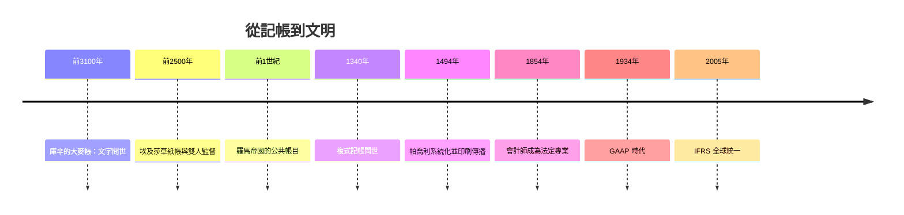

# 1.2 庫辛：人類史上第一個留名的人，是個記帳員

## 一塊五千年前的泥板

在伊拉克南部的古城烏魯克（Uruk）遺址，考古學家挖出了成千上萬塊泥板。其中一塊編號為 Uruk V 的泥板，年代約在西元前3100年，被認為是人類最早的文字紀錄之一。上面刻著幾個方框，框內是符號與數字，末尾還有一個圓柱印章的印記。

德國亞述學者近年釋讀出這塊泥板的內容，大意是：

$$29{,}086 \text{ 份大麥} \quad 37 \text{ 個月} \quad \text{庫辛（Kushim）}$$

也就是說：在37個月的期間內，共計收入或經手29,086份大麥，經手人（或經手官）名為庫辛。這是一張帳，不是史詩、不是詔書、不是祭文。帳的最後簽著經手人的名字。

有些學者對庫辛是「人名」還是「職稱」仍有爭論，但這不減損這件事的意義：人類文明最早的完整文句，記錄的是一堆大麥的數量，而第一個被記下的名字，是一名負責大麥帳目的人。

## 「簽名」背後的制度意義

庫辛的名字為什麼要刻在泥板上？因為帳目需要問責。經手人署名，表示「這批糧食我經手，數量以我登記為準」。若有短缺或爭議，追責有據。這個今天看來理所當然的動作，其實是整個會計制度的核心發明之一：把責任連結到具體的個人。

更耐人尋味的是，印章本身也承載身分。學者推測這塊泥板上的印章屬於一名名叫「蘇巴吉」（Subagi）的官員，可能是庫辛的上司。也就是說，這張帳同時呈現了兩層問責：經手人簽名，主管蓋印。五千年後現代企業財報上的「會計主管簽章、董事長蓋印」，結構竟與這塊泥板如出一轍。

## 蘇美神廟經濟：會計如何撐起第一座城市

烏魯克在當時是世界上最大的聚落，人口可能達數萬。這座城市依賴神廟集中管理土地、勞力與收成：農民把穀物繳入神廟倉庫，神廟發放配給、支付工匠、祭祀神明。這整套運作，全靠泥板記帳：

- 收成入庫登記（類似現代的進貨記錄）
- 口糧發放清單（類似薪資名冊）
- 勞役天數計算（類似工時計錄）
- 倉庫存量盤點（類似存貨盤點）

沒有這些帳，城市會在貪污、遺忘與爭執中瓦解。蘇美諺語說「在帳上正確地登記，登記後不要忘記」，可見當時已把記帳視為職業倫理。

## 文明的選擇：我們選擇了記帳

歷史學家常開玩笑說：人類文明的第一部作品是會計報告。這不是偶然。文字從一開始就不是為了寫詩而發明，而是為了回答三個實際問題：有多少、歸誰管、誰負責。文學、哲學、史書，都是記帳技術成熟數百年之後的事。

從庫辛以降，會計師與社會制度互相塑造：神廟需要他，才有了官僚帝國的雛形；帝國需要他，才有了稅收與軍費；銀行需要他，才有了跨境貿易與信用；資本市場需要他，才有了公開財報。這條因果鏈，將在後續章節逐一展開。

會計史，其實就是一部人類信任機制的進化史。
