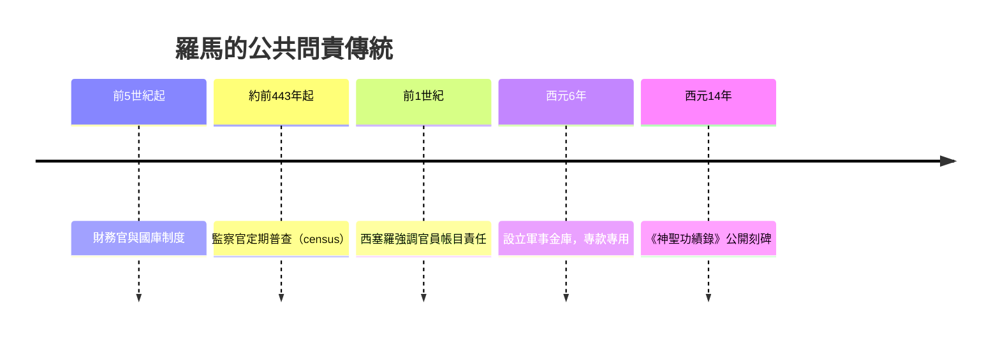

# 2.2 奧古斯都的《神聖功績錄》：帝國帳目的公開展示

## 皇帝的「財務報告」

西元14年，羅馬第一任皇帝奧古斯都（Augustus）去世。他生前留下遺囑，指示將一份自己手擬的文件，刻成銅牌，立在陵墓門前，昭示全羅馬。這份文件就是《神聖功績錄》（Res Gestae Divi Augusti，直譯「神聖的奧古斯都功業錄」）。碑文以第一人稱寫成，篇幅不長，但內容驚人：幾乎每一段都是一筆具體的支出數字。

他寫道：他曾四次以自己的錢補貼國庫；曾以自己的名義購買穀物賑濟平民；曾撥款給退役士兵，人數若干、每人金額若干；曾出資修神廟、架橋、鋪路；曾在劇場贈予平民賞金，總額多少塞斯特斯。全文列舉的金錢數字，總計規模大到史學家估計超過他個人財產所能負擔——因此更像是「國家財政」與「元首私產」混在一起的總帳。

這份碑文在羅馬各處都有複製品流傳（今日安卡拉的「安齊拉碑」保存最完整），等於是史上第一份對公眾公開的「財務報告與社會責任報告書」。它的核心訊息是政治性的：帝國的錢，我管；花在哪裡，我向全體公民交代。

## 共和的遺產：羅馬本來就有公共帳

奧古斯都的舉動並非憑空而來。羅馬共和國早有強烈的公共問責傳統：財務官（quaestor）管理國庫，監察官（censor）定期進行人口與財產普查（census，「普查」一詞與「審查」同源），執政官任期結束時要接受同僚的行政審查。羅馬人視「帳目清楚」為官員的最低門檻——西塞羅曾說，官員離任時若無法順利核銷帳目，形同恥辱。

奧古斯都在共和的外殼下建立帝政，深知傳統的力量：他不能（也不願）像東方君主那樣神祕統治，反而要以「首公民」（princeps，第一公民）身分自居，把個人財力包裝成公共奉獻。《神聖功績錄》正是這套政治語言的極致：用最透明的形式，掩蓋最高度的集權。這也提醒我們，公開透明從來不僅是技術，更是政治工具。

## 軍費、邊防與帝國會計的現實

《神聖功績錄》中反覆出現的一個主題是軍費。奧古斯都建立常備軍與退役金制度，三十萬大軍的餉銀與退役安置，是帝國最大的常年支出。為此他設立了專門的軍事金庫（aerarium militare，西元6年）。公共支出專款專用、設立獨立金庫、以專項收入（如新開徵的遺產稅與拍賣稅）支應——這些是帝國規模的「預算會計」。

羅馬人的記帳實務上，官員與富家普遍使用「收支部」（journal）與「存摺式」的記錄，商業帳簿則尚未發展出借貸平衡的複式結構。羅馬對會計史的最大貢獻不在記帳技術，而在制度觀念：公共錢財須經法定程序收付、官員須對帳目負法律責任、帳目可以公開。這些觀念在中世紀幾乎失落，要到義大利城邦的商業革命中才與複式記帳法重新合流。

## 一份碑文的後世迴響

把統治者自己的帳公開，此後一千年間幾乎沒有再發生。專制帝國的財政重新變成宮廷機密，直到文藝復興時期的城邦、17世紀的荷蘭與英國議會，公共帳目的公開才慢慢制度化。今天各國政府編列預算書、上市公司發布年報、企業發布ESG永續報告書，其精神原型，都可以在安卡拉那塊石碑上找到：數字自己會說話，而掌管數字的人必須站出來署名。

從奧古斯都到庫辛，古代世界的會計完成了兩個奠基：一是把責任連到個人（庫辛），二是把帳目攤在陽光下（奧古斯都）。接下來的近千年中世紀，這兩樣都會遭遇黑暗期，然後在義大利的海港城市裡，以一種革命性的記帳法重生。
