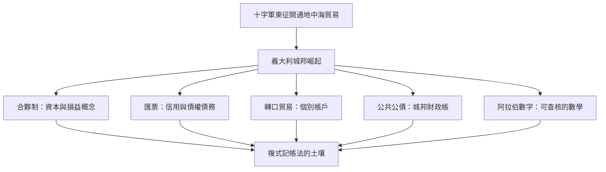

# 3.1 十字軍東征之後：地中海貿易與信用的萌芽

## 中世紀的會計黑暗期與再起

西羅馬帝國崩解後，西歐的商業與識字率大幅萎縮，羅馬的公共會計傳統幾乎失落。加洛林王朝勉強維持的莊園經濟裡，帳簿多半是莊園管事的簡單流水清單。真正的轉機來自十字軍東征（1096年起）：這場宗教遠征在政治上是災難，在經濟上卻意外打開了地中海的通道。義大利北部的港口城市——威尼斯、熱那亞、比薩、佛羅倫斯——從十字軍的補給與東方貿易中大賺其錢，崛起為獨立城邦。

城市需要錢，錢需要管理，管理需要帳簿。義大利商人在阿拉伯世界與拜占庭的影響下，重拾並改良了記錄技術，同時催生了一整套金融發明。

## 催生記帳革命的五股力量

第一是合夥。海上貿易風險高、資金需求大，商人以「合夥」（compagna）的方式共集資本、共擔風險。合夥有期限、有解散，帳目必須在合夥結束時清算結算，這逼出了「資本」與「損益」的概念：投資人的本錢與這段期間賺賠多少，必須分得清清楚楚。單式記帳的流水帳，已經無法回答這個問題。

第二是匯兌與信用。跨國貿易最怕運送現金被劫，於是商人發展出匯票（bill of exchange）：在熱那亞付錢，持票人在香檳市集收款，省去千里運銀的風險。匯票的開立、貼現、轉手，本質上是信用交易，必須在帳上同時反映「誰欠我」與「我欠誰」。債權與債務成為帳簿的主角。

第三是轉口貿易的複雜性。一艘船裝滿香料、布匹、金屬，途經數港分批買賣，若每筆交易各自記流水帳，最後根本算不出這趟旅程賺了多少。商人開始把每一種商品、每個客戶分開設帳，也就是「個別帳戶」（personal / commodity accounts）的出現——這正是複式記帳的前身。

第四是公共財政。城邦政府向富商借錢打仗，發行「強制公債」，產生了龐大的公共債務帳。熱那亞的聖喬治銀行（Casa di San Giorgio，1407年成立，前身可追溯至12世紀）專門管理這些公共債務，其帳簿體系之嚴密，連馬基維利都讚嘆。國家的會計需求，與商業的會計需求在此交匯。

第五是算術教育。1202年比薩的斐波那契發表《計算之書》（Liber Abaci），把阿拉伯數字與位值記數法引入歐洲。用羅馬數字記帳，加減都要在算板上撥算珠、難以查核；用阿拉伯數字，數字直接寫在紙上、可以被檢驗與追溯。沒有阿拉伯數字的普及，複式記帳法在技術上幾乎不可能實行。

## 教會、利息與記帳的道德戰場

中世紀教會嚴禁放貸取息（高利貸禁令），迫使義大利金融業發展出迂迴形式：匯票的匯率差價、合伙損益分配、海險貸款（bottomry）。換句話說，禁令沒有消滅信用交易，反而使其更精巧，也使帳簿更複雜。但丁《神曲》把放高利貸者放在第七層地獄，與自殺者同層；而同一個時代，佛羅倫斯的梅迪奇家族一面放款一面捐獻修道院。記帳的人處在道德灰色地帶：他記錄的每一筆利息，都是一樁良心事務。

這種張力在後來的會計史上反覆重演：技術永遠跑在規範之前。13、14世紀的義大利商人未必意識到，他們為了算清信用交易所演化出的記帳法，即將改寫商業文明。

下一章，我們將打開一本1340年的城市帳簿——複式記帳法最早的完整實例。
