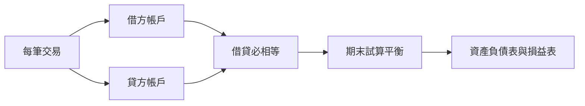

# 3.2 1340年熱那亞Massari帳簿：複式記帳的第一個完整實例

## 一本城邦的總帳

在熱那亞國家檔案館，保存著一套1340年的官署帳簿，由城邦的兩位財務官（massari）署名記錄，故稱 Massari Ledger（財務官總帳）。這是現存最早、結構完整的複式記帳（double-entry bookkeeping）實例：每一筆交易，同時在兩個帳戶各記一行，一行記在借方（in dare）、一行記在貸方（in avere），兩方金額相等，期末結出總餘額並互相核對。

值得玩味的是，最早留下完整複式帳簿的不是商行，而是城邦政府。這並非偶然：1340年前後，熱那亞正值與威尼斯的海上戰爭與內部派系鬥爭，財政官承受巨大的信任壓力，帳目必須經得起議會與政敵的檢驗。複式記帳的「自帶勾稽」特性，正是公共問責的需求所逼出來的。

## 複式記帳在講什麼道理

複式記帳的核心思想，一句話講完：任何一筆交易，都是兩件事同時發生，錢從哪裡來、到哪裡去。收了一筆現金，必有一筆對應的來源（收入、借款或出售了什麼）；付了一筆錢，必有一筆對應的去向（買了什麼、還了誰）。把每個「什麼」（現金、存貨、某客戶、資本、損益）各立一個帳戶，每筆交易在兩個帳戶同時登記，帳簿就自動形成一個封閉的核算系統：

$$\text{資產} = \text{負債} + \text{資本}$$

$$\text{收入} - \text{費用} = \text{利潤}$$

帳簿寫錯了，借貸會不平衡，錯誤自己會現形。這是會計史上第一次，帳簿可以自我查核。

## 從流水帳到複式帳：一個實例

假設熱那亞商人以100枚金幣購入一批胡椒，再以160枚售出。

單式記帳（流水帳）只寫：
- 付胡椒款100
- 收胡椒款160

若混入數十筆其他交易，將難以知道胡椒這一趟的盈虧。複式記帳則同時記兩行：

- 借：胡椒存貨 100 / 貸：現金 100
- 借：現金 160 / 貸：胡椒存貨 160

胡椒帳戶結清時，貸方多出60，表示這批貨賺了60；這60再轉入損益帳戶。商品的來龍去脈、每一趟旅程的損益、每個客戶的往來餘額，全部一目了然。

## 為什麼這項發明如此重要

德國社會學者韋伯與經濟學家熊彼德都把複式記帳視為資本主義的先決條件。熊彼德說過一句名言：資本主義的會計實務把經濟世界分割成「企業」這個抽象單位，企業的損益從此可以被獨立計算——換言之，複式記帳發明了「企業」這個可被計算的實體，也發明了「利潤」這個可以被持續追蹤的目標。一家企業的價值、一段合夥的成果、一項投資的報酬，從此變成明確的數字。

熱那亞與威尼斯的商人用這套方法，把分散多年的海上冒險整合成可計算、可比較、可轉讓的商業單位；資本的累積、股權的轉手、公債的交易，都在帳簿上找到了形式。1340年的Massari帳簿，是這場革命的物證。

## 為什麼商人「本來就會」，但還要等一本書

複式記帳在14世紀的義大利是「師徒相傳」的技藝，各城各家略有差異，規則散落在商人父子之間的手抄備忘錄裡（現存如佛羅倫斯、威尼斯的多份商人手記）。技術已經存在，卻尚未成為公共知識。

把它變成公共知識的人，是一位方濟各會修士、數學教師，而他還有個更出名的朋友——李奧納多·達文西。下一章，就是1494年那本改變商業史的教科書。
