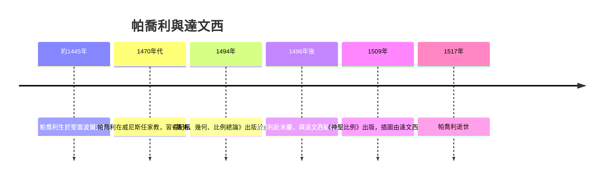

# 4.2 數學家與畫家：帕喬利與達文西的跨界友誼

## 米蘭宮廷的相遇

1496年前後，帕喬利應「摩爾人」盧多維科·斯福爾扎之聘，來到米蘭教授數學。宮廷裡已有另一位住客：李奧納多·達文西，當時正為斯福爾扎家族製作巨大的騎士紀念碑泥模。兩人成為摯友，而且是工作上互相依靠的那種朋友。

證據在紙上：達文西的手稿裡寫著「請教比例大師盧卡」（_Liutico:學習比例——並留有向帕喬利請教幾何學的筆記，包括立體幾何與比例問題；他在筆記裡畫下了多面體的插圖。1509年，帕喬利出版第二部巨著《神聖比例》（De divina proportione），專論黃金比例與正多面體——書中的幾何插圖，正是達文西親手繪製的。這是達文西少數有確證的出版插畫作品。達文西在序言的名單中被帕喬利鄭重致謝。

換句話說：現代會計之父的第一部理論著作，其插圖出自文藝復興最偉大畫家之手。科學史家對這段友誼的意義有共識：帕喬利給了達文西數學的訓練與理性方法的榜樣，達文西則把抽象的幾何變成可見的美。

## 達文西欠帳嗎？斯福爾扎宮廷的會計側寫

順帶一提，這段友誼本身也有會計色彩：斯福爾扎宮廷的帳冊裡詳細記錄給兩位大師的薪餉與開支——達文西的顏料錢、馬匹飼料費、帕喬利的講席費用。文藝復興的輝煌藝術，背後是一套嚴密的宮廷會計。沒有這些帳簿，後世史家連達文西在哪一年支領多少薪俸都無從知道。

## 《神聖比例》與會計的共同精神

《神聖比例》論的是比例：人體、建築、字形中，各部分之間的和諧關係。帕喬利深信比例是宇宙的秩序。這種信念與他的會計思想一脈相承——複式記帳的靈魂正是平衡與對稱：借與貸、資產與權益、收入與費用，每一筆都必須「成雙成對、互為因果」。帕喬利把記帳視為理性秩序的體現，與他把幾何視為神聖比例，是同一種世界觀。

達文西在《神聖比例》的插圖之外，手稿中還留下一句常被會計史引用的話：他抱怨商人的帳目繁瑣、堅稱數學是確定性的根基。這對朋友一個把數學帶向藝術，一個把數學帶向帳簿，共同體現了文藝復興的核心信念：世界是可量度的，而量度使世界可信。

## 從宮廷到世界：這本書此後的命運

帕喬利晚年回到故鄉，1510年受任該城宗教職務，1517年去世。他的《總論》在十六世紀被多次重印與翻譯，成為其後兩百餘年歐洲會計教科書的原型。德、法、荷、英的會計著作都以它為範本改寫。1938年，義大利在紀念活動中重印《總論》；今天國際會計學界以「帕喬利獎」表彰會計史研究，並稱他為「現代會計之父」。

## 文藝復興的整體圖像

把鏡頭拉遠：1494年前後的義大利，古騰堡的印刷術把知識複製的成本降到前所未有的低點；城邦商業累積的實務技藝，被數學教育傳統整理成理論；宮廷與教會提供贊助與講席。會計學在這裡完成了從「商人的手藝」到「可傳授的知識」的轉型——這是任何一門學科成為「學」的關鍵一步。

複式記帳法此後將跟隨歐洲的貿易與殖民，航向全世界。而第一個把它帶向「超大規模企業」的，是下一章的主角：英國東印度公司。
