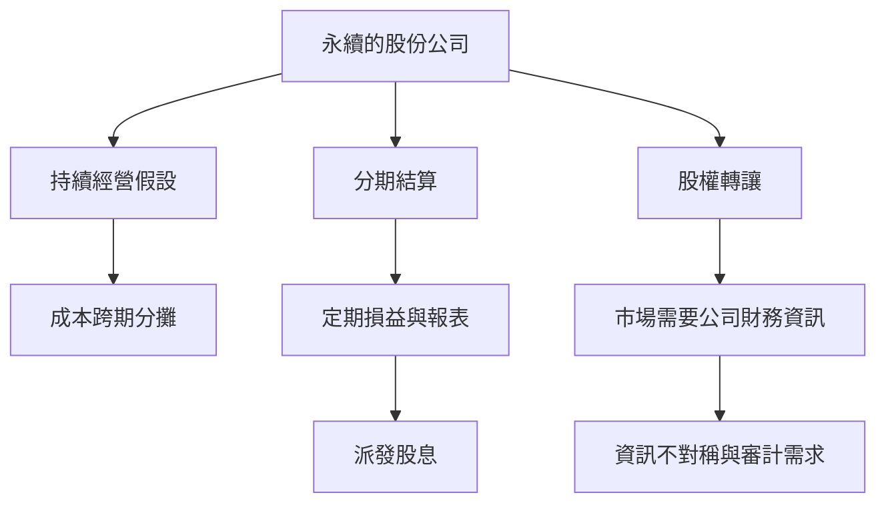

# 5.1 東印度公司：持續經營與分期結算的誕生

## 一個會計上的大難題：公司不死

1600年12月31日，伊莉莎白一世授予倫敦商人特許狀，成立「倫敦對東印度貿易公司」，即英國東印度公司。它在此後兩百多年間，從一個遠洋貿易合夥，成長為擁有軍隊、統治印度次大陸的巨型組織。從會計史的角度看，東印度公司提出了一個全新的難題：帕喬利時代的商號，多為「一趟航程一個合夥」，船回來、帳結清、合夥解散；而東印度公司是一個「永續存在」的實體，資本長期投入、跨航程運轉。那麼，這樣一個不停業的組織，要如何在任何時點算出「它現在值多少、賺了多少」？

答案是兩個概念的發明。

## 持續經營（Going Concern）

會計必須假設企業將持續存在，才能把長期投入的成本（船隻、倉庫、要塞）分攤到多個期間，而不是在每趟航程結束時清算一次。一旦採用持續經營假設，「本期損益」才有意義：本期的收入與為賺取收入而消耗的成本，必須落在同一個期間相互配比。這正是今天的「持續經營假設」與「權責發生制／配比原則」的根源。值得一提的是，「持續經營」一詞在會計文獻中的確立是漸進的（美國會計學者佩頓於1920年代系統闡述），而英屬東印度公司正是最早把這種觀念付諸實務的組織之一。

## 分期結算與定期報表

與持續經營配套的是「分期結算」：把永續的時間切成會計期間，每期編製損益與資產負債狀況。東印度公司在17世紀已向股東定期公告帳目，並在17世紀後期起派發穩定的年度股息（1684年前後逐步確立每年派息的慣例），這意味著公司必須每年算出可供分配的利潤。可以說，定期財務報表的必要性，是被股份公司與股息制度逼出來的。

## 股份公司如何改變會計

東印度公司的制度設計有兩個會計上的深遠影響：

1. 所有權與經營權分離。公司由聘任的總督與職員經營，數百上千名股東並不參與日常業務。股東要知道公司經營得好不好，只能依賴公司提供的帳目——「代理問題」與「資訊不對稱」就此誕生，審計的需求從此有了新的社會基礎。
2. 股份可轉讓。1680年代起，東印度公司的股票在倫敦的咖啡館與交易所頻繁買賣。股票要定價，就需要公司的利潤與資產資訊。財務報表第一次成為投資決策的依據——也是炒作與詐欺的素材。

## 光鮮帳目下的另一面

必須誠實地說：東印度公司的帳簿同時也是帝國掠奪的工具。公司職員在印度私做買賣、帳目混雜公私，倫敦方面長期查不清公司的真實盈虧；1773年的《規制法》與1784年的《印度法》，正是英國國會試圖整頓東印度公司帳目與治理的產物。1770年孟加拉大饑荒（公司稅收制度加重了災情）震動英國輿論，埃德蒙·柏克在國會彈劾公司總督黑斯廷斯的長篇演說中，大量引用其帳目作為罪證。商業會計、國家財政與殖民政治，在此深度纏繞。

## 帕喬利的邏輯走到極限

複式記帳的技術本身不變，但東印度公司讓它的應用規模發生了質變：數千公里外的原料、數月航期的在途貨物、數十年的固定設施、被征服土地的貢賦，全都要進帳。會計不得不發展出更複雜的概念：折舊、在途存貨、長期投資、外幣換算。而當公司大到「尾大不掉」、大到連英王都要靠它借錢時，更大的危機正在醞釀——1711年成立的另一家特許公司，將在1720年引爆英國史上最著名的金融泡沫。

那就是南海泡沫。
