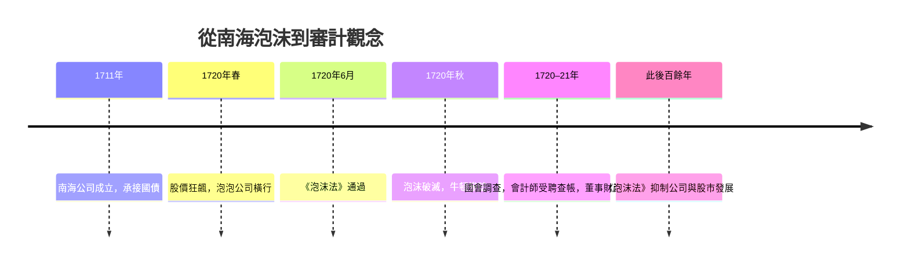

# 5.2 1720南海泡沫：獨立審計的起點

## 一場由「帳面數字」撐起的狂熱

1711年，牛津伯爵哈利創立南海公司（South Sea Company）。它握有英國與西屬南美洲貿易的特許權，但實際上主要業務是承收政府國債：政府把債務轉為公司股本，公司收取利息。1720年，南海公司提出把絕大部分國債轉換為公司股票的方案，並以不斷增發新股、承諾高額股息的方式炒作股價。南海股價從年初約128鎊飆至夏天約1,000鎊。

狂熱中伴隨著赤裸裸的資訊造假：公司按季宣布「即將派發高股息」以拉抬股價，實際上業務根本不足以支撐；許多公司根本只是印一本「看起來像回事」的章程募股，即所謂「泡泡公司」。1720年6月的《泡沫法》（Bubble Act）試圖遏止，反而在秋天戳破了市場信心。南海股價雪崩式崩跌，無數家庭破產，連牛頓都損失慘重，留下那句名言：「我能算出天體的運行，卻無法算出人類的瘋狂。」

## 為什麼帳目是這場泡沫的關鍵

南海泡沫暴露了一個結構性問題：公司拿股東的錢經營，股東卻無從查證公司真實的財務狀況；而公司的董事可以任意決定公布什麼、隱瞞什麼。當股價完全建立在公司自己宣布的「好消息」上，造假就是最有效的抬轎手段。當時甚至流傳董事集體「多認繳、少實繳」、以虛假認股製造需求繁榮的假象。

泡沫破滅後，英國國會成立調查委員會徹查南海公司帳目。委員會發現帳簿經過刻意模糊處理（部分簿冊被藏匿或毀棄），最終靠著審計人員逐頁追查，才還原了董事操縱股價與賄賂官員的路徑；財政大臣艾斯拉比因此被送入倫敦塔。國會通過法案沒收南海主要董事的財產補償受害人。

## 一項重要的制度回應：審計師制度

1720年底至1721年，調查委員會雇用了三位倫敦會計師（包括查爾斯·史內爾 Charles Snell 等）審計南海公司及其相關方（如刃器公司、約克建築公司）的帳簿——史學界一般把史內爾對約克建築公司（York Buildings Company）的查核，視為「獨立會計師受聘審計公司帳目」最早的明確案例之一。

審計這個行當並非1720年才出現（英國的莊園、行會、城鎮早有「聽帳」auditing 的傳統——audit 本義即「聽」，帳目要唸給監督人聽）；南海泡沫的意義在於：它讓全社會認識到，帳目必須由「與公司無利害關係的外部專業人士」查核，股東的信任才有着落。獨立性、專業性、受託責任——現代審計的三大支柱，自此確立。

## 《泡沫法》的副作用與黑暗時期

泡沫的立法後果是《泡沫法》長期存在，英國此後百餘年對「未經特許的公司」嚴格限制，未特許公司不得以法人身分發行可轉讓股票。這壓抑了股市，也壓抑了財務會計的發展：公司不需向公眾交代，外部審計的需求也隨之低迷。會計職業的大發展要等到工業革命——當工廠需要成本計算、鐵路需要折舊會計、破產潮需要清算專家時，會計師才會以職業團體的形式重新登上舞台。

## 泡沫給會計史留下的三課

南海泡沫留給後世三條至今有效的教訓：第一，財務資訊是市場的空氣——資訊造假，市場就是騙局；第二，公司自行選擇公布內容時，必須有獨立的外部查核加以制衡；第三，危機後的立法（泡沫法、後來的證券法、再後來的沙賓法案）會重塑會計職業的邊界。每一次大崩盤，都是會計制度的一次躍遷——這個劇本將在1929年與2001年再度上演。

下一章，我們回到英國的工廠：蒸氣機將迫使會計回答一個南海時代沒有的問題——機器每年「耗掉」多少價值？
