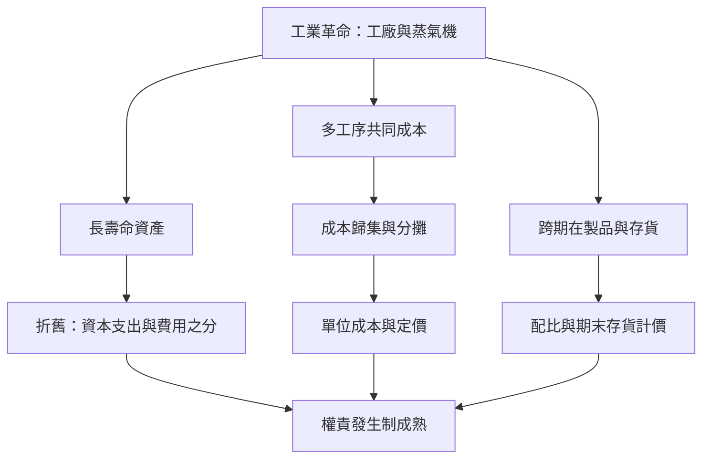

# 6.1 工廠制度下：折舊與成本核算的誕生

## 買賣帳失效的時代

18世紀下半葉起，英國發生工業革命：瓦特改良蒸氣機（1769年專利、1780年代商用）、紡織機械化、工廠制度取代家庭代工。商業資本主義的記帳邏輯瞬間失效——過去的商人「低買高賣」，帳上天然就是損益；而工廠主的錢先變成機器、廠房、原料與工資，生產週期長達數月數年，產品才能變現。三個新的會計問題因此浮現：

1. 機器與廠房不是一次性的「貨」，它們使用幾十年。花大錢買的機器，該算成「今年的費用」還是「逐年攤提」？——這是折舊（depreciation）問題。
2. 產品成本由原料、人工、蒸氣、機器耗損、廠房、監工等構成，如何把這些「共同成本」合理地分攤到每一件產品上，算出單位成本，才能定價與比較？——這是成本會計（cost accounting）問題。
3. 工廠在製品（已投入未完工）與存貨會跨期存在，如何衡量期末存貨價值，才能正確計算本期損益？——這是成本流轉與盤存問題。

## 鐵路：折舊會計的催化劑

折舊概念雖然在18世紀已有萌芽（蘇格蘭學者與實務家已討論資產損耗），真正迫使會計界正視的是1825年後英國的鐵路狂潮。鐵路公司資本龐大、設備（鐵軌、枕木、機車）年年耗損、需定期更換，壽命又長短不一：鐵軌與機車是「資本支出」還是「維修費用」？若把更換成本直接當費用，利潤忽高忽低，無法比較。鐵路會計因此發展出將資本支出與當期費用區分、對資產計提折舊的成熟做法。19世紀中葉的鐵路財務爭議（有些公司虛報利潤、不提折舊以美化股息）使「審慎提列折舊」成為會計職業的核心信條。

## 美國的平行發展：從紡織廠到鐵路

同樣的演化在大西洋彼岸同步發生。1814年波士頓製造公司（Boston Manufacturing Company）的洛厄爾式紡織廠，建立起美國最早的成本核算實務：將紡紗與織布的原料、人工、動力成本按工序歸集，計算每磅棉紗、每碼布的成本。接著，鐵路（如巴爾的摩與俄亥俄鐵路、賓州鐵路）在1830–1870年代發展出部門別成本、營業比率（營業成本對收入的比率）等管理會計工具。工業化使會計從「對外記帳」開始轉向「對內管理」——這是管理會計的誕生。

## 會計師的職業化呼聲

成本與折舊的計算需要專業判斷，破產清算與鑑識需要獨立查核，於是「會計師」從零散的清算代辦人，逐漸形成職業群體。1850年代蘇格蘭的愛丁堡與格拉斯哥，聚集著為銀行、鐵路、工商企業查帳與清算的專家。1853年前後，愛丁堡的會計師們決定組織起來：制定入會資格、考試制度、職業倫理與查帳準則。1854年，維多利亞女王頒發皇家特許狀，「愛丁堡特許會計師協會」（Society of Accountants in Edinburgh）正式成立——「特許會計師」（CA）成為英國法律承認的頭銜。

格拉斯哥的會計師隨後也取得特許狀（1855年），倫敦的英格蘭及威爾斯特許會計師協會（ICAEW）則於1880年成立。職業化的意義深遠：查帳者的獨立性不再依賴個人品行，而由職業團體的資格、倫理與同儕紀律保證。這是「會計師」從手藝變成profession（專業）的時刻。

## 會計與資本主義的合流

工業革命把會計推向三個方向：對內，成本會計成為工廠管理的眼睛；對外，折舊與配比使「公司利潤」成為可定義、可比較的數字，股票市場有了定價的依據；對社會，特許會計師成為資本市場信任的第三方守門人。韋伯所說的「理性化」，在帳簿上具體成形。

而職業會計師第一個大展身手的戰場，正是19世紀英國的破產法庭與鐵路董事會。這個新職業的權威將被兩次世界大戰間的災難檢驗——那將是下一章的故事：1929年。
