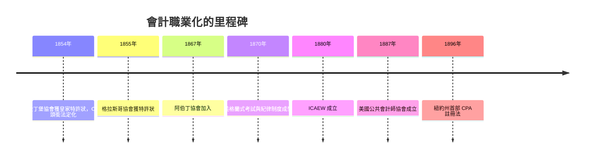

# 6.2 1854年蘇格蘭愛丁堡協會：會計師成為法定專業

## 為什麼是蘇格蘭？

會計職業的法定化發生在愛丁堡，而非倫敦，有其結構性原因。19世紀中葉的蘇格蘭是英國金融與工程的重鎮：愛丁堡與格拉斯哥聚集了銀行、保險、鐵路與重工業，破產與清算事務頻繁；蘇格蘭法律體系（不同於英格蘭）對受託與清算職務的處理，使「會計師」常被法院指定為破產管理人與遺產執行人。這些職務要求專業與公正，逐漸形成一群以查帳、清算為業的專家。

他們面臨典型的職業化困境：市場上有魚目混珠者，社會無法分辨誰有資格。醫師有醫學院、律師有律師公會，會計師卻沒有公認的資格與紀律機構。解法是英國維多利亞時代職業運動的標準套路：成立協會、制定入會考試、爭取皇家特許狀。

## 1854年：皇家特許狀

1853年5月，愛丁堡的會計師們成立「愛丁堡會計師協會」（Institute of Accountants in Edinburgh），向政府請願。他們的請願書寫得擲地有聲：會計師必須具備高度修養與經驗，而社會需要一種可靠的保證，確保從業者的資格與正直，以免公眾受騙。1854年10月，維多利亞女王頒發皇家特許狀（Royal Charter），協會獲得法定地位，有權舉行考試、授予「特許會計師」（Chartered Accountant, CA）頭銜、開除違紀會員。

特許狀明定了三件影響深遠的事：其一，會員須經考試（考會計、商法等科目）；其二，協會有權制定與執行職業紀律；其三，會計師的工作是受託的公共職能——為法院、為股東、為社會查核帳目。換句話說，會計師從「受雇於客戶的技術員」，被制度定位成「受社會信託的守門人」。這一定位，是此後一百五十年審計制度的哲學基礎。

1855年，格拉斯哥的會計師同樣取得特許狀；阿伯丁於1867年加入。三個蘇格蘭協會後於1951年合併為蘇格蘭特許會計師協會（ICAS）。倫敦方面起步較晚：英格蘭及威爾斯特許會計師協會（ICAEW）於1880年由五個倫敦協會合併經特許成立。美國則在1887年成立美國公共會計師協會（AICPA的前身），紐約州於1896年通過全美首部CPA註冊法。

## 特許狀的三層意義

第一層是知識的標準化：考試制度使「什麼是會計、會計師該會什麼」有了公共定義，會計知識從師徒相傳變成可考核的學科。第二層是獨立性的制度化：協會的紀律委員會可以懲戒違紀會員，獨立審計的信用有了組織保障。第三層是社會契約：以法定專業換取壟斷資格，代價是承擔公共責任。這個「職業換信任」的模式，是現代專業社會的縮影，也預示了之後每一次會計職業危機的爭議點：當守門人失職，社會就收回信任，要求更嚴的監理（如1929年後的SEC、2002年後的PCAOB）。

## 蘇格蘭會計師與帝國的網絡

職業化也使會計師隨著大英帝國的資本流向全世界：鐵路公司在殖民地發行證券、銀行設立海外分行、公司跨國清算，都需要查帳的人。蘇格蘭與倫敦的會計師事務所（如稍後成長為跨國事務所的組織，普華、德勤、安達信、永道等的前身，皆創立於19世紀）隨之建立全球網絡。會計師事務所成為世界上最早的跨國專業服務組織之一——這也為20世紀末「五大」的興起與安達信的覆滅埋下伏筆。

## 從工廠到華爾街

至此，會計完成了三級跳：技術上有了成本與折舊，職業上有了法定CA，功能上有了獨立審計。但整個19世紀，財務報表仍無全國統一的規則——各公司自選會計政策，披露內容參差不齊，資本市場各憑本事。這個缺口將在20世紀的美國被殘酷地暴露：當數百萬小股東湧入股市、而公司愛怎麼編報表就怎麼編時，1929年的崩盤不是意外，而是必然。
