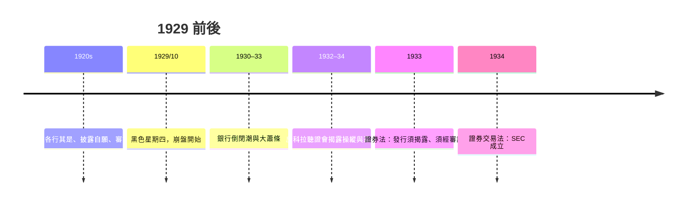

# 7.1 黑色星期四：財報不透明的毀滅性代價

## 一個沒有統一規則的股市

1920年代的美國是「新時代」（New Era）：汽車、電力、收音機，工業生產與股市同步狂飆。數百萬中產家庭第一次買股票——許多人用保證金融資，只付一成價金。但這個市場建立在極度不透明的地基上：

- 公司沒有統一的會計原則，折舊、存貨計價、子公司合併等政策各行其是；
- 披露多為自願，許多公司只公布淨利與股息，不附明細；
- 集團與控股公司層層嵌套，母子公司往來在報表上看不見；
- 審計非強制，且報告常是一行字：「我們證明以上報表正確」——審計師不對方法表態，只背書數字。

有些公司甚至用「準備金」調節盈餘：賺太好時藏利潤、衰退年再放出來。投資人其實是在對著一面霧玻璃下注。

## 1929：崩盤的三部曲

1929年10月24日（黑色星期四）、10月28–29日（黑色星期一、二），紐約股市連續崩跌，兩週內市值損失數百億美元。股市隨後漫長下探，到1932年道瓊指數已跌掉近九成。接著是銀行倒閉潮（1930–33年間約九千家銀行歇業）、失業率飆至四分之一、經濟大蕭條。

會計在此的角色不是唯一兇手，但調查揭示的亂象觸目驚心：許多崩盤前「獲利優異」的公司，真相是靠虛增資產、隱匿虧損、母子公司利益輸送與內線炒作撐出來的；國會聽證中曝光的池內操縱（pool operations）更是公然拉抬自家股票。人們意識到：不透明本身就是系統性風險——當投資人無法分辨好公司與壞公司，壞消息一來，所有人都只想逃，信任全面凍結。

## 國會的清算：皮科拉聽證會

1932–34年，參議院銀行與貨幣委員會舉行證券市場聽證會（因首席律師費迪南德·皮科拉 Ferdinand Pecora 而聞名）。皮科拉的問訊讓全國讀報者震驚：全國城市銀行（後花旗）透過附屬公司持股、發行證券並隱匿虧損；交易所總裁薪水與免稅安排驚人；內線交易與操縱的細節一一曝光。聽證會直接催生了三項立法：1933年《證券法》、1934年《證券交易法》、1933年《格拉斯—史蒂格勒法》（銀行與證券分業）。

## 對會計職業的衝擊

崩盤前，美國會計師界已非全然懵懂：1917年聯邦儲備局與AICPA前身曾發布《統一會計》（Uniform Accounting）試圖推廣標準；1920年代的學者佩頓（W.A. Paton）與利特爾頓（A.C. Littleton）也開始建構會計理論。但職業整體在政治上毫無防備——聽證會中，會計師被問到審計程序時的回答顯得脆弱：為什麼不函證應收帳款？為什麼不實地盤點存貨？為什麼接受管理層對估值的說法？皮科拉的追問讓「審計到底是什麼」成為全國公審的題目。

職業面臨存亡抉擇：要嘛被政府接管會計規範，要嘛主動建立標準以換取自律地位。美國會計師界選擇了後者——這正是下一章GAAP故事的開端。

## 歷史的押韻

南海泡沫→泡沫法與審計觀念；1929→證券法與GAAP；2001安隆→沙賓法案。資本市場的每一次信任崩塌，都以會計制度的重構收場。原因很簡單：股市本質上是「對未來現金流的預期交易」，而財務報表是預期賴以形成的公共資訊。資訊失真，定價失靈，市場自我毀滅。會計從來不只是技術，它是資本主義免疫系統的一部分。
