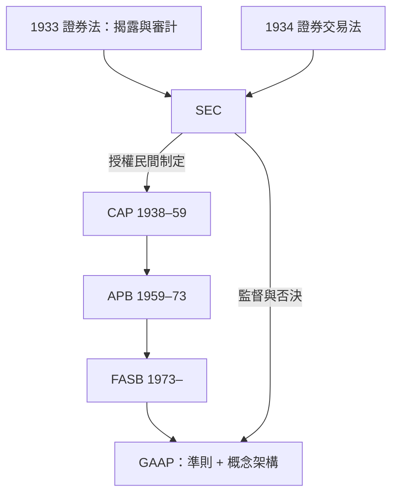

# 7.2 SEC與GAAP：會計規範化的黃金時代

## 1934：監理的誕生

1934年《證券交易法》創立美國證券交易委員會（SEC），賦予它對上市公司財務揭露的法定權力，包括制定「編製報表所需之會計原則」。這是歷史性的時刻：會計原則從商人的習慣與職業的判斷，變成受政府監理的公共規範。

但SEC走了一條巧妙的路。首任主席約瑟夫·甘迺迪（老甘迺迪）與其後繼者並未由聯邦官僚自訂會計制度，而是把制定權「授權」給民間職業團體，SEC保留監督與否決權。1937年起，SEC透過《會計系列文告》（Accounting Series Releases）行使監督；1938年，SEC的ASR No.4 表明：若遵循民間團體制定的、有「實質權威支持」（substantial authoritative support）的原則，SEC即認為符合法定要求。這套「民間制定＋官方認可」的雙層結構，塑造了此後六十年的美國會計治理。

## 從CAP、APB到FASB

民間制定者幾經更迭：

- 1938–1959年：會計程序委員會（CAP）發布《會計研究公報》（ARB），累積出四十餘號公報。它是「個案累積」式的：遇到問題、解決問題，尚無統一理論。
- 1959–1973年：會計原則委員會（APB）試圖建立理論基礎，並以《意見書》（APB Opinions）的形式發布原則，但屢遭業界與學界批評（如投資稅捐抵減與租賃的處理），公信力受損。
- 1973年至今：財務會計準則委員會（FASB）成立，採獨立委員制、完整的研究與公開聽證程序，發布《財務會計準則公報》（SFAS），後改為《會計準則編纂》（ASC, 2009年起）。

這一系列文件匯總起來，就是一般公認會計原則（GAAP, Generally Accepted Accounting Principles）。GAAP不是一本書，而是一套由準則、解釋、立場公報與產業實務累積而成的規範體系。

## 理論的整合：三份經典研究

規範化的黃金時代同時是理論的黃金時代。SEC在1950年代後期推動會計研究，產出三份影響深遠的文件：

1. 佩頓與利特爾頓《公司會計準則緒論》（1940，事實上先於SEC計畫，是理論基礎）：確立權責發生制、配比原則、持續經營等基本假定。
2. 《會計研究叢刊第1號：會計的基本假定》（1961，穆尼茨）與第3號《試編企業一般會計原則彙編》（1962）。
3. 《會計研究叢刊第7號：會計計量的理論架構》（1970，由斯普勞斯與穆尼茨主持）——首次以「決策有用性」為會計目標，主張以現金流與現值為核心的計量觀。

第7號被職業界認為過於激烈，但它開啟了「概念架構」（conceptual framework）的傳統：先定義會計的目的、品質特性與要素，再推導出具體準則。FASB於1970年代末至80年代完成《財務會計概念公報》（SFAC），確立「提供有助於投資、授信決策的資訊」為財務報導的首要目標。這是把會計學從「技藝彙編」提升為「有理論體系的科學」的關鍵一步。

## 黃金時代的成果與代價

成果是明顯的：財務報表從霧玻璃變成了有統一格式的窗；應收帳款函證、存貨實地盤點、審計報告範本、子公司合併編表等，都成為強制或準強制的實務；審計意見從一行背書，進化為有範圍與意見的正式文件。美國股市在戰後的繁榮，很大程度上建立在這套可信揭露的基礎上。

代價與限制也逐漸浮現：GAAP是規則導向（rules-based）的，條文越細，规避條文的技術（後來的SPE、特殊目的會計）越精巧；美國準則與各國準則並存，跨國公司面對的是會計的巴別塔；而當金融創新（衍生性商品、租商品、租賃、證券化）跑在準則之前時，GAAP追不上。這些矛盾，將在20世紀末集中爆發——但在此之前，世界先得解決另一個問題：各國各說各話的準則，如何統一？

那是1973年的故事。
