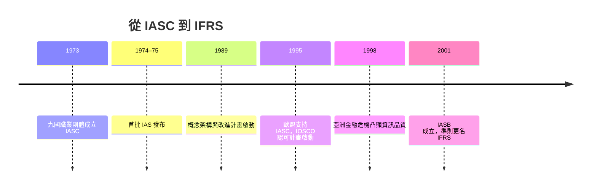

# 8.1 1973年IASC：跨國企業財報的翻譯難題

## 一個越來越小的會計世界

戰後的世界經濟發生了質變：跨國公司崛起。美國企業在歐洲、日本與拉美大量投資，歐洲企業互相購併，石油美元透過歐洲美元市場全球流動。到1960年代末，一位在倫敦讀財報的投資人，面對德國、法國、美國子公司時，面對的是根本無法比較的數字：

- 折舊政策各國不同；
- 研發支出有的費用化、有的資本化；
- 租賃有的不入帳（表外融資）；
- 備抵、準備金的認列隨意；
- 甚至連「會計年度」長度都可能不同。

學者稱之為會計的巴別塔。1970年代，會計的「國際化」呼聲從三個方向匯聚：跨國企業本身（同一集團要編合併報表）；資本市場（投資人要跨國比較）；國際組織（歐洲經濟共同體著手制定公司法指令，1978年的第四號指令規範會計揭露）。

## 1973：IASC 的誕生

1973年6月，澳大利亞、加拿大、法國、德國、日本、墨西哥、荷蘭、英國（含愛爾蘭）、美國九國的職業會計師團體，在倫敦成立國際會計準則委員會（IASC, International Accounting Standards Committee）。這是一個純粹由職業界自發組成的國際組織——沒有政府強制力，只有同業的共識。

IASC的運作哲學務實而聰明：不推翻各國現行實務，而是從各國準則中找出「可接受做法的交集」，訂成《國際會計準則》（IAS），允許多種會計政策並列（即所謂「選擇權多」的早期準則）。第一批IAS於1974–75年陸續發布（如IAS 1揭露、IAS 2存貨、IAS 3合併報表、IAS 4折舊、IAS 7財務狀況變動表）。目的不是完美的理論，而是「不同國家至少能互相聽懂」。

## 1989–2001：從「交集」走向「高品質單一準則」

1989年，IASC發布《財務報表編製與表達之架構》（Framework），確立了概念基礎。同年發布ED 32，開始一項大工程：「改進計畫」（comparability and improvements, 1990–93）——刪減準則中的會計政策選擇權，朝單一處理方向收斂。

真正的轉機來自外部。1990年代末，全球化資本市場要求的是一套能被證券監理機構接受的準則；IASC的會員組織架構（各國職業團體代表）被批評不夠獨立、資源不足。1998年亞洲金融危機更凸顯跨國資訊的品質問題。2000–01年，IASC完成重組：2001年4月起，新機構「國際會計準則理事會」（IASB）成立，由十四位全職、獨立的專家委員組成（不再代表各國團體），受一個由監理者與使用者組成的基金會（IASC Foundation，後改稱IFRS Foundation）監督，經費來自會計師界與企業界捐助。IASB發布的準則改稱《國際財務報導準則》（IFRS）。

## 制度經濟學的視角

IASC的故事是一個「自願協調」的範例：沒有一個世界政府強制統一會計，協調是透過網絡外部性完成的——準則被採用的人越多，對每個採用者的價值越大（比較成本低、跨國融資容易）。證券監理組織（IOSCO）的背書、歐盟的政治支持、跨國企業的自願採用，共同把一套「職業界的共識」推上「全球通行規範」的位置。這與1929年後SEC「官方立法」的路徑形成對比：美國模式是危機後的強制，國際模式是漸進的協調。

剩下的問題只有一個：誰先真正下場全面採用？答案是歐盟——2005年1月1日，歐洲七千多家上市公司同時換軌IFRS。那一天的細節，見下一節。
