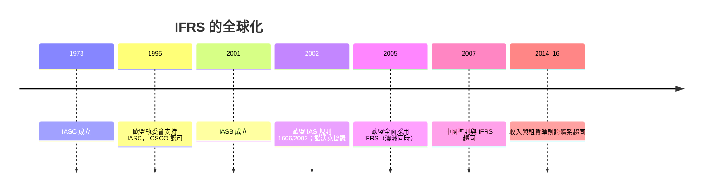

# 8.2 2005年歐盟採用IFRS：同一套商業語言

## 歐洲的會計傳統：各行其是五百年

2005年之前，歐洲各國的會計傳統迥異。英國的「真實與公平觀點」（true and fair view）重實質與判斷；德國的會計深受稅法與債權人保護影響，講究謹慎與「有備無患」（隱藏準備金是美德）；法國則以《會計總方案》（Plan Comptable Général）為國家統一帳戶體系，會計服務於統計與政策。要跨國比較英德法公司的獲利能力，幾乎是緣木求魚。

歐盟的整合壓力改變了一切。歐元1999年問世，單一貨幣催生單一金融市場：泛歐上市、跨境併購、歐洲規模的共同基金。若財報語言不統一，歐洲資本市場永遠只是一堆互相看不懂的地方市場。

## 兩次關鍵的決定

第一步在2000年：歐盟執委會發布策略文件，決定歐盟上市公司自2005年起以IFRS編製合併財務報表。2002年7月，歐洲議會與理事會通過《1606/2002號規則》（IAS Regulation），正式賦予法律效力，並設立「歐洲財務報導諮詢小組」（EFRAG）負責對IFRS逐號「背書」（endorsement）——歐盟不重新制定準則，但對採納與否有最終決定權。

第二步在2001–02年間：IASB重組完成、推出高品質新準則（如IAS 39金融工具、IFRS 3企業合併），使「全面採用」在技術上可行。美國證監會此時的政策是要求在美上市的外國公司按美國GAAP重編，這也刺激了歐洲下決心：與其在紐約削足適履，不如建一套全球準則讓紐約來學。

## 2005年1月1日：歷史性的同時換軌

2005年1月1日，歐盟25個成員國約七千家上市公司（含在歐盟上市的非歐盟公司），同一日起以IFRS編製合併報表。澳大利亞（2005年）、紐西蘭、南非、香港等也在相近時間採用IFRS或其趨同版本。俄羅斯、中國大陸、韓國、印度、日本則以各種方式「趨同」（中國2007年起實施與IFRS實質趨同的企業會計準則體系）。至2010年代，要求或允許使用IFRS的司法管轄區超過一百四十個。

換軌的衝擊是真實的：同一公司、同一年的帳，從本國準則換成IFRS，淨利與權益可能變動百分之數十——德國公司的「隱藏準備金」被翻出來（Daimler-Benz早在1990年代按US GAAP重編時，1995年從德國準則下的虧損翻成US GAAP下的獲利，即為著名案例）；保險、銀行與營建業的處理天翻地覆。企業花費數以億計的調整成本，換來的是跨國比較的可能性與更低的資金成本。

## 同一套語言之後：兩大體系的趨同與分歧

2005年後，全球會計形成「美國GAAP＋IFRS」雙巨頭。2002年起，FASB與IASB簽署諾沃克協議（Norwalk Agreement），展開「趨同計畫」：雙方合作修訂企業合併、金融工具、收入認列（2014年IFRS 15／ASC 606幾乎同步出台）、租賃（2016年IFRS 16／ASC 842）等。趨同有成功也有僵局（金融工具減損、保險準則的爭執多年）。2008年金融海嘯後，會計（公允價值會計是否放大危機）再次被推上政治舞台，SEC與歐洲的立場分歧一度加劇；美國最終未全面採用IFRS（2010年代中期政策轉向「允許但不強制」），世界維持雙準則並存。

## 通用語言的意義

回望整條線索：庫辛的泥板記錄了糧食，帕喬利的教科書統一了歐洲商人的記帳法，SEC統一了美國的報表，IFRS則試圖統一全世界。會計標準統一化的每一步，都是信任半徑的擴大：從一間倉庫、一個城邦、一個國家，到全球資本市場。今天，一個台灣投資人可以在台股年報、美股10-K、歐洲公司IFRS報表之間自由切換，正是五千年會計史的果實。

然而標準再好，也要有人誠實執行。下一章的故事將證明這一點：在標準化最成熟的美國市場，一家七年連獲「最受尊崇企業」的公司，用最精巧的會計技術，蒸發了數百億美元的退休金——並順手埋葬了一家89歲的百年事務所。
