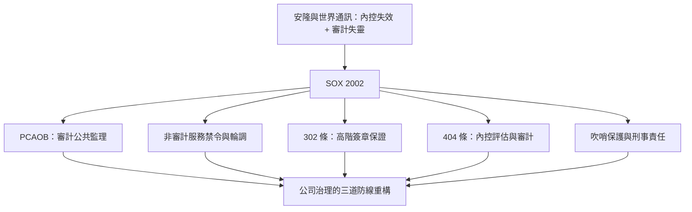

# 9.2 2002薩班斯法案：內部控制與審計獨立性的重塑

## 七十天立法：反應式的制度革命

安隆（2001年12月）與世界通訊（2002年6月，虛報逾38億美元、後總數近百億）的連環崩塌，讓美國國會以驚人的速度行動：薩班斯—奧克斯利法案（SOX）自提出到小布希總統簽署（2002年7月30日）僅約七個月，被稱為1934年以來最徹底的證券法改革。法案共11章、66條，幾乎每一條都對應著安隆案的一個漏洞。

## SOX做了什麼：三道防線的重構

第一道：審計監理收歸公共。1934年以來「民間自律」的審計治理被打破——設立上市公司會計監理委員會（PCAOB），負責登記並檢查審計事務所、制定審計準則、調查懲戒。審計師第一次有了一個有政府後盾的公共監理者（受SEC監督）。事務所須接受年度檢查，對發行人的審計品質不再是職業同儕的事。

第二道：切斷利益衝突。SOX禁止審計師向審計客戶提供多類非審計服務（簿記、財務資訊系統設計、估值、精算、內部稽核外包、經紀投資顧問、法務等），並強制審計合夥人輪調（主責合夥人五年、複核合夥人七年）。審計委員會直接聘任並監督審計師、負責聘僱與考核財務長；所有審計與非審計費用須預先核准並公開揭露。「同一事務所又查帳又賣顧問」的模式自此終結。

第三道：把責任釘到個人身上。SOX 302條要求CEO與CFO對每份定期報告「親自簽章保證」：報表無重大不實、內部控制有效。SOX 404條進一步要求管理層對「財務報導內部控制」（ICFR）每年評估並公開報告，外部審計師須對其出具意見（404(b)）。302條同時規定報告若有重大虛偽，執行長與財務長可處最高20年刑責。刑事化的對象明確指向高階經理人——這是安隆與世界通訊高層皆逃過刑責初期的直接回應。

法案還包括：管制員工向審計師報告可疑事項的行為（吹哨保護，806條）、擴大證券詐欺追訴期、沒收經理人因不實報表獲得的利益、設立公司破產時的公平基金補償受害人。

## 成效與代價

正面成效明確：財報重編次數在2000年代中期顯著下降；審計獨立性實質提升；404條逼出來的內控文件化，讓企業對「誰授權、誰執行、誰覆核」有了前所未有的清楚認識——它本質上是把內部控制的學術原則（職務分離、授權核准、資產保管與記錄分開，其原型正是兩千五百年前埃及的雙人監督）變成了法定程序。

代價也不容忽視：404條的合規成本驚人（尤其第一年，中小企業平均數百萬美元）；數千家外國公司因此退出美股（「SOX折價」一度成為學術研究主題）；資源向合規傾斜，被批評擠壓了創新。2000年代後期，SEC與PCAOB陸續放寬中小企業豁免（404(b)豁免）、簡化文件要求，制度進入「校準期」。

## 全球擴散：SOX成為世界標準

SOX的影響遠超美國：日本2006年的J-SOX、歐盟多國的類似條款、台灣2014年證交法修正增訂審計委員會制度與2014年（實際上多數條文自2007年起陸續增修）的相關強化，皆可見其影子。COSO內控架構（1992年首次提出、2004年修訂加入企業風險管理ERM）在SOX之後成為全球內控與風管的實務憲章。「企業治理」從股東會與董事會的抽象議題，變成可稽核的具體流程。

## 制度反思：守門人的悖論

安隆案留給會計史的根本問題是「守門人悖論」：審計師的費用由被審計者支付，其忠誠天然有偏；制度設計只能在「利益夠不夠分離」與「責任夠不夠重」之間尋找平衡。南海泡沫→審計觀念；1929→SEC與GAAP；安隆→SOX與PCAOB；金融海嘯→公允價值之辯。每一次危機都是一場制度修補，而修補永遠追在創新之後。這正是下一章的主題：當記帳的技術本身（區塊鏈）與執行記帳的智慧（AI）同時躍遷時，五千年來「人記帳、人查帳」的模式，是否正在被改寫？
