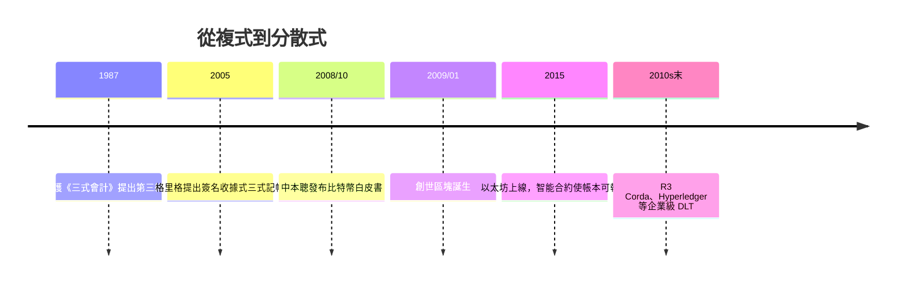

# 10.1 2008比特幣白皮書：分散式帳本與三式記帳法

## 一個理論家與一個化名工程師

三式記帳法的想法比比特幣早二十多年。1987年，日本京都大學的計算機科學家伊護（Yuji Ijiri，1935–2005）在《會計評論》發表專著，提出在借、貸之外加入第三個維度——「動能」（momentum），即變化率的變化，讓損益與財富變化可以從三個面向互相勾稽。伊護的三式記帳最終停留在理論與實驗系統，未能落地，因為第三維度缺乏商業上的必要用途。

2005年，賽普勒斯的全金融研究員伊恩·格里格（Ian Grigg）提出另一種「三式記帳法」（Ricardian contracts 系統）：每一筆交易除了借貸雙方的分錄，還附上一份雙方簽名的「合約收據」（receipt）。第三方（如公證人）保存這份簽名收據，交易的真實性就由簽名而非帳簿的封閉系統保證。格里格寫道：複式記帳的兩欄（借與貸）加上市場交易雙方的簽名，構成「三重」的證據。

2008年10月31日，化名中本聰（Satoshi Nakamoto）的作者發布《比特幣：點對點電子現金系統》白皮書。其核心是區塊鏈（blockchain）——一條由全體參與者共同維護、以密碼學串聯、難以竄改的分散式帳本（distributed ledger）。2009年1月，比特幣創世區塊誕生，區塊裡刻著當日《泰晤士報》頭條：「財相救助銀行的第二輪邊緣」——這是對2008年金融危機中銀行帳目失信的明顯諷刺。

## 為什麼區塊鏈是「帳」的演化

用會計史的語言說：區塊鏈不是新貨幣，而是一種新的記帳技術。

- 蘇美泥板：帳由單一保管者（神廟書吏）持有；
- 複式記帳：帳在組織內部自我勾稽，但仍由組織自己持有、自己可改；
- 區塊鏈：帳由所有參與者各自持有一份完整副本，任何改動需多數共識，且每一塊與前一塊以雜湊相連，動一筆則全鏈失效。

換句話說：複式記帳讓帳簿「內部一致」，區塊鏈讓帳簿「外部不可篡改」。格里格所說的「第三個維度」——簽名與共識——被大規模實作了。因此有人稱比特幣式帳本為三式記帳法的實踐：交易雙方＋共識網絡共同見證。

## 企業的回應：從加密貨幣到DLT

比特幣最初被金融主流視為投機品（2013–14年Mt. Gox交易所倒閉，85萬枚比特幣失竊，本身就是一場「帳目失守」的教訓）。但分散式帳本技術（DLT）逐漸被企業與金融機構認真對待：跨境支付（2018年上線的等）、貿易融資單據、證券清算交割、供應鏈溯源。2010年代後期，四大事務所皆成立區塊鏈團隊；審計的未來被重新想像：若交易即時記錄在不可篡改的帳本上，年終實地盤點、帳齡分析、函證這些「事後查證」可能變成「即時連續審計」。

與此同時，會計準則開始面對新的科目：加密資產如何分類、如何衡量？IASSB（2019）與FASB（2023）陸續發布指引，要求對特定加密資產以公允價值衡量。五千年來會計追著技術跑的劇本，再次上演。

## 保留與懷疑

學界對「三式記帳」的名稱仍有保留：區塊鏈解決的是「交易發生時的不可否認與不可篡改」，但未解決「交易本身的真實性」（上鏈的資料可以是假的——垃圾進、垃圾出）；智能合約的漏洞（如2016年The DAO事件，6,000萬美元被盜）顯示技術不能取代判斷。審計的核心——職業懷疑與對「人」的判斷——沒有被取代，反而更形重要。

## 記錄者的解放

區塊鏈之外，更大規模的變革是自動化：雲端ERP（SAP、Oracle、NetSuite）、RPA機器人流程自動化、發票光學辨識、銀行與帳務系統直連，使大量基礎記帳工作（過帳、對帳、調節）被軟體取代。基礎會計職位的數量與結構正在改變，而會計師的角色被推向何處——這是下一節，也是這個故事最新的一章。
