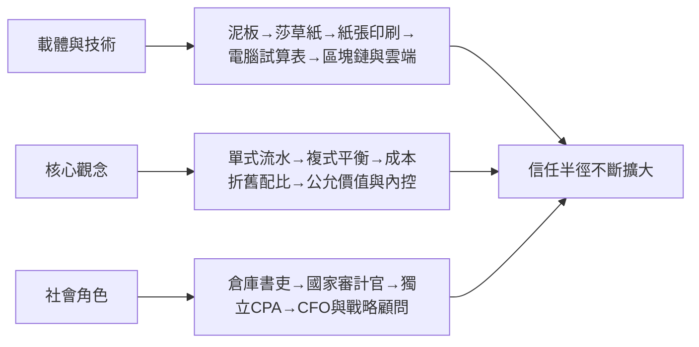

# 10.2 從記錄者到戰略家：AI時代的會計師

## 記帳工作正在消失，會計工作不會

回望全書的線索：會計每一次技術躍遷，都削減一部分「記錄」的工作，同時創造更高階的角色。

- 15世紀印刷術普及帕喬利的方法，使記帳從商人的家傳手藝變成可訓練的技能；
- 19世紀的職業化把查帳與判斷（折舊、清算、破產）變成專業；
- 1930年代的GAAP把「如何編表」標準化，會計師的價值移向「判斷是否遵循、揭露是否充分」；
- 2002年的SOX把內控文件化，催生了內部稽核與風管的龐大需求；
- 21世紀的ERP、RPA與AI，則直接接管了過帳、對帳、調節、報表產出。

今天的企業財務部門裡，發票自動辨識、機器學習對帳、異常偵測、即時併表已是常態。德勤等事務所在2010年代提出的「Finance 2020」願景中，財務人員的時間將從「編製報表」移向「分析、預測、與業務夥伴合作」。換言之：記錄者（bookkeeper）的工作大幅萎縮，而解釋者、驗證者、顧問的工作擴張。

## AI 做得到什麼，做不到什麼

機器學習在會計上已有實質成果：異常交易偵測（舞弊偵查）、應收帳款壞帳預估、審計抽樣的風險導向最佳化、合約條款抽取（租賃、收入合約的自動辨識）、文字型財報的語意分析。審計事務所使用數據分析進行全體交易檢驗（100% testing），取代傳統抽樣，這改變了「審計證據」的概念。

但AI的極限正是會計判斷的核心所在：估計與假設（未來現金流、折現率、減損跡象）涉及管理層的意圖與情境；會計準則的適用依賴對「實質重於形式」的詮釋——安隆的SPE在形式上完全符合當時的3%規則，問題出在實質。機器可以告訴你數字是否一致，不能告訴你交易是否誠實。職業懷疑、對人性的理解、與對商業實質的判斷，仍是人類會計師不可讓渡的領地。這也是為什麼各國監理者（PCAOB、IAASB）在推廣審計數據化的同時，堅持審計意見只能由具資格的專業人員簽發。

## 新的角色地圖

21世紀的財務職涯正在重組為幾條主線：

1. 財務業務夥伴（Finance Business Partner）：把成本、損益分析帶進事業單位決策，是CFO與業務之間的橋樑。
2. 風險與治理專家：內控（SOX/COSO）、企業風險管理、法遵與吹哨機制的設計者。安隆後的世界，這是剛性需求。
3. 永續與非財務報告：ESG揭露（ISSB的IFRS S1/S2、歐盟CSRD）把會計的邊界擴張到碳、人力與供應鏈——這是1990年代「三重底線」理念的制度化，本質上是新的「帳簿革命」。
4. 數據與系統能力：會計師與資料科學的複合人才（審計數據分析、ERP與區塊鏈導入顧問）。

CFO的角色是最大的縮影：從20世紀中葉的「帳房主管」（數字的守護者），到1980年代後的價值管理者（資本配置、併購、投資人關係），再到今天的策略與風險共同設計者。麥肯錫與德勤的調查皆顯示，董事會越來越期待CFO參與策略制定，而不只是報告結果。

## 五千年的三條主線，與一個未完的問題

若把整個故事壓縮成三條線，會計史的主軸是：

三條線共同指向一件事：會計是人類為「在陌生人之間維持可信的合作」所發明的技術。庫辛在泥板上簽名時面對的問題——這批大麥有多少、誰經手、誰負責——與今天CFO簽署10-K、審計師出具意見時面對的問題，在結構上是同一個。技術從黏土變成密碼學，規模從一座倉庫變成全球市場，但問題的核心從未改變：如何讓看不見的資產、看不見的行為，變成可以信任的數字。

南海的董事、安隆的財務長、以及未來每一個試圖操縱帳簿的人，都會不斷考驗這個答案。會計學的故事因此沒有終章——只要人類還在交換與承諾，帳就會繼續記下去。
