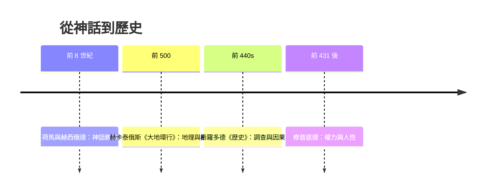

# 1.1 希羅多德：從神話到調查

## 一個詞的發明

英文 history、法文 histoire、德文 Historie，全都來自古希臘語 historía——本義是「調查、探究」。第一個把這個詞變成書名的人，是哈利卡納蘇斯的希羅多德（Herodotus，約前 484–前 425）。他的《歷史》（Histories）開篇就自我介紹：「這裡發表的，乃是哈利卡納蘇斯人希羅多德的研究成果，其所以要把這些研究成果發表出來，是為了保存人類的功業，使之不致由於年深日久而被人們遺忘。」

「研究成果」——這個詞宣告了一種新的知識態度：過去不是吟遊詩人傳唱的神話，而是可以走訪、提問、比對、記錄的對象。荷馬的《伊利亞特》講的是諸神操縱的英雄；希羅多德講的是他親自走過的地方、親自詢問過的人。

## 希波戰爭：一部書的骨架

《歷史》的主題是希臘城邦聯盟與波斯帝國的戰爭（前 490 年馬拉松、前 480 年薩拉米斯、前 479 年普拉提亞）。但希羅多德沒有直接開打，而是用整整四卷的篇幅鋪陳「衝突的根源」：呂底亞、波斯、埃及、斯基泰的地理、風俗、王統與傳說。他提出著名的因果框架：「為了不使希臘人與蠻族人間的功業失去應有的光彩」，並且要查明「他們相互爭鬥的原因」——從腓尼基人拐帶婦女說起，一層層推到波斯帝國的擴張邏輯。

這是史學史上第一次系統地追問「為什麼會發生戰爭」，而不是「神要戰爭發生」。

## 耳聞、目見與問詢：方法論的雛形

希羅多德在書中反覆交代證據來源：「這是我親眼看見的」「這是我聽當地祭司說的」「這一點我無法證實」。他區分自己看到的（opsis）、詢問得知的（akoe）與自己的判斷（gnome），並且常常並列多種說法——關於尼羅河為何氾濫，他列舉三種解釋並給出自己的評價；關於某個傳說是否可信，他直說「我的職責是記錄人們所說的一切，但我並沒有義務全部相信」。

這種「存疑而不刪除」的態度，使《歷史》同時是史料寶庫與方法論教科書：後人可以批判他的輕信（例如某些數字顯然誇大），卻無法否認他建立了「交代來源、區分傳聞與親證」的基本規範。

## 一個世界主義者的好奇心

希羅多德生於小亞細亞的哈利卡納蘇斯，是波斯帝國治下的希臘人城市，一生遊歷埃及、黑海、巴比倫、義大利。這個身分決定了他罕見的視角：他對「蠻族」沒有教條式的鄙視。他記錄埃及的木乃伊工藝、巴比倫的婚姻拍賣習俗、斯基泰的葬禮，常常以對方的習俗自身為尺度——「每個人都認為自己祖國的習俗是最好的」，他寫道，並用大流士問希臘人與卡拉提亞人願不願意互換喪葬習俗的故事說明：習俗（nomos）是萬物之王。

這種文化相對主義的直覺，要到兩千四百年後的人類學那裡才被系統化；希羅多德憑雙腳與好奇心提前抵達。

## 時代背景：為什麼是此時此地

希羅多德的工作依賴三個時代條件。其一，波斯帝國的道路與郵驛系統使遠行與多語資訊成為可能——他本人顯然利用過帝國境內的旅行網絡。其二，愛奧尼亞的自然哲學家（泰勒斯、赫卡泰俄斯）已開創「用觀察與推理解釋世界」的傳統，希羅多德明確與其前輩赫卡泰俄斯對話：「米利都人赫卡泰俄斯在此講述如下，我卻認為如下所述更接近真實。」——批判性地修正前人，正是理性學術的姿態。其三，雅典的民主與劇場文化提供了聽眾：他的著作據傳在奧林匹亞賽會上公開朗誦，歷史從貴族家譜變成公共論述。

## 遺產與爭議

古代已有人（普魯塔克）寫《論希羅多德的惡意》批評他偏袒；近代史學則一度尊修昔底德而貶希羅多德為「故事之父」（father of lies）。但二十世紀以來評價逆轉：他的民族誌式記錄（如對埃及的描述大體被考古證實）、他對來源的坦白交代、他對非希臘世界的公正，都被視為史學最珍貴的起點。

他留下的問題至今有效：當你記錄他人告訴你的事，你是歷史學家還是轉述者？真相與好聽的故事之間，界線在哪裡？修昔底德將用更冷硬的方式回答——而他給出的答案，將塑造此後兩千年的「科學史學」理想。
