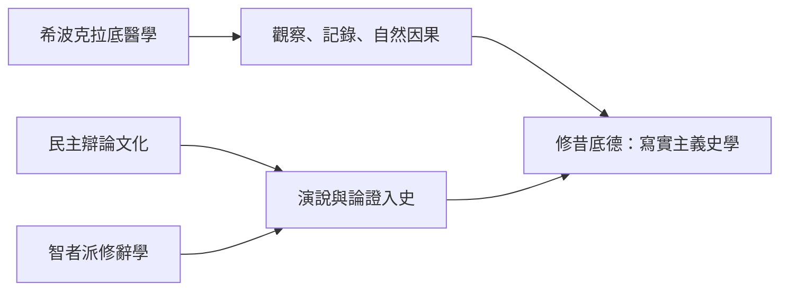

# 1.2 修昔底德：權力與人性的寫實史學

## 一個被放逐的將軍決定寫史

修昔底德（Thucydides，約前 460–前 400）出身雅典望族，色雷斯擁有金礦，前 424 年以將軍身分駐守安菲波利斯，因馳援不及被政敵彈劾，遭終身放逐。這個災難成了史學的幸運：放逐讓他獲得罕見的自由——可以在雅典與斯巴達兩邊活動、訪談雙方當事人、旁觀而不被捲入。他自述：「整個戰爭期間，我的地位使我便利於對雙方情況的了解。」

他的《伯羅奔尼撒戰爭史》記錄雅典與斯巴達二十七年（前 431–前 404）的總體戰。與希羅多德不同，他只寫自己時代、自己親歷或可親證的事件，開篇即宣布方法：「在敘事方面，我決不先入為主，以想像力取代親身觀察；在判斷方面，我不用傳聞與猜測，而以親歷者的一致證詞為準——其中多數我逐一檢驗過。」

## 三個方法論革命

第一，剔除神意。全書沒有一句「宙斯決定了」；地震、日食、瘟疫都作為自然事件敘述。瘟疫一章（前 430 年雅典大疫）是醫學式的臨床觀察記錄：症狀、病程、死亡順序、道德秩序的崩解——修昔底德本人染病倖存，以病歷式精確寫下所見。

第二，因果分層。他區分「公開藉口」（科基拉事件、波提狄亞爭端）與「真實原因」（truest cause）：「雅典勢力的增長，引起了斯巴達的恐懼，使戰爭不可避免。」一句話把戰爭從偶然事件提升為結構性動力——權力轉移引發衝突。這個洞見在二十世紀被國際關係學者重新發現，稱為「修昔底德陷阱」。

第三，檢驗證據。他批評詩人的誇張與編年家的取悅聽眾，聲明自己的書「不是競賽作品，而是永久的財富」（ktema es aiei）。他甚至親自核對：對西西里遠征規模的估算，他採信目擊者的船隻計數而非官方宣傳。

## 演說：一種危險的發明

《戰爭史》中最著名也最受爭議的，是那些大段演說——伯里克利的葬禮演說（歌頌雅典民主與開放）、米洛斯對話（雅典使者對小島居民直言：「強者做他們有權力做的事，弱者接受他們必須接受的事」）、以及戰敗後克里昂與狄奧多圖斯關於米提林尼的辯論。

修昔底德坦承演說難以逐字復原，他寫的是「演說者在情境要求下應當說的話」（ta deonta）。這是嚴謹與文學的危險混合：它把政治邏輯提煉成戲劇，卻也讓後人永遠爭論——這些話是史實還是修昔底德的哲學代言？無論如何，米洛斯對話成為西方政治思想中現實主義的原典：權力不講道理，只講位置。

## 人性不變的科學

修昔底德史觀的底盤是一個命題：人性（physis）不變。因此，凡依據人性必會重複的事件，他的記錄「對理解未來有用」。恐懼、榮譽、利益——他認為這三種動機驅動國家；繁榮滋生傲慢，災難釋放殘忍（科基拉內戰一章對內戰如何敗壞語言與道德的分析，是政治心理學的開山之作）。

這使他的書超越編年，成為一部「政治的病理學」。從馬基維利到霍布斯（他親自翻譯修昔底德）、從國際關係的現實主義學派到核戰略家，都在這本書裡找鏡子。

## 為什麼是雅典、為什麼是此時

修昔底德的冷峻背後有時代條件。前五世紀的雅典：民主政治使公共辯論與論證成為日常；智者派（普羅塔哥拉「人是萬物的尺度」）把論證技術推向職業化；希波克拉底醫學傳統確立「疾病有自然原因」；悲劇（尤其修昔底德好友歐里庇得斯）發展出對人類處境的無情剖析。史學的「去神話化」不是孤立的發明，而是整個理性文化的一次總爆發。

## 未完成的書與未完的命題

修昔底德寫到前 411 年中斷（他未能活著完成全書，最後的尼西阿斯與德基利亞戰役由色諾芬續寫）。但更深的未完成是他的核心命題：強國與弱國、恐懼與傲慢的幾何學是否真的不變？雅典的失敗——遠征西西里的豪賭、瘟疫、民主的瘋狂——在他筆下既是結構的必然，又是選擇的悲劇。兩千年後，當人們討論霸權衰落、核威懾與帝國過度擴張時，仍在引用那個雅典人。他想要的「永久的財富」，如願了。
