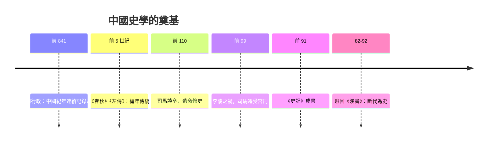

# 2.1 司馬遷與史記：究天人之際

## 從史官世家到宮刑之辱

司馬遷（約前 145–約前 86）生於史官世家：父親司馬談任太史令，臨終執其手囑託續修史書。司馬遷十歲誦古文，二十歲壯遊天下——「上會稽，探禹穴，窺九疑，浮於沅湘」，北涉汶泗、過梁楚，實地考察屈原沉江處、孔子遺風、蕭何韓信故跡。這次壯遊塑造了《史記》的體質：文獻之外，還有田野。

命運的轉折在前 99 年。名將李陵兵敗降匈奴，滿朝落井下石，唯司馬遷為其辯護，觸怒漢武帝，下獄論死。依漢律可以錢贖死或改處宮刑，家貧無錢，他選擇接受宮刑——當時最羞辱的刑罰——以求活命完書。他在《報任安書》中自白所以隱忍苟活：「恨私心有所不盡，鄙陋沒世，而文采不表於後也。」並列舉前例自勵：「文王拘而演《周易》；仲尼厄而作《春秋》；屈原放逐，乃賦《離騷》；左丘失明，厥有《國語》……《詩》三百篇，大抵聖賢發憤之所為作也。」

## 一家之言：體例的發明

前 91 年前後，《史記》一百三十篇完成：十二本紀（帝王編年）、十表（大事年表）、八書（典章制度——禮、樂、律、曆、天官、封禪、河渠、平準）、三十世家（諸侯與重臣）、七十列傳（人物專傳）。全書五十二萬餘字，上起黃帝，下訖當朝。

這套「紀傳體」是真正的體例發明。此前中國已有《尚書》（誥命檔案）、《春秋》（編年大事記）、《左傳》（編年敘事），但司馬遷第一次把時間（本紀、表）、制度（書）、空間與人物（世家、列傳）組成一個可互相參照的結構。他自述宗旨：「究天人之際，通古今之變，成一家之言。」

三個關鍵創新值得細看：

1. 經濟史的地位。《貨殖列傳》為商人立傳，直言「天下熙熙，皆為利來；天下攘攘，皆為利往」——在獨尊儒術、貶抑逐利的時代，司馬遷承認逐利是人性與社會的動力，並系統記錄各地物產、市場與富豪。這是《史記》最「不合時宜」也最現代的一卷。
2. 為失敗者與邊緣人立傳。《刺客列傳》《遊俠列傳》《滑稽列傳》《龜策列傳》，乃至為項羽作「本紀」（以實際統治者而非名分為準）、為陳涉入「世家」（首義者不因其出身布衣而降格）。歷史的主角由勝利者擴大到所有塑造時代的人。
3. 批判的筆法。「太史公曰」的論贊體承《春秋》褒貶而更直白：他寫漢武帝的封禪求仙、酷吏政治，皆寓貶於敘。班固後來統計，說《史記》「是非頗繆於聖人」——正因為它不曲從官方意識形態。

## 與漢帝國的張力

《史記》成書於漢武帝時代——一個國家機器空前強大、思想正在定於一尊（前 136 年立五經博士，前 134 年罷黜百家）的帝國。司馬遷的「一家之言」因此具有雙重意義：它是帝國檔案制度（太史令掌天文、檔案、記注）的產物，又是對帝國敘事權的私人堅持。漢明帝時楊終曾奏刪《史記》「十餘萬言」，東漢王允甚至稱「昔司馬遷作《史記》，謗書也」——可見其批判鋒芒之刺眼。

## 制度遺產：正史兩千年

《史記》開創的紀傳體成為此後正史的標準形制：班固《漢書》改「書」為「志」、斷代為史，確立「一代一史」的傳統；歷代官方修史至《明史》（1739 年刊行），正史共二十四部。更重要的是制度配套：唐代設史館，官方修史成為常設機構；「起居注—實錄—正史」三級記錄體系貫穿帝制中國。司馬遷的私人著作，最終變成一套國家記憶制度——而「太史公曰」的私人評斷，也在每一部正史中留下空間。

## 史料的另一面

司馬遷的方法自覺同樣驚人。他交代取材（《世本》《戰國策》、秦記、檔案與口述），自承「網羅天下放失舊聞」；對矛盾傳說並存其說（如商湯以前世系）；並以實地見聞校正文獻（「吾視郭解，狀貌不及中人」）。二十世紀的王國維以「二重證據法」（紙上材料與地下文物互證）研究殷商世系，發現《史記·殷本紀》的商王世系與甲骨文基本吻合——兩千年前的記錄，經住了考古的檢驗。

「究天人之際」的天人問題（歷史由天道支配還是人事決定），司馬遷沒有給出教條答案；他給出的是一種姿態：把過去當成可以被追問的對象，把記錄者當成要承擔責任的主體。這個姿態，與同時代的希羅多德和修昔底德遙遙相望——人類在兩個大陸上，幾乎同時決定認真對待自己的過去。
