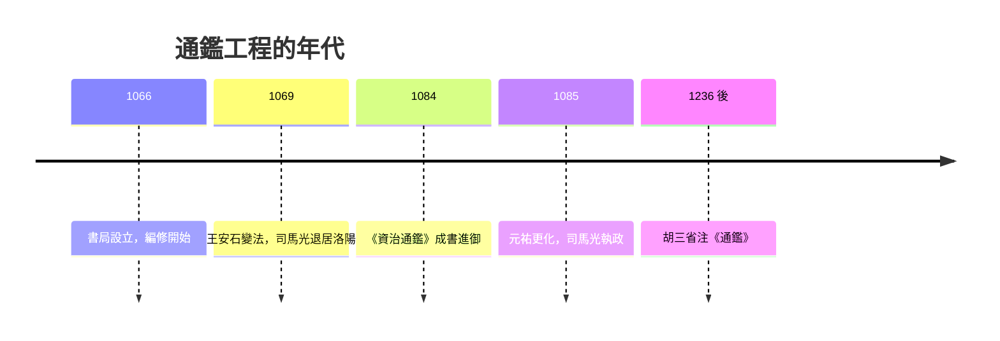

# 2.2 司馬光與資治通鑑：歷史作為治國之鑑

## 十九年的國家工程

《資治通鑑》二百九十四卷、三百餘萬字，記載周威烈王二十三年（前 403）至後周世宗顯德六年（959）共一千三百六十二年歷史。這部書不是個人著作，而是一場制度化的編纂工程：宋英宗與神宗先後批准設立書局，司馬光自選助手——劉恕（精通五代與南北朝）、劉攽（漢史）、范祖禹（唐史）——分工長編，司馬光總其成。歷時十九年（1066–1084），「骸骨癯瘁，目視昏近，齒牙無幾」。

體例上，司馬光捨紀傳而取編年：以年為經、以事為緯，仿《左傳》。理由很實際——紀傳體分頭記人，同一事件散在數十篇中，「欲知其詳者，不能遍觀」；治國者需要的是時間軸上的連續因果。他還創造了配套工具《目錄》（大事索引）與《考異》（三十卷，專門記錄史料取捨的理由：某事諸書異同，何以從甲捨乙）。

## 考異：中國史學的文獻批判高峰

《考異》是這部書最被低估的貢獻。面對雜史、小說、碑誌、文集互相矛盾的記載，司馬光的做法是：先長編羅列異文，再逐條裁斷，並保留推理過程——「若各說不同，則取其證據最明顯、情理最近者」。例如記玄武門之變，他參酌《實錄》的諱飾與野史的記載，注明取捨之由。這已經是系統的史料批判：承認記載有偏，明示裁斷的規則，讓讀者可以檢驗。它與同期歐洲的文獻學方法（見第 3 章）互不相謀而殊途同歸，且早了四百年。

## 「鑑前世之興衰，考當今之得失」

書名與宗旨由神宗欽定：「資治」——供治理之資；「通鑑」——貫通古今之鑑。司馬光在進書表中說得直白：歷史的價值在於為君主提供決策案例，「監前世之興衰，考當今之得失，嘉善矜惡，取是捨非」。

這決定了全書的取捨標準：詳政治、軍事、財政、人事，略文學、藝術；凡涉及治亂興衰之機者，雖小必書。全書以「臣光曰」開篇——不承認周威烈王以後的韓趙魏為合法諸侯，直斥三家分晉為「天子自壞綱紀」——禮制秩序（名分）是他整部書的政治哲學底座。這個立場與王安石的變法派針鋒相對：司馬光視新法為「侵官、生事、征利、拒諫」，歷史在他手中是保守主義的論據庫。

## 政治鬥爭的產物

《資治通鑑》深深嵌入北宋黨爭。司馬光是舊黨領袖，與王安石變法（1069 年始）勢同水火；他兩度退居洛陽十五年，「獨樂園」中專心修史。1085 年神宗死，高太后起用舊黨，司馬光入相，盡廢新法（「元祐更化」），數月後去世。《通鑑》因此可以讀成兩層：一層是千年的興亡記錄，一層是北宋改革與反改革的思想戰場——他寫漢武帝輪台悔過、寫唐代藩鎮與黨爭，字字皆有所指。

## 遺產與迴響

《通鑑》催生了一個「通鑑學」傳統：南宋朱熹《通鑑綱目》改編為綱目體以正名分；胡三省《資治通鑑音注》（宋亡後成書，寓遺民之痛）成為標準注本；王夫之《讀通鑑論》以之為政治哲學的演練場。毛澤東自述讀《通鑑》十七遍，視之為治國案例庫。在東亞漢字圈，它長期是統治者與士人的必修課。

## 兩種史學理想的對照

把司馬遷與司馬光並置，可以看清中國史學的兩翼。司馬遷：私人、文學性、為一切人物立傳、「成一家之言」——史學是表達。司馬光：官方、工程化、為治國者服務、「考異明據」——史學是決策科學。前者開創體例與批判精神，後者樹立工程方法與史料規範；兩者合起來，說明傳統中國史學並非只有「帝王家譜」一種面貌，而是同時發展出批判（考異）、綜合（長編）、與制度化的知識生產（書局、分工、審核）。

西方要到十九世紀的蘭克（見第 5 章）才以同等規模實現「檔案＋分工＋考證」的專業化編纂；而司馬光在十一世紀已經示範。歷史學的兩大問題——「如何知道過去」（方法）與「歷史為誰服務」（目的）——在這部書裡以中國的方式被完整提出，而這兩個問題，將貫穿本書接下來的每一章。
