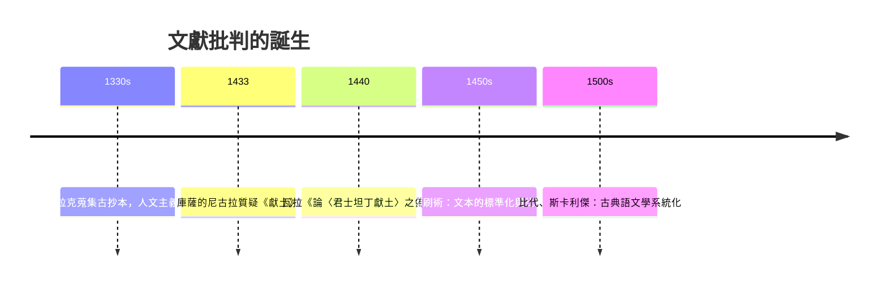

# 3.1 瓦拉：一張文法錯誤拆穿千年文書

## 一紙文書撐起的教皇國

《君士坦丁獻土》（Donatio Constantini）是中世紀歐洲最重要的法律文書之一。它宣稱：君士坦丁大帝在四世紀因患痲瘋受教皇西爾維斯特一世施洗痊癒，遂將羅馬、義大利西部乃至整個帝國西部贈與教會，並讓位東遷君士坦丁堡。中世紀教廷以此為依據主張對西歐的至高權威；教皇國（教宗諸邦）的世俗領土、教皇對皇帝的優位，都引此為據。但丁與十四世紀的帕多瓦的馬西利烏斯已懷疑其真偽，庫薩的尼古拉在《天主教會的協調》（1433）中指出文書與史實不合——但都止於懷疑。

## 1440：文法成為武器

洛倫佐·瓦拉（Lorenzo Valla, 1407–1457）是當時最鋒利的拉丁語文法學家，也是教皇尤金四世的秘書——他以教廷內部人士的身分拆教廷的台。1440 年，他寫成《論〈君士坦丁獻土〉之偽》（De falso credita et ementita Constantini donatione），沒有引用任何新史料，只用一種方法：語言學斷代。

他的論證是逐字的：

1. 時代錯誤的詞彙：文書稱君士坦丁堡為「我們的首都與主權所在地」——但獻土聲稱的 324 年，君士坦丁堡尚未建成（330 年才定都），文書卻使用後來的稱謂。
2. 制度錯誤：文書稱「薩特拉普」（satraps，波斯式總督）——羅馬帝國不用此詞；「元老院第二等級」「克勞迪亞世系」等提法皆不合四世紀羅馬的政制與頭銜。
3. 文風斷代：全書的拉丁文帶有八世紀教廷文書院的風格與用語，而非君士坦丁時代優雅的古典拉丁文——瓦拉以語感對比《聖傑羅姆書信》等四世紀文獻，指出多處「四世紀的人絕不會這樣寫」的句法。
4. 事實矛盾：獻土若為真，君士坦丁等於放棄半壁江山，但四世紀史料毫無痕跡；教皇西爾維斯特的名字甚至未出現於同期文獻。

結論：這是八世紀（約 750–850 年間，法蘭克王國與教廷結盟前後）偽造的文書。瓦拉的推理模式——以語言的時代特徵為證據、以矛盾為刀——就是現代文獻批判（source criticism）的誕生。

## 為誰而寫：政治的火藥味

瓦拉不是中立的學者。1440 年正是那不勒斯國王阿拉貢的阿方索與教皇尤金四世交戰之際，瓦拉任職於阿方索宮廷——拆穿教廷的權利文書，直接服務於僱主的戰爭。這件事本身就是一課：文本批判從誕生起就與政治利益結盟；「求真」的工具，往往由「求勝」的人資助。瓦拉本人在教廷與宮廷之間搖擺，1448 年重返教廷任職（尼古拉五世不計前嫌），晚年主持翻譯希羅多德與修昔底德——他把希臘史學重新帶回西方。

## 文藝復興的技術條件

瓦拉的工作依賴文藝復興的土壤。其一，彼特拉克以降的人文主義者以「復古」為業：蒐集抄本、校勘異文、重學西塞羅的拉丁文——語言的歷史敏感度正是校勘學訓練出來的。其二，印刷術（1450 年代古騰堡）尚未普及，抄本文化反而使「版本比對」成為顯學：誰的抄本更古老、哪一處是抄工的錯誤，人人有經驗。其三，義大利城邦的官僚與外交需要「辨偽」能力——契約、特許狀、家譜的真偽直接關係訴訟與聯盟。

## 遲到的承認與深遠的迴響

瓦拉的小冊子在當時未能撼動教廷（教會直至十九世紀才正式承認其偽），但它在人文主義者間流傳。1517 年馬丁·路德將其德譯出版，作為攻擊教廷世俗權力的炮彈——宗教改革的論戰武器庫裡，有一門語文學。此後，比代與斯卡利傑把古典語文學建成精確的斷代科學；宗教戰爭時代的耶穌會士波蘭達斯（Bollandists）與毛爾比雍（Mabillon，1681 年《古文書學》）把文書鑑定系統化；十八世紀穆拉托里整理義大利史料。這條線一直通向蘭克（見第 5 章）——蘭克自述其方法受惠於瓦拉傳統。

## 一個方法論的寓言

瓦拉的故事是史學史上最好的寓言之一：他沒有挖出一塊新碑，沒有找到一封密信；他只是問了一個問題——「四世紀的人會這樣說話嗎？」——然後用全部的語文學修養回答它。真相有時不藏在檔案館的深處，而藏在句子裡。這種「讓文本自己招供」的能力，兩千年來從拉丁文法延伸到碳十四、DNA 與數位文本比對（見第 10 章），但核心從未改變：細節的時代一致性，是偽造者最難偽造的東西。
