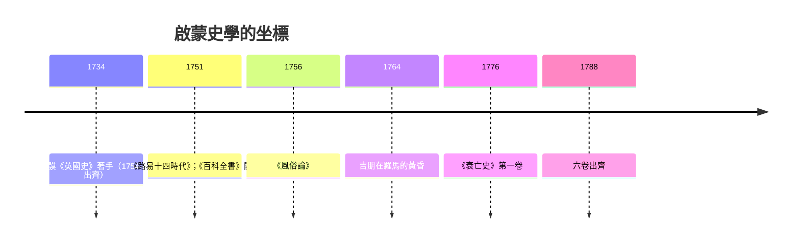

# 4.1 伏爾泰與吉朋：風俗與文明的史學

## 「歷史不過是國王與強盜的編年」

伏爾泰（Voltaire, 1694–1778）對當時史學的評價刻薄而準確：宮廷史家寫的盡是「國王與強盜的編年史」，戰爭與條約之外一無所有。他的回應是《路易十四時代》（1751）與《風俗論》（Essai sur les mœurs，1756 初版、不斷增訂）。

《風俗論》的革命在於範圍與主題。範圍上，它從中國、印度、阿拉伯寫起，把歐洲史放進世界史框架——伏爾泰大量利用耶穌會士的中國報告（杜赫德《中華帝國全志》1735），盛讚中國的文官考試與世俗理性，作為批判歐洲教會的鏡子（這種「親華」有烏托邦成分，但方向上是對歐洲中心的一次突圍）。主題上，它寫「風俗與精神」（mœurs et esprit）：法律、商業、藝術、科學、日常生活的變遷——他說，偉大君主的名字會被遺忘，牛頓與索福克勒斯不會。

方法上，伏爾泰兼收並蓄：他鄙視博學派的瑣碎，卻大量使用他們考訂的成果；他親自核對年表、批判奇蹟傳說（他的宗教批判正是瓦拉式文獻批判的啟蒙版）。他證明了「哲學史學」的可行：史家可以同時是論戰家與考證者。

## 吉朋：帝國的解剖學

愛德華·吉朋（Edward Gibbon, 1737–1794）的《羅馬帝國衰亡史》（六卷，1776–1788）是啟蒙史學的巔峰。第一卷出版的 1776 年，與《國富論》《獨立宣言》同年。吉朋的自述已成經典：1764 年 10 月 15 日黃昏，坐在羅馬卡比托利歐山的廢墟上，赤腳修士在朱庇特神廟舊址晚禱，「沉思的念頭」由此萌生。

吉朋的問題意識是啟蒙式的：一個曾統治已知世界的帝國，為什麼滅亡？他的答案有兩層。表層是軍事與政治：軍隊蠻族化、皇位繼承的暴力循環、行省的離心。深層則是他的名言——「對羅馬的征服者（基督教）的征服」：基督教以來世的許諾消解了公民勇氣，以修道院生活吸走社會精英，以教義爭論消耗帝國的智力資源。第四十七章著名的一段把神學爭論寫成「五位希臘主教用三十五頁論戰文獻證明同一個觀點」的喜劇——他對教會的敵意貫穿全書。

但吉朋與伏爾泰的口號不同，他是檔案動物。他自學拉丁文法學（《法學階梯》）、利用歷代博學派的考訂成果（蒂爾蒙特 Tillemont 的拜占庭輯錄被他反覆核對），每章附腳註——腳註既載證據與異說，也是他機鋒的藏身處（關於基督教聖徒遺物奇蹟的長註，堪稱理性主義的微型論文）。他承認：「歷史的哲學部分是我的，事實部分是蒂爾蒙特的。」——這句話精確描述了啟蒙史學的分工結構：博學派供料，哲學家立論。

## 時代的驅動：印刷、沙龍與帝國

啟蒙史學的繁榮有堅實的物質與社會基礎。印刷書籍的廉價化使「讀史」成為中產階級的消費；沙龍、咖啡館與期刊（《百科全書》1751–1772）提供了論戰的公共空間；英法兩國的商業社會培養出對「文明進程」的興趣（蘇格蘭啟蒙的休謨、弗格森、斯密把歷史寫成從狩獵到商業社會的階段論——史學與政治經濟學在此握手）。吉朋本人是議員與民兵軍官，寫的是一個商業帝國對另一個商業帝國前身的好奇。

## 遺產：文化史的母體

伏爾泰開出的「風俗與精神」清單，直接預告了十九世紀的文化史（布克哈特《義大利文藝復興時期的文化》1860 自認承其衣缽）、二十世紀的心態史與年鑑學派（布洛赫明言受惠於伏爾泰）。吉朋則確立了另一個傳統：以問題（為何衰落）組織巨量檔案、以腳註維持可檢驗性、以敘事維持可讀性——這個三角，今天仍是史學寫作的黃金標準。

兩人也共同留下爭議的種子：把「文明」當作價值尺度，自然滑向對非西方世界的貶低與對中世紀的偏見——這面鏡子要到二十世紀的後殖民批判（見 9.2）才被徹底翻轉。而「衰落」這個框架本身（從盛到衰的單線敘事）也已被修正：後世史家更願意談「轉型」——拜占庭延續千年、伊斯蘭世界接管地中海、羅馬法在教會法中存活。吉朋提出的好問題沒有過時，只是答案在不斷改寫。
