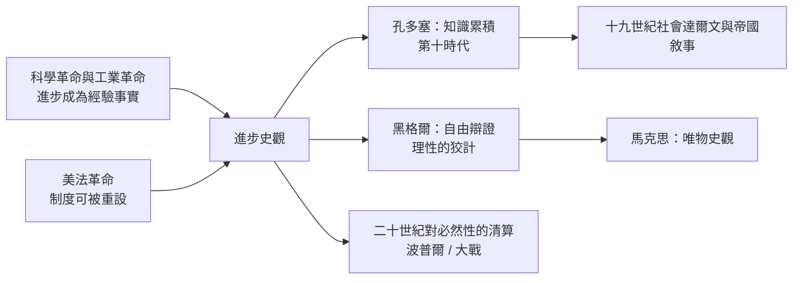

# 4.2 孔多塞與黑格爾：歷史走向理性與自由

## 孔多塞：在監獄裡預言進步

1793–94 年，法國大革命的溫和派哲學家孔多塞（Marquis de Condorcet, 1743–1794）被雅各賓政權通緝，藏身巴黎一位畫家遺孀家中，寫下他最後的著作《人類精神進步史表綱要》。數月後他被捕，死於獄中（一說死於獄中，一說自盡）——一個被革命吞噬的人，寫出了對人類未來最樂觀的預言。

《綱要》把人類史分成十個時代，從部落、遊牧、農耕到第九時代（笛卡爾以降、美國與法國革命），並預言第十時代：隨著理性普及，人類將走向無限完善。他列舉的未來清單驚人地具體：廢除奴隸制與殖民、男女平等（他與妻子索菲·德·孔多塞都是女權先驅）、普遍教育、社會保險、醫學進步延長壽命、乃至「人口與生存資料的協調」——他讀過馬爾薩斯（1795 年的初版曾提及孔多塞的觀點，馬爾薩斯《人口論》正是為回應戈德溫與孔多塞式的進步論而寫，見《經濟學的故事》4.1）。

孔多塞的樂觀不是空想，而有其知識論基礎：他是機率論大家（孔多塞陪審團定理——多人獨立判斷的多數決，其正確機率隨人數上升）、百科全書派成員、革命的憲法起草者。他的信念是：知識是可積累的，而社會制度若依理性行事，錯誤可被系統地消除。歷史第一次被寫成「可預測的學習過程」。

## 黑格爾：歷史是自由意識的成長

格奧爾格·黑格爾（G. W. F. Hegel, 1770–1831）在柏林大學的歷史哲學講演（1820s，死後由學生整理出版）給出另一種必然性。他的核心命題：「世界歷史是自由意識的進展。」歷史不是隨機事件的堆疊，而是「精神」（Geist）透過矛盾與揚棄（dialectic）逐步實現自我認識的過程。

他畫出的路線：東方世界（一人自由——專制下的普遍奴役）→希臘羅馬（一些人自由——公民與奴隸之分）→日耳曼—基督教世界（人人自由）。歷史的動力是「理性的狡計」（List der Vernunft）：偉大人物（他舉愷撒、拿破崙——他曾在耶拿街頭見過騎馬的拿破崙）自以為在追求私慾，實則不自覺地推進了精神的議程；戰爭與災難是辯證的爐火，「世界歷史不是幸福的樂園」。

黑格爾的影響是雙向的。右翼學生（如蘭克一代的普魯士國家主義）讀出「現存國家即理性實現」；左翼學生（馬克思）把辯證法「倒轉過來」放在物質基礎上——歷史的動力從精神的自我實現換成生產方式與階級鬥爭（見 6.1）。可以說，十九與二十世紀的所有宏大歷史理論，不是黑格爾的繼承，就是黑格爾的叛離。

## 進步觀的土壤與它的代價

兩種進步觀——孔多塞的知識累積論與黑格爾的自由辯證法——都生長於十八世紀的特定條件：科學革命（牛頓體系的連續勝利）與工業革命的早期成果，使「明天會更好」第一次成為可論證的經驗命題；而政治上，美國（1776）與法國（1789）革命證明制度可以被人為重設。歷史哲學從「鑑戒」（司馬光式）轉向「預言」。

代價同樣明顯。單線進步觀容易滑向等級論：孔多塞的第十時代把「文明」排成階梯，為十九世紀的帝國主義提供了「落後民族需被引導」的敘事；黑格爾的「無歷史民族」（非洲、斯拉夫東部）論更是赤裸的歐洲中心。二十世紀的兩次大戰與極權主義，把「歷史必然性」變成最可疑的詞——波普爾《歷史決定論的貧困》（1957）對「歷史有可預測規律」的系統駁斥，正是對這一傳統的清算。

## 留下的問題

進步觀退潮後，史學面臨一個真空：如果歷史沒有方向，寫史的意義何在？蘭克派的答案是不問方向、只問「過去究竟如何」（見第 5 章）；馬克思派的答案是方向仍在、但在物質結構中；年鑑學派的答案是換一個時間尺度——不看事件的方向，看結構的節律（見第 7 章）。孔多塞與黑格爾提出的問題——歷史有沒有意義——從此成為每個史學流派必須表態的問題；而二十世紀最誠實的回答，也許是 E. H. 卡爾的那句話：歷史是現在與過去之間永無止境的對話（見第 9 章）。
