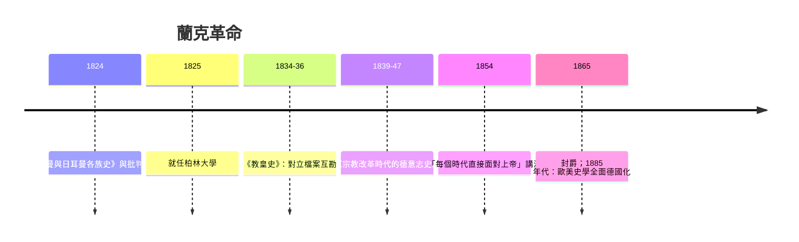

# 5.1 蘭克：如實直書

## 一部處女作引發的論戰

利奧波德·馮·蘭克（Leopold von Ranke, 1795–1886）生於路德派牧師家庭，萊比錫大學受古典語文學訓練。1824 年，他出版第一部著作《羅曼與日耳曼各族史（1494–1514）》。書的題材平淡（宗教改革前夜），卻因一篇附錄掀起風暴：《對近代史家之批判》。蘭克逐家檢驗吉朋、圭恰迪尼、喬維奧等名家的記載，結論是殘酷的：連第一手回憶錄也不可靠——圭恰迪尼的《義大利史》多處為修辭與黨派利益改寫事實；同時代人未必比後人誠實。

蘭克的結論成為一代人的綱領：「歷史學向來被賦予評判過去、教益未來的任務。本書不企圖如此——它只想說明，過去究竟如何（wie es eigentlich gewesen）。」

這句話後來被奉為客觀主義史學的旗幟，但需正確理解：wie es eigentlich gewesen 的本義接近「過去實際上是怎樣的」，強調的是區分「事實層」與「判斷層」——不是說史家沒有立場，而是說史家的首要義務是還原事實本身，而非從中抽取道德教訓或哲學預言。它同時是對兩種傳統的拒絕：修辭式（為教益而剪裁）與哲學式（為體系而剪裁）。

## 方法：檔案、內證與外證

蘭克的方法有三個支柱：

1. 原始檔案優先。他堅持使用當事國的公文書、使節報告、會議記錄，而非轉述。1830 年代起他長年駐維也納、羅馬、威尼斯、巴黎、倫敦的檔案館——他曾獲准讀維也納宮廷檔案，並以私人身分複製大量材料（這種「史學旅行」後來成為職業標配）。
2. 外證（外部考證）：文書的真偽、年代、作者——這是瓦拉以來古文書學的成熟應用。
3. 內證（內部考證）：作者是否在場、立場如何、與其他記載是否互洽。蘭克的名言：「我對回憶錄與歷史的信任，僅當其經過原始記錄的檢驗。」

在《教皇史》（1834–36）中，他把這套方法用於宗教改革：寫新教史不用新教史家的轉述，而用天主教檔案；寫天主教史反之——「讓雙方自己說話」。這種「對立證詞互勘」成為後世史料批判的標準操作。

## 普魯士與柏林大學：制度的溫床

蘭克 1825 年獲柏林大學教職（普魯士教育大臣的推薦），此後六十餘年在此講授。他的研討課（Seminar）是劃時代的：學生圍繞原始文獻做考證練習、提交習明納爾報告——這是現代研究所制度的原型。普魯士的動機並非純學術：1806 年耶拿慘敗後，洪堡式的「研究型大學」被當成國家復興的知識基礎設施；歷史學被寄望於培養國家官僚與塑造民族認同（蘭克本人政治上保守，支持普魯士王國，他的德意志史以普魯士崛起為主軸）。

蘭克的著述產能驚人：五十四卷全集，《宗教改革時代的德意志史》《普魯士史》《英國史》《法國史》——他把歐洲各國史寫成一個互相關關聯的「羅曼—日耳曼民族共同體」。他的學生遍布德國與海外：英國的阿克頓勳爵、美國的第一代專業史家（亞當斯、班克羅夫特一脈）多出自柏林研討課或其再傳——美國歷史學會（1884）的建制直接模仿德國模式。

## 「每個時代都直接面對上帝」

蘭克不是枯燥的資料管理員。他的史觀有一個神學底座：「每個時代都直接面對上帝；其價值不在於它為後世貢獻了什麼，而在於它自身、它的存在、它自身的自我。」換言之，他反對兩種傲慢：啟蒙式（把中世紀當成黑暗的預備階段）與進步式（把過去當成現在的階梯）。每個時代要在自己的條件下被理解——這是「歷史主義」（Historismus）的核心：價值內在於時代，評判必須先於理解的理解。

這個立場的深遠影響是雙面的。正面：它杜絕了以今非古的粗暴，催生了嚴謹的脈絡化研究。負面：它容易滑向相對主義與國家崇拜——既然每個時代與民族有其內在精神，批評便無處落腳；蘭克史學「以國家為歷史主體」的傾向，把外交與戰爭置於中心，恰恰是後來年鑑學派與社會史要反叛的對象。

## 一個悖論

蘭克留下的最大悖論是：他要求「如實直書」，而他本人的書無一不是立場鮮明的敘事——以國家為單位、以精英為主角、以普魯士為德意志史的樞軸。「客觀」從未被真正達成，但作為紀律的「客觀性追求」被制度化了：交代史料、可檢驗、可批評。這個紀律如此成功，以至於整整一個世紀後，當懷特（見 9.1）宣稱歷史敘事本質上是文學時，整個學科感到被冒犯——因為它已把蘭克的旗幟當成了自己的身分證。
