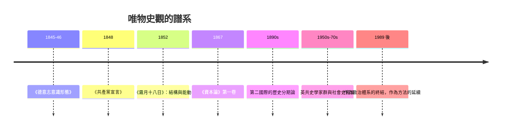

# 6.1 馬克思與恩格斯：經濟基礎與階級鬥爭

## 從《德意志意識形態》到《宣言》

馬克思對史學的貢獻始於一次哲學的「倒轉」。1845–46 年，馬克思與恩格斯合寫《德意志意識形態》（生前未出版），清算黑格爾左派：不是意識決定生活，而是生活決定意識——「每個時代的觀念，都是統治階級的觀念」。歷史的動力不在精神的自我展開，而在物質生產方式的變革及其引發的階級關係重組。1848 年《共產黨宣言》把這個框架壓縮成一句名言：「至今一切社會的歷史都是階級鬥爭的歷史。」（恩格斯 1888 年註明：指有文字記載的歷史。）

唯物史觀的核心命題可整理為：

1. 生產力（工具、技術、勞動力）與生產關係（所有制與剝削形式）構成經濟基礎；
2. 法律、政治、宗教、哲學、藝術是上層建築，反映並維護基礎；
3. 當生產力與生產關係衝突，社會形態更替——亞細亞、古代、封建、資本主義（馬克思晚年對東方社會的多線演變有所保留）；
4. 階級鬥爭是更替的推動者：「每一次社會的革命與改造，都以那個時代的經濟發展狀況為基礎。」

## 作為史學方法的馬克思主義

無論人們對其政治結論持何態度，唯物史觀給史學帶來了實質的方法遺產：

- 對經濟結構的系統分析：地租、工資、利潤、貿易週期成為解釋歷史變遷的核心變數——斯密的分工、李嘉圖的地租理論被轉化為歷史動力學。
- 對物質生活細節的尊重：恩格斯 1845 年《英國工人階級狀況》以曼徹斯特的親身調查寫成——居住、工時、疾病、童工——這是社會史的早期典範，其資料直接服務於英國的工廠立法辯論。
- 長時段的視野：生產方式的更替以世紀計，歷史分期從王朝轉向社會形態——這個「長時段」直覺，比布勞岱爾早了一百年。
- 對「誰被書寫」的顛覆：農民、工人、奴隸成為歷史的主體而非背景。

馬克思本人的史學實踐同樣值得注意：《路易·波拿巴的霧月十八日》（1852）分析 1848 年革命到政變的過程，開篇名言——「人們自己創造自己的歷史，但是並不是隨心所欲地創造，而是在既定的、從過去承繼下來的條件下創造」——精確區分了能動性與結構；《法蘭西內戰》（1871）與晚年的人類學筆記（柯瓦列夫斯基、摩爾根）顯示他對非西方與前資本主義社會的多線思考。

## 在史學界的傳播與變形

馬克思主義史學在十九世紀末二十世紀初迅速建制化。德國社會民主黨的考茨基一系把它寫成教科書式的歷史分期論；普列漢諾夫與列寧發展「帝國主義論」（1916–17）解釋大戰；第二國際的經濟史家開創了「從封建主義到資本主義」的過渡問題——這個問題日後成為經濟史的顯學（多布—斯威奇之爭，1950 年代）。

英國共產黨史學家群（多布、希爾、霍布斯鮑姆、湯普森）在 1950–70 年代把馬克思主義史學推向高峰：希爾重寫英國革命（內戰作為階級運動），霍布斯鮑姆以「雙元革命」（法國政治革命＋英國工業革命）框架重述十九世紀，湯普森《英國工人階級的形成》（1963）把階級定義為「歷史過程中的關係與自我理解」而非統計範疇——工人不是被經濟決定的客體，而是在鬥爭中形成主體。這一轉向使馬克思主義史學與社會史、文化史合流，也為英美社會史提供了主力。

## 爭論與修正

唯物史觀的史學爭論同樣激烈。韋伯以新教倫理（1904–05）反駁單向經濟決定論——觀念（入世禁欲主義）可以反過來塑造資本主義；波蘭尼《大轉型》（1944）指出市場本身是政治建構；年鑑學派吸收馬克思的經濟社會議題卻拒絕其階級動力論；法國的阿爾都塞在 1960 年代提出「多元決定」修正經濟還原論。1989 年後，作為政治體系的馬克思主義崩潰，但作為分析工具的馬克思主義史學並未消失——2008 年危機後，金融資本、不平等、危機週期重新成為史學熱點。

## 一個持久的二分

馬克思留給史學一個至今有效的二分：歷史的主體是結構還是行動者？唯物史觀偏向前者，傳記與思想史偏向後者；最好的史學——從湯普森到金茲堡（見 8.1）——都在兩者之間走鋼索。而「上層建築」的自主性問題（文化、宗教、意識形態能在多大程度上反過來塑造基礎），正是二十世紀文化轉向（見第 9 章）的理論入口。
