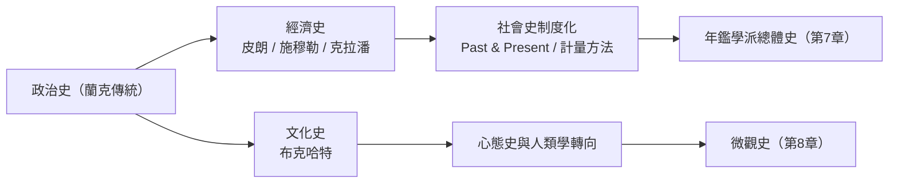

# 6.2 社會史的萌芽：從帝王到工農

## 「沒有人民的歷史」

蘭克式史學以國家與精英為主角，十九世紀末已有人不滿。瑞士史家雅各布·布克哈特（Jacob Burckhardt）在《義大利文藝復興時期的文化》（1860）繞開政治軍事，寫文化與心態——他是文化史的先驅；而更激進的轉向發生在經濟與社會層面。英國的阿諾德·湯因比（Arnold Toynbee，老湯因比）1880 年代的工業革命講座把「工業革命」確立為史學概念，關注工人處境；德國的經濟史學派（施穆勒）與英國的經濟史（阿什利 1888 年赴哈佛任經濟史講席）把「經濟史」從歷史學與經濟學中間開闢出來。

法國則出現了自成一格的路線。歷史地理學家維達爾·白蘭士（Vidal de la Blache）以地區與人地關係重寫法國地理（1903《法國地理概論》——「法國是一個歷史的地理現象」）；呂西安·費弗爾與馬克·布洛赫將在 1929 年把這條路正式化（見第 7 章）。而在他們之前，比利時的皮朗（Henri Pirenne）已用經濟史重寫中世紀：他的「皮朗命題」——伊斯蘭擴張封閉地中海，才使歐洲重心北移、加洛林經濟自足、封建制與城市隨之而生——把民族興衰歸因於貿易路線與貨幣經濟的地理學。史學的重心第一次從「誰統治」移到「如何謀生」。

## 英國：從憲政史到工人史

英國的轉向有清晰的政治經濟背景。維多利亞晚期的社會調查（布斯《倫敦人民的生活與勞動》，1889–1903，用調查員逐街記錄貧困地圖）與統計運動，把「社會狀況」變成可測量的對象；工會、合作社與工黨的興起（1900 年工黨代表委員會成立）使工人階級成為政治主體，也成為歷史主體。J. L. 與芭芭拉·哈蒙德夫婦的《鄉村勞工》（1911）等著作把工業革命的代價寫成人民的苦難史；到 1930 年代，劍橋的克拉潘（Clapham）以嚴格統計重寫《英國經濟史》，經濟史在大學獲得獨立教席。

這條線的頂點是戰後：1950–60 年代，經濟史與社會史在英美制度化（英國經濟史學會 1926、社會史期刊 Past & Present 1952——創刊者多為馬克思主義者與左翼學者）、湯普森的工人階級史（見 6.1）、以及劍橋人口與社會結構研究組（拉斯萊特 Wrigley 與斯科菲爾德用教區登記重建英國人口史，1981 年《英國人口史》把人口學引入歷史）——社會史從宣言變成可操作的技術。

## 法國之外：俄國與美國的平行線

俄國的歷史學院（如經濟史家斯捷潘諾夫一脈）與蘇聯學界把「亞細亞生產方式」與農村公社變成大論戰；美國的進步主義史學（特納、比爾德）同時在進行另一場轉向：特納 1893 年的「邊疆論文」把美國史的主軸從憲政轉到地理與移民的擴張；比爾德《憲法的經濟解釋》（1913）用經濟利益解釋制憲——政治史被經濟化。這些平行發展說明：社會史的萌芽不是單一學派的發明，而是工業社會矛盾在知識界的全面反應。

## 社會史的承諾與難題

社會史的承諾是「自下而上的歷史」（history from below，湯普森 1966 年的著名演說）：讓無名者進入歷史。但它的難題同樣早熟：普通人的文獻極少，史家被迫依賴教區登記、稅冊、法庭卷宗——間接、零碎、且多由壓迫者記錄。於是方法創新成為關鍵：人口學的序列重建、計量經濟史的模型（福格爾與恩格爾曼 1974 年《苦難的年代》用計量方法重估美國奴隸制經濟，引發方法大戰）、人類學的深描（見第 8 章）。

到 1970 年代，社會史已成西方史學的最大板塊（美國史學會的論文分類中社會史占比過半）。而它的內部張力——結構 vs 經驗、計量 vs 敘事、集體 vs 個體——正把史學推向兩個新方向：一是更宏觀的年鑑式總體史（第 7 章），一是更微觀的個案深描（第 8 章）。

## 一個意味深長的回響

值得記住的是：社會史的許多關鍵資料——教區登記、土地冊、法庭卷宗——正是前現代國家為徵稅與治理而製造的檔案。史學的每一次「發現人民」，都依賴國家為統治而留下的紙。這個反諷在數位時代將加倍上演：當我們用大數據重寫普通人的生活（見 10.2），我們使用的仍然是平台與國家的記錄——歷史學與權力的這段共生關係，從太史令的檔案到雲端伺服器，從未中斷。
