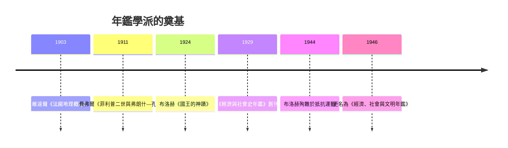

# 7.1 費弗爾與布洛赫：年鑑的誕生

## 兩個年輕教授與一本雜誌

1929 年，斯特拉斯堡大學的兩位教授——呂西安·費弗爾（Lucien Febvre, 1878–1956）與馬克·布洛赫（Marc Bloch, 1886–1944）——創辦了《經濟與社會史年鑑》（Annales d'histoire économique et sociale）。這份雜誌的創立是宣言式的：標題本身就拒絕了「政治史」的壟斷，把經濟與社會放到刊名正中。

背景是法國史學的結構性僵局。索邦的「方法學派」（瑟諾博司、朗格諾瓦）把蘭克傳統制度化：史料考證＋政治外交史＋敘事式博士論文。而一戰的屠殺動搖了這套範式的正當性——如果歷史只是國家與外交的記錄，它顯然解釋不了 1914 年的深淵。戰後，法國大學也在重建：斯特拉斯堡收回阿爾薩斯後成為「德國模式」的實驗田，費弗爾與布洛赫在此獲得一片新天地。

## 兩位創辦者的來路

費弗爾的《菲利普二世與弗朗什—孔泰》（1911）已是年鑑式的：寫一個省的社會、宗教與貴族結構，而非一場戰爭；他的《大地與人類演化》（1922）與維達爾·白蘭士的地理學結盟，把「地理可能性的邊界」引入歷史。布洛赫的路更奇特：他出身里昂猶太學者家庭，巴黎高師畢業，一戰兩次負傷；《國王的神蹟》（1924）研究中世紀英法國王以觸摸治瘰癧的「奇蹟」——用集體心理與儀式分析解釋一種「錯誤的信念」為何延續數百年，這是心態史的先聲；《法國農村史》（1931）以土地制度與農業技術為經緯；《封建社會》（1939–40）把封建制定義為一整套人際依賴與心態結構，而非法律制度。

布洛赫還留下一句方法論名言：「好的歷史學家像神话中的食人魔，哪裡有人肉味，就在哪裡追蹤獵物。」——意思是：史料不限於檔案，法庭記錄、民歌、地契、工具、地名、諺語皆可為證。他在《史學家的技藝》（死後 1949 出版，未完成）中系統闡述：歷史學的對象是「人類在時間中的活動」，證據是一切人為痕跡。

## 年鑑的議程

年鑑雜誌的議程可以歸納為幾條戰鬥綱領：

1. 打破學科牆：與社會學（涂爾幹傳統）、地理學（維達爾學派）、經濟學、語言學結盟；費弗爾的名言「歷史是整體的社會科學」。
2. 打破分期牆：中世紀與近代不應割裂（布洛赫研究中世紀農業技術延續到近代）。
3. 打破題材牆：價格、貨幣、人口、鄉村、心態、恐懼、時間感——一切人的集體生活皆為史。
4. 問題先行：不是「記錄發生了什麼」，而是「提出問題、檢驗假說」——費弗爾的名文〈走向另一種歷史〉（1949）宣布：史學的敵人是敘事的惰性。

## 戰爭與殉難

年鑑學派的歷史有一道傷口。二戰爆發，布洛赫以五十三歲之齡參軍，1940 年親歷法國潰敗，寫下《奇怪的戰敗》（死後出版）——用史學家的分析解剖法軍的指揮僵化與社會分裂。此後他參加里昂的抵抗運動，1944 年 3 月被蓋世太保逮捕，6 月 16 日被槍殺於里昂附近，臨刑前對年輕同胞說的最後一句話是「Vive la France！」——一位寫了《國王的神蹟》的人，以自己的死驗證了心態史最莊嚴的一頁。

費弗爾戰後重建年鑑：1946 年雜誌更名《經濟、社會與文明年鑑》（Annales. Économies, Sociétés, Civilisations），並在高等研究實踐學院（EPHE）第六部（社會科學部）建立學術基地。他把接力棒交給一個在巴西任教多年的年輕人——費爾南·布勞岱爾（見 7.2）。

## 為什麼是法國、為什麼是此時

年鑑的誕生是三股力的交匯：法國的維達爾地理學與涂爾幹社會學提供了現成的理論庫存；一戰的創傷與第三共和的世俗大學提供了政治動機與制度空間；而法國史學自身的「方法學派」僵化提供了反叛的靶子。此外還有一層物質基礎：1920 年代法國的統計與價格史工程（西米昂 Simiand 的價格序列研究——他 1903 年的名文把「社會科學的三個偶像」定性為政治、個人與敘事）為「序列史」準備了數據。年鑑學派不是橫空出世，而是把法國人文與社會科學的全部存量資產重新編組。

## 留給後世的問題

費弗爾與布洛赫立下的綱領也埋下了張力：總體史（histoire totale）要求史家無所不包，但個人的精力有限——總體史最終只能由集體工程（如《法國史》計畫）與結構分析承載，而「人」在結構中容易被淹沒。這個張力在布勞岱爾的巨著中達到極致，也在他的繼承者那裡反彈——微觀史學（第 8 章）正是對年鑑第一代的回應與報復。
