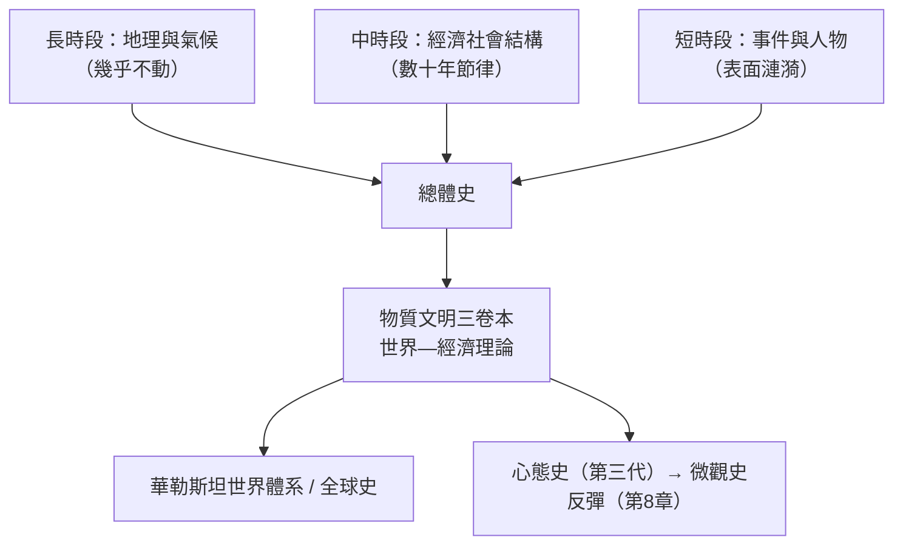

# 7.2 布勞岱爾：地中海與三種時段

## 戰俘營裡寫出的巨著

費爾南·布勞岱爾（Fernand Braudel, 1902–1985）的《菲利浦二世時代的地中海與地中海世界》（1949，初版一千二百餘頁）有一個傳奇的誕生環境。他是巴黎的歷史教師，1930 年代在阿爾及爾任教時迷上西班牙檔案與地中海；1939 年入伍，1940 年被德軍俘虜，在美因茨的戰俘營（Oflag XII-B）度過近五年。他憑記憶、筆記與集中營圖書館寫出了巨著的初稿——他後來說，戰俘營的隔絕反而讓他「以二十年、三十年甚至更長的時間尺度看歷史」，而把 1940 年的災難只當成「一個事件，一個轉瞬即逝的瞬間」。

1947 年，費弗爾主持的評審把這部書評為法國最佳博士論文。1949 年出版後，它成為二十世紀最有影響力的史學著作之一：歷史第一次以「海」而非「王」為主角。

## 三種時段：時間的地震儀

《地中海》的結構本身就是理論。全書分三部分，對應三種時間尺度：

1. 長時段（longue durée）：幾乎不動的歷史——山脈、高原、半島、氣候、道路與海洋。第一部分「環境的作用」寫山與平原、海岸與島嶼、季風與商路：地中海不是一個「地區」，而是一個由山環繞的海盆構成的交通系統；人與自然的交易以世紀為單位。
2. 中時段（conjonctures）：社會與經濟的緩慢節律——人口、物價、工資、貨幣、貿易路線、國家財政，以數十年為週期。第二部分寫十六世紀的經濟：大西洋的興起如何改變地中海的命運。
3. 短時段（événements）：事件史——政治、外交、戰爭，泡沫般的表面震盪。第三部分寫菲利浦二世的時代：勒班陀海戰、荷蘭叛亂——放在前兩層之上，事件被降格為「表面漣漪」。

布勞岱爾的比喻是地質學：長時段是地殼，中時段是潮汐，短時段是浪花。史學的革命在於顛倒傳統的時間觀：政治事件最不重要，地理與結構最重要。這是對蘭克傳統最徹底的宣戰——「事件史是塵埃」。

## 從地中海到「物質文明」

1956 年布勞岱爾接掌年鑑雜誌與 EPHE 第六部，1960 年代又創立高等社會科學研究院（EHESS 前身），把年鑑變成法國社會科學的樞紐。他的三卷本《十五至十八世紀的物質文明、經濟和資本主義》（1967–79）把視野擴大到全球：第一卷寫日常生活的物質基礎（衣食住行、人口、城市）；第二卷寫市場經濟與遠程貿易；第三卷寫「世界—經濟」（économie-monde）——他提出資本主義不是一個「經濟」，而是一串以某個城市為中心的世界經濟體（威尼斯、熱那亞、阿姆斯特丹、倫敦、紐約相繼為軸心），資本主義的「上層」是壟斷與投機，位於市場經濟之上。這個框架直接啟發了華勒斯坦的世界體系理論，也預告了後來的全球史（見 9.2、10.1）。

## 批評與反彈

布勞岱爾的成功也累積了反彈。批評有三：一是「人的消失」——在長時段與結構面前，人物與選擇淪為裝飾，史學變成了沒有人的自然史；二是「總體史的不可能」——他晚年承認總體史是「永遠無法完成的計畫」；三是法國之外的接受度——英美史學對結構決定論的不適。1960 年代末，年鑑第三代（勒高夫、勒華拉杜里）在延續結構分析的同時轉向心態史；而 1970 年代的義大利，金茲堡們乾脆掉轉鏡頭——從衛星看地中海，改為顯微鏡看一個磨坊主（見 8.1）。

有趣的是，1980 年代後長時段以新形式復活：全球史與環境史（見 10.1）本質上是布勞岱爾的放大版——把時間尺度拉長到數萬年（人類世、大歷史），把空間尺度擴大到星球。布勞岱爾晚年說：「歷史學家如果看不到長時段，就看不到一切。」這句話在氣候危機的時代，聽起來像預言。

## 一種治史姿態的遺產

剝去爭議，布勞岱爾留下的核心資產是一種姿態：把眼前的騷動放進更長的節律裡看。戰俘營教給他的這一課——「事件的暴政」可以被時間尺度馴服——在資訊過載的二十一世紀反而更顯珍貴：當每天的頭條都像歷史的終結，長時段是史學家提供給社會的解毒劑。
