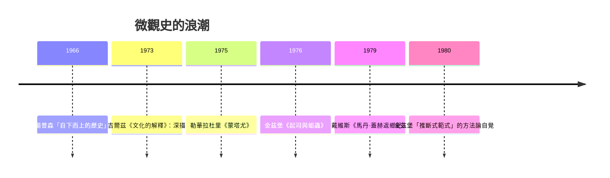

# 8.1 金茲堡：一個磨坊主的宇宙觀

## 弗留利的審判卷宗

1976 年，義大利史家卡洛·金茲堡（Carlo Ginzburg）出版《起司與蛆蟲：十六世紀一個磨坊主的宇宙觀》。主角多梅尼科·斯坎代拉，綽號「梅諾基奧」（Menocchio），是威尼斯共和國弗留利山區蒙雷阿萊鎮的磨坊主，生於 1532 年左右，識字，當過鎮長與教區管理者。他因異端言論兩度受宗教裁判所審判（1584、1599），第一次被判終身監禁，獲釋後不肯沉默，第二次被捕，1599 年左右死於獄中。

金茲堡的資料是奇蹟般的：宗教裁判所的完整審判卷宗——兩次審訊的詳細記錄、證人證詞、梅諾基奧自己的長篇供述，甚至列出了他借閱過的書單。金茲堡的手藝在於：他不但重建了梅諾基奧說了什麼，還重建了他「怎麼想」——並且找到了兩者之間的橋。

## 起司與蛆蟲：一個農民的宇宙生成論

梅諾基奧的宇宙論在卷宗中說得清清楚楚：「我曾說，在我看來，一切都是混沌……大地、空氣、水、火一起攪動，像牛奶做起司一樣；起司腐壞時生出蛆蟲，而蛆蟲就是天使。」——宇宙像一塊腐爛的起司，天使與人類都是從這團混沌中自發生成的蛆蟲。據此，他否認上帝創世、否認聖母的處女生育、否認三位一體的傳統表述，主張上帝、聖靈皆是受造物，並抨擊教會以聖事斂財：「教皇、紅衣主教與主教，都是大商人。」

金茲堡的關鍵操作是「過濾」：他逐一檢查書單上的書——《聖經》方言本、《古蘭經》（轉譯本）、曼德維爾遊記、《黃金傳奇》、行吟詩歌與廉價小冊子——然後問：書上有的，梅諾基奧吸收了；書上沒有的，從哪裡來？他的答案：梅諾基奧以農民口傳文化的「濾網」閱讀印刷新書——把印刷品的片段（尤其「混沌」概念，可能來自方言聖經的譯文）重新組裝成一套前基督教色彩的、口傳的宇宙論。這是文化史的方法創舉：閱讀不是單向吸收，而是兩個文化層（精英的印刷文化與農民的口傳文化）的循環往復（他借用當時義大利史學界討論的「文化循環圈」概念）。

## 微觀史的方法論宣言

《起司與蛆蟲》與勒華拉杜里的《蒙塔尤》（1975，以宗教裁判所卷宗重建一個奧克西坦尼山村的心態世界）、拉杜里稍早的《朗格多克的農民》一起，構成 1970 年代微觀史的浪潮。金茲堡後來在《線索與痕跡》（1980 年論文集，含名文〈格呂克的印記〉）中給出方法論自覺：微觀史的方法論範式不是伽利略式的定量科學，而是「推斷式」（inferential）知識——像獵人讀獸跡、醫生聽脈象、偵探看線索：從微小、具體、看似無關緊要的痕跡，回溯不可直接觀察的整體。

這個範式與年鑑式計量史構成方法論的兩極：計量史處理可重複的序列（價格、人口），放棄個體；微觀史處理不可重複的個案，以證據密度取勝。金茲堡的回答是：個案不是樣本，而是「異常的證據」（evidential paradigm）——正因為梅諾基奧反常，他的供述才暴露出正常情況下不可見的文化深層。顯微鏡不與望遠鏡爭論，它們看的是不同尺度的真實。

## 為什麼是 1970 年代

微觀史的興起有其時代條件。其一，年鑑計量史與馬克思主義結構史在 1968 年後遭遇信任危機——「沒有人的歷史」令新一代不滿，史學界重新尋找能動性與經驗。其二，義大利的條件特殊：宗教裁判所卷宗保存完整（學界此時才系統開發），而義大利共產黨知識圈（金茲堡的父親是反法西斯文學史家，家族有蘇聯關聯——金茲堡少年時譯過蘇聯小說）提供左翼但反教條的學術氛圍。其三，人類學的深描方法（吉爾茲 Geertz，1973）與葛蘭西的「底層文化自主性」概念，為「農民有自己的思想世界」提供了理論許可——梅諾基奧不是被動的迷信者，而是自覺的思想者，這個發現本身就是政治性的。

## 一個人物的命運與一門學科的命運

梅諾基奧的故事之所以震撼，還因為它的結尾：一個山區磨坊主，用借來的書、鄉間的比喻與固執的舌頭，獨自走完了宗教改革未能抵達弗留利的路——他既非新教徒也非再洗禮派（雖然審判官反覆逼問他與這些網絡的關聯），他的異端是土生土長的。金茲堡拒絕把他浪漫化：梅諾基奧好鬥、固執、兩次不肯妥協而送命。但正因如此，他證明了一件年鑑學派半信半疑的事：底層不只有「心態」，還有思想。

微觀史此後擴散到全世界（中國、印度、拉美皆有實踐），也招致批評：個案能否推及一般？敘事的魅力是否犧牲了分析的嚴格？金茲堡的回應是：歷史知識本來就是間接的、推斷的——蘭克的「客觀」與年鑑的「科學」同樣是修辭。這場關於證據與敘事的辯論，把史學直接推向了後現代的戰場（見第 9 章）。
