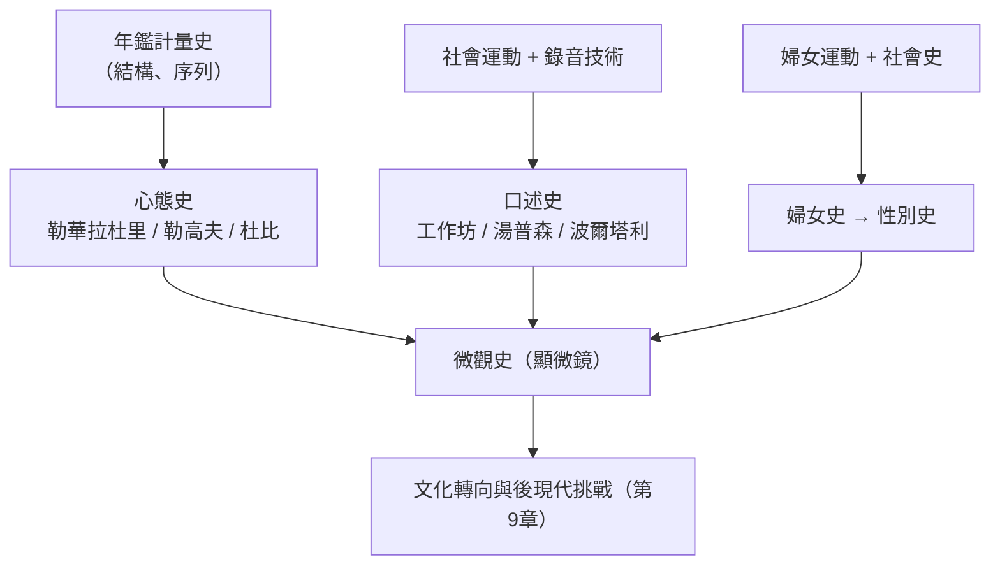

# 8.2 微觀史、口述史與心態史

## 心態史：年鑑的第三代

微觀史不是孤島，它生長在年鑑學派第三代的土壤上。1960–70 年代，勒高夫（Jacques Le Goff）、杜比（Georges Duby）、勒華拉杜里（Emmanuel Le Roy Ladurie）接掌年鑑，把布勞岱爾的長時段從地理轉向「心態」（mentalités）：一個時代集體的、不自覺的感知結構——時間感、空間感、生死觀、對奇蹟與巫術的想像。

勒華拉杜里是轉型的樣本。他 1966 年的《朗格多克的農民》是標準的計量史（用教區登記與稅冊重建人口與生計的長期節律，結論驚人：法國農村在數世紀間幾乎處於生物學的停滯）；但 1975 年他掉頭寫《蒙塔尤》——1294–1324 年宗教裁判所卷宗裡一個比利牛斯山村異端（清潔派）社群的全景：家庭結構、性、牧羊人的時間觀、對死亡的想像。同一個史家，先寫結構再寫心態，正標誌著年鑑的重心轉移。勒華拉杜里甚至留下一句著名的（半開玩笑的）宣言：未來的史學家必須是程序員，「否則一無所成」——計量與文化，在他身上並不對立。

勒高夫則把心態史推向文化深層：商人與煉獄（《中世紀的商人與金錢》《煉獄的誕生》，1981——煉獄概念在十二世紀的發明，對應著城市商業社會對時間與償還的新理解）、中世紀的時間觀（教會鐘聲與商人時鐘的競爭）。杜比的《三等級》（1978）把中世紀社會想像（祈禱者、作者、作戰者、勞作者）當作一種意識形態結構來解剖。心態史讓「文化」第一次成為歷史分析的正式對象，而不只是經濟的倒影。

## 口述史：讓無聲者發聲

與微觀史平行的是口述史的建制化。技術條件是錄音機的普及（1960 年代廉價磁帶），政治條件是 1960 年代的社會運動：民權、反戰、女性主義、工人自傳潮。1948 年哥倫比亞大學口述歷史研究室成立（美國內戰老兵與政界人物的訪談計畫），是機構化的起點；1967 年英國口述史學會、1972 年《口述史》期刊、英國的「歷史工作坊」運動（History Workshop，魯斯金學院，湯普森等）把口述史變成工人階級寫自己歷史的工具。

口述史的方法論貢獻在於承認：記憶不是錄音帶，而是選擇、遺忘與重構——訪談是「主體間」的事件，受訪者的「錯誤」往往比「正確」更有史學價值（湯普森《愛德華七世時代的鷹與雲雀》用口述重建工人與貧農的童年與性別經驗，1975）。義大利的波爾塔利（Alessandro Portelli）對泰沃利工人階級記憶的研究（包括著名的鋼鐵工人之死：工人們把 1949 年一個死者的日期記錯——記成了另一個更象徵性的日子——而這個「錯誤」暴露了集體記憶如何運作）成為口述史方法的經典。1990 年代起，口述史還成為創傷研究（大屠殺倖存者影像檔案、1994 年起的南加州大學 Shoah 基金會）與真相委員會（南非 1995–98）的核心技術——記憶的採集成為轉型正義的基礎設施。

## 婦女史與日常生活史

1970 年代還有兩條相關的支流。婦女史從社會史的邊緣破土：1975 年《成為可見的女人》等文集、凱利—加多爾的名文〈婦女有文藝復興嗎？〉（1976）用「再評價」框架質疑宏大敘事對一半人口的無視；到 1980 年代，性別（gender）作為分析範疇登場（斯科特 Joan Scott 1986 年的名文），把婦女史從「補充史料」推向「重構範疇」。德國的日常生活史（Alltagsgeschichte）與英國的歷史工作坊呼應，都主張：歷史的單位是人的日常實踐。

## 張力：顯微鏡與望遠鏡的和解

到 1980 年代末，史學的版圖呈現三極：宏觀的全球與結構（布勞岱爾的遺產）、中觀的社會史與計量史、微觀的個案與記憶。三極互相批評：計量派說微觀史是軼事，微觀派說計量史沒有人，政治史家則覺得兩者都離開了「正業」。但實踐中，最強的工作往往混合三種尺度——戴維斯（Natalie Zemon Davis）的《馬丹·蓋赫返鄉記》（1983，用法庭卷宗與口述傳統重構一個冒名頂替案，並拍成電影）既是一個農民的微觀史，又是鄉村財產制度與記憶文化的研究。

這個「多尺度」的格局，正是後現代挑戰（第 9 章）到來時史學的防禦工事：當懷特與德里達的追隨者質疑一切敘事的客觀性，微觀史與口述史的回應是——回到證據的密度與方法的透明，讓每一個推斷都攤在讀者面前。歷史學沒有在哲學攻擊下瓦解，反而因為擁有了更多層次的工具而更堅韌。
