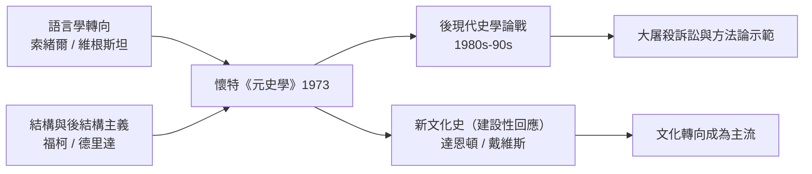

# 9.1 懷特與元史學：歷史是文學嗎

## 一個比較文學學者的挑釁

1973 年，加州大學的比較文學與思想史學者海登·懷特（Hayden White, 1928–2018）出版《元史學：十九世紀歐洲的歷史想像》。這本書的挑釁在標題：meta-history——不研究歷史本身，而研究「歷史著作」這個文類的深層語法。懷特分析了十九世紀四位史學大師（米什萊、蘭克、托克維爾、布克哈特）與四位歷史哲學家（黑格爾、馬克思、尼采、克羅齊），結論驚人：他們之間的差異首先不是證據或方法，而是「情節化」（emplotment）方式的差異。

懷特借用文學理論（諾思羅普·弗萊）與修辭學，主張任何歷史敘事都必須選擇一種情節模式：

1. 浪漫劇（romance）：善惡對決、危機與救贖（米什萊的法國大革命）；
2. 悲劇（tragedy）：不可抗的命運與犧牲中的和解（蘭克筆下的國家理性）；
3. 喜劇（comedy）：衝突在更大的和諧中消解（布克哈特的文化綜合）；
4. 諷刺（satire）：暴露幻象、拒絕意義（尼采式、克羅齊式）。

再配上四種論證方式（形式論、機械論、有機論、情境論）與四種意識形態蘊含（無政府主義、激進主義、保守主義、自由主義），構成一張網格。同一堆史料，可以被情節化為悲劇或諷刺——而這個選擇無法由證據本身決定。「同一組事件可以構成許多不同的故事」——歷史著作因此在本質上是「語言的造物」，其科學性與藝術性不可分割。

## 「歷史的負擔」

1978 年，懷特把這些論點收進論文集《話題：歷史話語的形式內容》，其中〈歷史的負擔〉一文最為激烈：歷史學家如果自認是「科學」，就會忽視自己作品的文學性與道德承載；歷史寫作無可逃脫地是「道德的、審美的行為」。這在當時是雙重冒犯——冒犯了蘭克主義的客觀性信仰，也冒犯了年鑑學派的科學化雄心。

爭論迅速白熱化。批評者（以蘭克傳統的英美史學界為主力）指出：懷特混淆了「事實層」與「敘事層」——情節化可以多樣，但事實的約束是真實的；把納粹屠殺「情節化」為喜劇，不只是美學選擇，而是錯誤。辯護者則指出：懷特從未說「歷史是虛構」，他說的是「敘事不可避免」——史學家的自我認識（知道自己用了什麼框架）恰恰是客觀性的更高形式。

## 更廣的哲學背景

懷特不是孤軍。他身後站著二十世紀的語言學轉向：索緒爾的語言學、維根斯坦的語言遊戲、以及 1960 年代法國結構主義與後結構主義（巴特「作者之死」、福柯的知識考古學、德里達的解構）。福柯對史學的衝擊尤其深：他的《瘋癲與文明》《規訓與懲罰》以檔案為材料，卻拒絕傳統史學的連續敘事與進步框架——他寫的是「知識型」（episteme）的斷裂、權力與知識的共謀。德里達 1967 年的「延異」與文本性論題，則把「文本之外無物」的口號推向極端——如果一切皆是文本，歷史與小說的界線何在？

這場衝擊在 1980 年代形成「後現代史學」的論戰。代表事件包括：1980 年代美國的「文化轉向」（新文化史——金茲堡、戴維斯、達恩頓《屠貓記》1984——其實是後現代衝擊下的建設性回應：既然敘事不可避免，就把文化符號與意義當作史料認真處理）；1990 年代英國的「後現代主義與史學」論戰（伊凡斯 Richard Evans《捍衛歷史》1997 對後現代的系統反擊、阿普爾比等《歷史的真相》1994 的折中）；以及德國圍繞納粹歷史「正常化」的史學家之爭（Historikerstreit，1986–87，諾爾特與哈貝馬斯之間）——後現代與政治在這裡正面相撞。

## 一個真實的壓力測試：大屠殺否認論

後現代主義最嚴峻的壓力測試來自大屠殺。利普斯塔德（Deborah Lipstadt）與否定論者的訴訟（2000 年倫敦高等法院 Irving v. Penguin 案）成為史學方法的公開示範：法庭逐項檢驗文件、統計、目擊證詞，判定否認論者蓄意扭曲證據。史學界從中得到的教訓是：證據的約束力在極端案例中依然成立——懷特本人在晚年也承認，某些事件（如奧斯維辛）對敘事自由設下了道德與事實的雙重界限。

## 留下的遺產

今天回看，《元史學》的最大貢獻不是「歷史是文學」這個被簡化的口號，而是強迫史學家完成了一次自省：承認選題、分期、情節與修辭是知識生產的一部分，而非可以剝除的雜質。此後的史學寫作普遍更自覺：交代立場、反思範疇（「發明傳統」——霍布斯鮑姆 1983——已是常識）、把敘事選擇攤在明處。客觀性沒有死亡，它從「鏡子」變成了「有紀律的建構」——而這正是 E. H. 卡爾那句老話的當代版本：歷史是現在與過去之間永無止境的對話。
