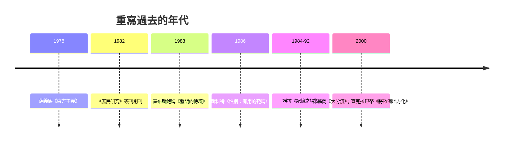

# 9.2 後殖民、性別史與重寫過去

## 東方主義：誰在描寫誰

1978 年，哥倫比亞大學的巴勒斯坦裔文學批評家薩義德（Edward Said）出版《東方主義》。核心論點：西方關於「東方」的知識體系——從學術著作、繪畫到殖民行政報告——不是中立的描述，而是一套權力的話語：它把東方建構成異質、停滯、感性、待教化的他者，從而為殖民統治提供知識正當性。薩義德的方法借自福柯（話語與權力）與葛蘭西（文化霸權），對象則是兩千年的西方文本傳統（從埃斯庫羅斯的《波斯人》到拿破崙的埃及遠征與十九世紀東方學）。

這本書的衝擊遠超文學批評。它迫使人們重審整個知識譜系：蘭克式「科學史學」所依賴的檔案，本身是殖民行政的產物（人口調查、土地冊、民族誌都是統治技術）；「印度史」「中國史」的學科框架由帝國學術機構（東印度公司的學院、殖民大學）塑造；乃至「東方」與「西方」這對範疇本身就是政治建構。

## 從《印度史》到庶民研究

薩義德之後，歷史學界的重寫分幾路推進。印度是最激烈的戰場。拉納吉特·古哈（Ranajit Guha）1982 年起主編《庶民研究》（Subaltern Studies）叢刊——「庶民」（subaltern，借自葛蘭西）指被排除於精英政治與精英書寫之外的農民、部落民、工人。古哈的名文〈農民起義散文〉指出：殖民檔案裡的「起義」記載由統治者書寫，農民在其中的「反叛」被寫成混亂與迷信；庶民史學的任務是「從統治者的敘事中讀出被壓抑者的主體性」。查克拉巴蒂（Dipesh Chakrabarty）後來的名言把問題推向極端：「歐洲是所有歷史的主體」——印度被永遠放在「還未」的位置（還未現代、還未理性）；《將歐洲地方化》（2000）主張把歐洲經驗降格為眾多歷史之一，而非普遍標準。

這條路線與全球史合流。彭慕蘭《大分流》（2000）用經濟史資料論證：十八世紀的江南與英格蘭在核心指標上不相上下，兩者的大分流是煤礦位置與美洲資源等偶然因素的結果——「歐洲的例外論」在資料面前站不住。弗蘭克、阿布—盧格霍德的「亞洲為中心的早期世界體系」、以及「早期現代全球化」的整體框架，共同完成了一場視角的哥白尼革命：世界史不再以歐洲為原點。

## 性別史與身體史

平行的是性別史的深化。瓊·斯科特 1986 年的名文〈性別：歷史分析的一個有用範疇〉主張：性別不是社會史的又一個變量，而是「權力表述的首要方式」——政治、法律、經濟範疇本身都被性別化（如「共和母親」「家庭」作為國家的隱喻）。這把婦女史（補充被忽略的婦女）升級為性別史（重構分析範疇）。福柯的性史（1976–84）與身體史（如費瑟斯通、蘇珊·桑塔格的視覺與身體研究、以及醫療史的爆發——從醫院到瘋人院到生育的控制）提供了身體作為權力場域的分析工具。1990 年代起，後殖民與性別視角交叉（殖民地的性別治理、混血與身分政治），成為文化史的主戰場。

## 記憶、認同與歷史政治

後殖民與性別史的推進，把史學推向「歷史政治」的戰場：誰有權解釋過去？1980 年代起，「記憶研究」崛起——阿萊達·阿斯曼與揚·阿斯曼的文化記憶理論（揚·阿斯曼《文化記憶》1992，研究古埃及與早期猶太教如何以文本與儀式管理記憶）、諾拉的《記憶之場》（1984–92，法國的紀念碑、教科書、地名如何承載民族記憶）。歷史與記憶的分工被重新劃定：記憶是群體的身分實踐，歷史是批判性的知識生產——兩者需要彼此，也必須保持張力。

現實政治同步升溫：教科書戰爭（日本、俄國、土耳其、印度）、博物館與紀念碑之爭（美國的邦聯雕像、歐洲的殖民紀念）、以及「去殖民化知識」運動對大學課程的重構。史學家發現自己站在公共辯論的第一線——這正是後現代批判的悖論性遺產：當「客觀性」被充分解構，歷史解釋權的鬥爭反而更激烈了。

## 留給數位時代的一個問題

這場「重寫」運動留給二十一世紀一個結構性問題：當史學的視角多元化（庶民、女性、殖民地、環境），敘事碎片化，宏觀綜合還可能嗎？年鑑學派式的總體史似乎不可能，蘭克式的單一敘事更不可能。全球史與大歷史（見第 10 章）給出的答案是：以連接（connection）與尺度（scale）取代中心與單線——不問「誰是主角」，而問「物、人、觀念、病毒如何流動」。而支撐這種重寫的技術基礎——資料庫、GIS、語料庫——正是下一節的主角。
