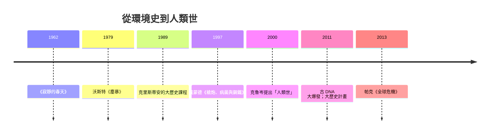

# 10.1 大歷史與環境史：從大爆炸到氣候

## 把歷史的起點前移一百三十八億年

1989 年，悉尼麥考瑞大學的大衛·克里斯蒂安（David Christian）開始講授一門把整個宇宙史壓縮進一學期的課程：從大爆炸、恆星核合成、行星形成、生命起源、智人出現，到農業革命與工業革命。他稱之為「大歷史」（Big History），並提出核心概念「複雜性階段」：宇宙史是能量流在更高複雜度層級上組織自身的過程——恆星、行星、生命、社會皆是「複雜實體」，其關鍵閾值（thresholds）構成歷史的分段。

大歷史的洞見在於尺度轉換。若把宇宙一百三十八億年壓縮成十三年，人類文明只存在於最後幾分鐘，工業革命只占最後幾秒。這個尺度下，「歷史」與「史前史」的分界（文字的發明）變得渺小，而真正的大轉折是：生命的出現、智人的出現、農業（「集體學習」使人類成為唯一能累積文化的物種——克里斯蒂安的關鍵概念）、化石燃料革命。比爾·蓋茲被克里斯蒂安的課程錄像打動，資助了「大歷史計畫」（2011 年起，免費課程進入數百所中學與大學）——一門史學課程獲得科技慈善資本的支持，本身就是數位時代的注腳。

大歷史不是要取代專業史學，而是提供一個框架：把人類史放回地球與宇宙的物質過程中——能量、熵、複雜性。這與賈雷德·戴蒙德《槍炮、病菌與鋼鐵》（1997）的地理決定論敘事、赫拉利的《人類大歷史》（2011，其實是大歷史的通俗版）構成了一個大眾化的「深時間史學」浪潮。

## 環境史：自然進入歷史

環境史的學術譜系更早。1970 年代美國的環保運動（1962 年《寂靜的春天》、1970 年第一個地球日、1972 年羅馬俱樂部《增長的極限》）催生了這門學科：沃斯特（Donald Worster）1979 年《塵暴》把 1930 年代美國大平原的沙塵暴寫成資本主義文化與生態互動的結果；克羅農（William Cronon）1983 年《土地的變遷》用生態學重寫新英格蘭殖民史——殖民不是單純的經濟事件，而是物種、土壤、火與貿易的生態重組；麥克尼爾（J. R. McNeill）2000 年《二十世紀環境史》系統記錄了「加速世紀」的生態代價。

環境史的理論核心是打破人類／自然的二分：人類是生態行動者，自然是有歷史的。它與年鑑學派的長時段一脈相承（布勞岱爾的第一層時間正是地理與氣候），但更進一步：不只把自然當背景，而是把生態過程當作歷史的動因。

## 人類世與氣候史

二十一世紀的關鍵概念是「人類世」（Anthropocene）：人類活動成為地質營力。大氣科學家克魯岑（Paul Crutzen，2000 年提出此詞）與後續研究給出候選起點——工業革命（1800 前後）、戰後「大加速」（1950 年起：人口、能源、化肥、塑料、核試驗的放射性沉積層）。這個概念把歷史學、地質學、氣候科學焊接在一起：過去的排放曲線就是未來的命運曲線。

氣候史的實證工作在近二十年大爆發，其方法論是跨學科的集成：

- 歷史氣候學：樹輪、冰芯、湖芯、珊瑚與文獻（教區登記的收成、船航海日志）互證，重建過去兩千年的溫度與降水序列（如 PAGES 2k 計畫）。
- 災害史：小冰期（約 1300–1850）與十七世紀「總危機」（帕克 Geoffrey Parker 2013《全球危機》：氣候惡化疊加戰爭與叛亂）的重建。
- 病菌與基因：DNA 考古改寫了人口史——古 DNA（帕博 Svante Pääbo 團隊，尼安德特人與丹尼索瓦人基因組，2022 年諾獎）證明智人與其他人種雜交；黑死病（鼠疫桿菌古 DNA，2011 年起確認）、哥倫布交換帶入美洲的天花與歐洲梅毒的基因溯源、乃至 1347 年大瘟疫的病原演化樹——流行病不再是文獻的推斷，而是可測序的歷史事件。
- 農業與馴化：動植物馴化的基因組與考古植物學，把「新石器革命」改寫為數千年、多中心的漸進過程。

## 一場範式的合流

大歷史、環境史、氣候史與基因考古共同完成了一場範式合流：史學的「行動者」名單徹底擴容——病毒、基因、碳、海洋、太陽活動都成為歷史的主體。這是布勞岱爾長時段的終極放大版：從地中海的氣候到行星的碳循環。它也改寫了史學的倫理位置：如果人類世是地質事件，那麼歷史學家的任務不只是解釋過去，而是為文明的自救提供時間深度——正如環境史家麥克尼爾所說，二十一世紀史學最大的題目是：人類如何走到了需要管理整個地球的地步。

## 一個新危機：尺度與敘事的張力

但深時間史學也帶來張力。當尺度拉到百萬年，人的能動性消失（這是微觀史的反向重演）；當「人類世」把全人類當成一個地質主體，它抹平了責任的分配（誰排放了碳？誰承受了災害？）——環境正義研究因此堅持在「人類世」中恢復階級與殖民的尺度。歷史學再次面對那個老問題（結構 vs 行動者、普遍 vs 特殊），只是這一次，棋盤是整個行星。
