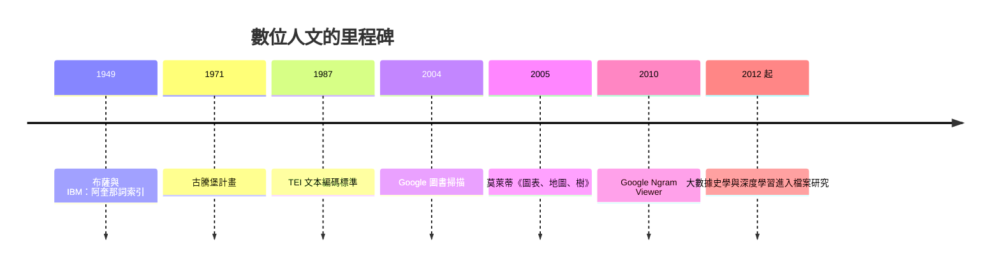

# 10.2 數位人文與演算法時代的記憶

## 從索引卡片到語料庫

數位人文（Digital Humanities）的前身可以追溯到 1949 年：義大利耶穌會士布薩（Roberto Busa）與 IBM 合作，用打孔卡機為托馬斯·阿奎那全集建立索引——《詞索引》（Index Thomisticus，1974 年完成）是人文計算的開山工程。此後數十年，這門手藝在文獻學邊緣緩慢發展：詞頻統計、作者鑑定（如 1960 年代用風格計量判斷《聯邦黨人文集》各篇作者）、文本編碼（TEI 標準，1987）。

真正的爆發在 1990 年代之後，驅動力是三件事：網際網路與萬維網（1991）、大規模數位化工程（古騰堡計畫 1971 年啟動、Google 圖書掃描 2004 年宣布，目標三千萬冊）、以及計算能力與儲存的指數下降。「人文計算」更名「數位人文」（2000 年代中期，隨著各大學設立中心與學位）——名稱的變化標誌著它從工具學科變成方法運動。

## 距離閱讀與計量文化史

史學界的代表性突破是莫萊蒂（Franco Moretti）的「距離閱讀」（distant reading）：不精讀少數經典，而用演算法處理數萬部小說的詞頻、主題、出版網絡——他的《圖表、地圖、樹》（2005）用圖表寫文學史，宣告「少數經典不等於文學的整體」。史學的平行運動是「計量文化史」：谷歌 Ngram Viewer（2010）讓任何人查詢詞語在數百萬冊書中的頻率曲線；米歇爾（Michel）等人的論文宣告「用百萬冊書做文化計量」的時代來臨。此後的應用爆發式增長：

- GIS 歷史地理：把檔案映射到空間——倫敦貧困地圖數位化、大運河與鐵路網絡的貿易模擬、上海與重慶的城市史 GIS。
- 網絡分析：書信網絡（啟蒙時代的共和國之書信共和國——伏爾泰與盧梭的通信網絡分析）、貿易網絡、親屬網絡。
- 主題建模（LDA 等）：在數萬份報紙或議會記錄中自動發現主題的興衰。
- 檔案的大規模開放：英國議會卷宗、荷蘭東印度公司檔案、殖民檔案數位化——庶民史與社會史第一次獲得「全量」而非「抽樣」的資料。

## 記憶的數位化與它的風險

數位化同時是一場記憶工程。大屠殺倖存者的影像檔案（Shoah 基金會數萬小時訪談數位化）、各國的口述史資料庫、社交媒體檔案（美國國會圖書館 2010 年起接收推特存檔）、以及 web 存檔（Internet Archive 自 1996 年起抓取網頁）——人類第一次有可能保存「日常生活的全量記錄」。這對史學是天堂也是陷阱：

1. 選擇性保存：數位檔案的保存依賴商業平台與政府預算——誰決定什麼被保存？被刪除的資料（帳號註銷、平台倒閉、連結腐爛）不留痕跡，數位遺產的「黑洞」比紙本時代更難察覺。
2. 平台的偏置：搜尋引擎與推薦演算法決定「可見的過去」——Google 的排序不是中立的檔案員；社交媒體的記憶是演算法策展的記憶。
3. 隱私與倫理：全量個人資料（健康、通訊、位置）的歷史價值與當事人隱私權直接衝突——GDPR（2018）的「被遺忘權」與史學家的「記憶義務」正面相撞。
4. 偽造的新可能：生成式 AI 可以無限製造假影像、假文獻——瓦拉式的語文學斷代（見 3.1）面對的是無限產能的偽造者；區塊鏈、數位簽章與來源驗證成為新的「古文書學」。

## 演算法時代的史學家

這些變化正在重構史家的技藝。傳統的考證學（外證＋內證）擴展為「資料考證」：來源鏈、元資料、版本譜系、演算法的偏置審計。跨學科的深度前所未有——史家與電腦科學家、統計學家、語言學家組隊（數位人文的典型工作形態）；同時，「距離閱讀」與「近距離閱讀」的結合成為標準操作：演算法發現模式，史家深入個案解釋模式。

但最深的問題仍是哲學的。如果歷史寫作不可避免地是敘事（見 9.1），那麼大數據史學的「客觀性」幻覺——以為演算法中立——恰恰是最需要警惕的後現代教訓。E. H. 卡爾的老命題在數位時代獲得新形態：歷史是現在與過去之間的對話——而現在，對話的一方已經是機器。史學家的任務不是與機器競爭記憶，而是守住機器沒有的東西：對證據的責任、對語境的敏感、以及對「誰的歷史、為誰而寫」的持續追問。

## 回到起點

兩千五百年前，希羅多德說他的工作是「保存人類的功業，使之不致被遺忘」；司馬遷要「究天人之際，通古今之變」。今天，當人類的功業以每秒百萬條的速度生成又消失，這兩個使命——保存與理解——面臨著史上最大的規模與最小的把握。歷史學的故事沒有終章：每一代人都在重新發明「如何記住」，而每一次發明，都同時是一次關於權力、技術與意義的選擇。這，就是歷史學的故事本身。
