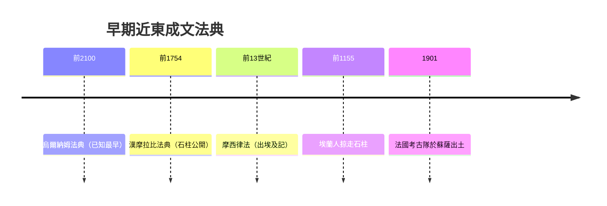

# 1.1 以眼還眼：漢摩拉比與巴比倫的正義

西元前 1750 年前後，美索不達米亞兩河平原上的巴比倫城，正處於它歷史上最輝煌的時刻。國王漢摩拉比（Hammurabi）經過四十餘年的征伐與經營，將散落在幼發拉底河與底格里斯河流域的眾多城邦統一成一個龐大王國。但是，征服容易，統治難。當一個王國從兩座城擴大到數十座城，從幾萬人擴大到上百萬人，說著不同方言、祭祀不同神祇的人們如何在同一套規則下生活？這是所有早期帝國都必須回答的問題。

漢摩拉比的答案，是把它寫在石頭上。

## 那塊著名的黑色石碑

大約在西元前 1754 年，漢摩拉比下令將 282 條法律條文刻在一根高約兩公尺半的黑色玄武岩石柱上，石柱頂端雕著一幅浮雕：國王本人站立著，恭敬地接受太陽神兼正義之神沙瑪什（Shamash）授予的權杖與指環。這個畫面的訊息再清楚不過：這些法律不是國王個人的心血來潮，而是神所認可的秩序。

石柱被豎立在巴比倫城的公共場所，並被抄錄分發到各個城市，讓抄寫員在各地神廟中朗讀給識字的人聽。任何一個對判決不服的臣民，都可以走到石柱前，親自查看法律是怎麼寫的。

這就是後世所稱的《漢摩拉比法典》（Code of Hammurabi）。它不是人類最早的法律文本——更早的烏爾納姆法典（Code of Ur-Nammu，約西元前 2100 年）、埃什嫩納法典、里皮特-伊什塔爾法典都出現在它之前——但它無疑是保存最完整、影響最著名的一部，因為那根石柱奇蹟般地存活了下來。

石柱的命運本身就是一段史詩。西元前 1155 年左右，埃蘭人攻陷巴比倫，將石柱作為戰利品運回蘇薩（今日伊朗境內的舒什）。此後三千年，它在沙土下沉睡，直到 1901 年被法國考古隊挖出，現藏於巴黎的羅浮宮。當時的碑銘學家雅克-讓·德·摩根（Jacques de Morgan）團隊將楔形文字逐條譯出，世界才重新讀到這批近四千年前的法條。

## 以眼還眼：誰適用、誰不適用

法典最著名的條文是第 196 條與第 200 條：

> 若自由民損毀另一自由民之眼，則其眼應被損毀。
> 若自由民擊落同等地位自由民之牙，則其牙應被擊落。

這就是「同害報復原則」（lex talionis，拉丁文意為「同樣的法律」）——「以眼還眼，以牙還牙」。很多人以為這代表野蠻，其實恰恰相反：它是理性的產物。在這條法律之前，報復沒有上限：你打瞎我一隻眼，我可以用整個家族的血來回敬你，血仇會代代蔓延，把你死我活變成兩個氏族之間的無止境戰爭。同害報復原則的核心是「比例」：懲罰不得超過傷害，報復到此為止。

更值得注意的是法典中隱藏的社會階層結構。巴比倫社會分為三個層級：阿維魯（awīlum，自由民）、穆什凱努（muškēnum，半自由民或依附民）、瓦爾杜（wardum，奴隸）。同樣是弄瞎眼睛，賠償依受害者身分而不同：

* 自由民弄瞎自由民之眼：以眼還眼。
* 弄瞎穆什凱努之眼：賠償一明那（約半公斤）白銀。
* 弄瞎奴隸之眼：賠償其主人約為奴隸身價一半的銀子。

換句話說，「正義」的價格取決於受害者的身分。第 199 條明文規定，弄瞎他人奴隸之眼，賠償相當於奴隸市價一半的白銀。這提醒我們：這部法典是一部階級法典，它維持的是社會秩序與各階層之間的平衡，而不是現代意義的「法律面前人人平等」。平等觀念要等到兩千八百年後的法國大革命，才成為法律的正式原則。

## 法典怎麼處理日常糾紛

除去血淋淋的身體刑條文，法典中大部分條文其實非常「行政」：關於商業契約、租賃、水井維護、船隻撞擊、家庭婚姻、醫療費用。

幾個例子可以看見巴比倫人面對的現實問題：

* 第 48 條：若自由民借款耕作，而洪水沖毀田地或旱灾荒年，則其可以延後還款、免付當年利息。這是缺乏氣象預報的農業社會中，法律的風險分配功能。
* 第 53 條：若自由民放任其堤防潰決而未加強，且田地因此被淹，他必須以自己的穀物賠償。這是水利社會（马克思所謂「東方專制主義」的基礎）中，公共建設責任的法律化。
* 第 108 條：若女性旅舍主人將假酒摻入酒中賣出，她應被投入水中處死。這是消費者保護與食品安全。
* 第 229 條：若建築師為人建屋，屋塌壓死屋主，建築師應被處死。若壓死的是屋主之子，則處死其子。這條法律殘酷得令人不寒而慄，但它體現了一種重要的設計思維：讓製造品質的人承擔與後果同等的責任，從而讓整個社會免於劣質建築。今日各國的建築法規中，依然可以看到這種「終身責任」的遺傳。

法典也保護消費借貸者不受無限剝削：債務人若因欠債而出賣自己或家人為奴，服役以三年為限，第四年必須恢復自由（第 117 條）。這是世界上最早的「債務清償破產期限」概念之一。

## 神授的合法性，人的執行技術

石柱頂端的神授浮雕不是裝飾，而是合法性的工程。在公元前三千年的世界，人們相信皇帝是神的代理人，而法律是宇宙秩序的一部分。將「神授」與「公開刻石」結合，漢摩拉比同時完成兩件事：

1. 用神聖性保護法律不被後代統治者隨意更改。
2. 用公開性讓人民知道自己的權利與義務，從而把執法變可預期。

後世羅馬法學家西塞羅（Cicero）會說「法是神與人的理性」；一千八百年後的英國法官柯克（Edward Coke）會對詹姆士一世說「國王不在任何人之下，但在上帝與法律之下」。這個「法之下」的長鏈條，第一個看得見的錶釦，就是漢摩拉比的石柱。

然而，神授也是一種枷鎖：如果法律是神的意思，那麼誰有能力「解釋」神？答案通常是統治者自己。在巴比倫，國王既是立法者、最高法官，也是最終的解釋者。這種三位一體的權力，正是後世兩千五百年間法律史反覆要對抗的結構。

## 故事還沒有結束

西元前 1595 年左右，巴比倫被赫梯人洗劫。石柱被運走、被遺忘、被沙土掩埋。但是它的條文梗概與精神，以抄本的形式流傳在後來的亞述、新巴比倫諸王國之中，成為整個近東法律傳統的一部分。當我們在《舊約聖經》的《申命記》與《出埃及記》中讀到「以眼還眼，以牙還牙」（出埃及記 21:24），讀到對假證人的嚴懲、對販賣人口的禁止，我們讀到的其實是同一條法律傳統在西奈曠野與耶路撒冷聖殿中的迴響。

巴比倫的落日，只是法學故事的序幕。

下一節，我們將看到這些法的「神授」性格如何被希臘人的哲學與羅馬人的制度改寫——法律的來源，從神的意志，第一次轉向了人的理性。
